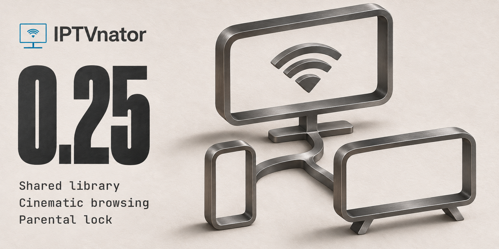
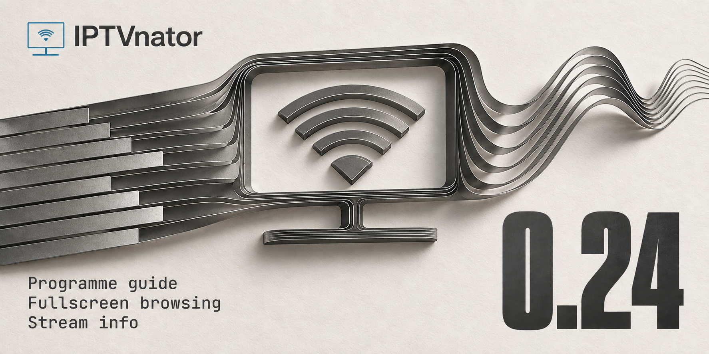

# Changelog

Releases **0.13.0 – 0.23.0** were published as
[GitHub releases](https://github.com/4gray/iptvnator/releases) and
[website posts](https://4gray.github.io/iptvnator/blog/) rather than collected
here. This file resumes from the next release onwards; the entries below are
kept as they were written.

New sections are generated from `.changes/*.md` and inserted directly below
this marker — see `.changes/README.md`.

<!-- next-release -->

# [0.25.0](https://github.com/4gray/iptvnator/compare/v0.24.0...v0.25.0) (2026-11-08)

IPTVnator 0.25 brings a shared library you can host from desktop, a redesigned browsing experience, and a PIN for selected categories.

- **Shared library.** Start a server in **Settings → Server**. With home-network access enabled, another device can open the library in a browser using an access code. Desktop and browser clients can opt into favorites, Recently Viewed and supported watch progress separately.
- **Cinematic browsing.** The redesigned dashboard and movie and series pages make it easier to see what's on and pick up the right episode. Settings has search and a dedicated Appearance page for Cream, Mocha, Night Owl and Black OLED.
- **Parental lock.** Hide selected M3U groups, Xtream categories and Stalker genres until you enter a PIN.
- **Playback and Live TV.** Redesigned controls, an Up Next card for series, and provider programme guides in the browser for Xtream and Stalker.
- **Experimental TV apps.** Separate installation paths are available for LG webOS, Samsung Tizen, Fire TV and Android TV. See the [TV setup guides](https://github.com/4gray/iptvnator/tree/v0.25.0#smart-tv).

The changelog records **63 feature entries, 221 fixes and 32 performance improvements**. During the development period, **47 GitHub issues were closed as completed**.

[Release blog and screenshots](https://4gray.github.io/iptvnator/blog/v0-25-release-notes/) · [Full changelog](https://github.com/4gray/iptvnator/blob/v0.25.0/CHANGELOG.md#0250-2026-11-08) · [Desktop server setup](https://github.com/4gray/iptvnator/blob/v0.25.0/docker/README.md#run-the-server-from-the-desktop-app)

<!-- end-github-summary -->

### Features

- **appearance** — Choose Cream or Mocha alongside the existing Light and Dark themes. Palette previews in Settings show each look before you save, and Discard restores your previous theme. ([#2121](https://github.com/4gray/iptvnator/pull/2121))
- **appearance** — Choose Night Owl for deep navy surfaces or Black OLED for a black background with graphite panels. Settings shows all six themes with palette previews and remembers your saved choice after restarting. ([#2124](https://github.com/4gray/iptvnator/pull/2124))
- **workspace** — The dashboard hero now shares the details pages' look: the same light Continue button and chips, a series title without its "(Season 1)" marker, and the blurred poster alone as the backdrop when a title has none. The hero can be focused: ← and → switch slides, Enter follows the main action, and rotation pauses while the window is hidden. ([#1792](https://github.com/4gray/iptvnator/pull/1792))
- **details** — Series pages get a calmer episode list: flat rows with runtime and air date, two lines of plot, a check on watched episodes and a bar only on started ones. Actions appear on hover or keyboard focus. Seasons are picked from chips, or a menu with watched counts from five seasons on, without season posters. ([#1859](https://github.com/4gray/iptvnator/pull/1859))
- **epg** — EPG can be turned off for all sources in Settings. Turning it off stops guide imports and requests, hides programme panels and channel previews, and keeps channel logos, source addresses and guide settings for later. ([#2064](https://github.com/4gray/iptvnator/pull/2064))
- **epg** — EPG guides load from XZ-compressed URLs and local files. The XMLTV file picker includes .xz files. ([#2133](https://github.com/4gray/iptvnator/pull/2133), closes [#744](https://github.com/4gray/iptvnator/issues/744))
- **i18n** — Choose Portuguese for Portugal or Brazil, with reviewed translations, regional dates and matching TMDB metadata. Existing Portuguese preferences use Brazil; saved language changes prepare the next startup immediately. Corrected English guidance is translated across all languages, checks catch broken placeholders and markup, and generic ratings are no longer labelled IMDb. ([ae23065](https://github.com/4gray/iptvnator/commit/ae2306579d3c0b47021f9019bcdf854e70c0ee88))
- **i18n** — Ukrainian is now available as an interface language, including remote control settings, player controls, and playback error notifications. TMDB searches prefer Ukrainian and also recognize Russian titles in mixed catalogs. ([#1911](https://github.com/4gray/iptvnator/pull/1911))
- **playlist** — M3U URL, file and text imports offer a default-on option to import the programme guide declared in the playlist. Turning it off keeps discovered sources available for later selection and preserves the choice across updates and restarts, without a preliminary network request. Backups retain the preference and guide selections, including on a fresh installation. ([#2061](https://github.com/4gray/iptvnator/pull/2061))
- **metadata** — Movie and series details now show available age classifications from your provider or TMDB. Choose a classification country in Metadata settings; foreign ratings show their country, and missing classifications are marked explicitly. ([#2029](https://github.com/4gray/iptvnator/pull/2029))
- **playback** — Catch-up and timeshift playback now draws the programmes of the archive window on the player's seek bar, one segment per programme. Hovering the bar shows the programme title with the time, so you can jump to the next show in an M3U recording that spans several. ([#1750](https://github.com/4gray/iptvnator/pull/1750))
- **playback** — Channels, movies and episodes now join Recently Viewed and the dashboard's Continue Watching hero only after they have actually played for a couple of seconds, so streams that fail right away no longer clutter your history. ([#1732](https://github.com/4gray/iptvnator/pull/1732))
- **playback** — The built-in player controls have a new look: a lighter dock that sits directly on the video, a round accent play button, the volume slider inline on wide players, a remaining-time counter, and a timeline that shows the time under your pointer before you seek. ([#1709](https://github.com/4gray/iptvnator/pull/1709))
- **playback** — With the Embedded MPV frame-copy engine, a movie's or episode's own chapters now appear as sections on the timeline, with their titles in the seek bar's label and read out by screen readers. When an episode has a closing-credits chapter, the "Up next" card appears as the credits start. ([#1874](https://github.com/4gray/iptvnator/pull/1874))
- **playback** — Audio, subtitles, quality, speed and aspect ratio now live in one settings panel behind a tune button. Wide players show subtitle and speed chips with their current value and slide the panel in beside the video; small players get a bottom sheet, and the tune button shows colored dots for anything turned on or changed. ([#1709](https://github.com/4gray/iptvnator/pull/1709))
- **playback** — The fullscreen channel and episode list now floats over the video as a rounded glass card, matching the player's settings panel, and the playing episode is highlighted the same way as a selected setting. ([#1767](https://github.com/4gray/iptvnator/pull/1767))
- **playback** — In the last minutes of a series episode the player shows an "Up next" card with the following episode's still, title and time remaining. One click plays it, and the switch keeps you in fullscreen. ([#1709](https://github.com/4gray/iptvnator/pull/1709))
- **playlist** — Compatible M3U links offer an Xtream setup with the server, credentials, title and custom User-Agent filled in. You can return to the original M3U form without losing your entries. Optional import settings and backend details stay collapsed until needed. ([#2047](https://github.com/4gray/iptvnator/pull/2047))
- **portals** — Movie and series pages open on a cinematic backdrop with chips, plot and one action row: a light Continue/Play button naming the next episode and the time left, a Trailer modal, and a "…" menu with other sources, external player, copy URL, reset progress and season actions. Cast & crew and Similar follow as rows. Without a 16:9 backdrop the hero shrinks to its content over the blurred poster. ([#1792](https://github.com/4gray/iptvnator/pull/1792))
- **portals** — A new Playback setting, "Play trailers in details background" (off by default), plays a movie's or series' trailer muted behind the details a few seconds after the page opens, with a corner button to unmute. It stays off under reduced motion and on metered connections, and stops when the page scrolls away or the window loses focus. ([#1792](https://github.com/4gray/iptvnator/pull/1792))
- **pwa** — The browser and Docker versions now show the programme guide that Xtream and Stalker providers send: the current show under each live channel, the guide beside the player, and what is on in favorites, recently viewed and on the dashboard. Settings → EPG offers the guide layout and a time offset. Guides from XMLTV sources remain a desktop feature for now. ([#1963](https://github.com/4gray/iptvnator/pull/1963), closes [#1683](https://github.com/4gray/iptvnator/issues/1683))
- **self-hosted** — Optionally synchronize Xtream and Stalker progress and watched marks between PWA and Electron through your own server, with one shared household activity. Offline changes stay queued, conflicts offer a choice, and older local activity requires an explicit import preview. Open views refresh automatically, and Xtream backups include shared activity. ([#2062](https://github.com/4gray/iptvnator/pull/2062))
- **self-hosted** — Sync favorites between PWA and Electron with a separate opt-in. Preview and import older local favorites, keep offline changes queued, and choose how to resolve concurrent edits. Turning sync off keeps local and server data. ([#2106](https://github.com/4gray/iptvnator/pull/2106))
- **self-hosted** — Optionally share Recently Viewed across PWA and Electron for shared M3U, Xtream and Stalker sources. Preview older local history before importing it; turning sync off keeps local history and pending actions. Backups preserve history and identity protection when mixing new and existing sources. Received entries keep favorites safe, and series can be hidden without a cached catalog. ([#2119](https://github.com/4gray/iptvnator/pull/2119), closes [#2059](https://github.com/4gray/iptvnator/issues/2059), closes [#1616](https://github.com/4gray/iptvnator/issues/1616))
- **self-hosted** — The Docker version keeps source data in a persistent server database with an optional access token. Existing local sources can be imported explicitly; viewing activity stays on each device. ([#1903](https://github.com/4gray/iptvnator/pull/1903), closes [#305](https://github.com/4gray/iptvnator/issues/305))
- **self-hosted** — Connect PWA and Electron clients to your self-hosted IPTVnator server to share sources across devices. Import existing local sources, keep uploaded M3U playlists on your server, and receive source changes automatically. Favorites and Recently Viewed can each be synced separately. ([#2013](https://github.com/4gray/iptvnator/pull/2013))
- **server** — Start an IPTVnator server from desktop Settings. You can opt in to home-network access so another device can open the shared library in a browser with an access code. Server settings explain what syncs and how to choose a server. ([#2146](https://github.com/4gray/iptvnator/pull/2146))
- **settings** — Appearance now has its own settings section after General for theme palettes, cover size and cover titles. Save, Discard and settings search work across both sections. ([#2138](https://github.com/4gray/iptvnator/pull/2138))
- **settings** — Settings are easier to scan: the sidebar groups pages into App, Library, Devices and Data with About pinned at the bottom, each page sorts its rows into titled cards with one aligned control column, and checkboxes became switches. Reset now lives on "Backup & data", subtitles moved to Playback, and the save bar counts your unsaved changes and answers Cmd/Ctrl+S. Esc leaves settings. ([#1853](https://github.com/4gray/iptvnator/pull/1853))
- **settings** — New parental lock: set a PIN in Settings → Parental lock, then mark Xtream categories, Stalker genres or M3U groups as locked. Locked categories and their channels disappear from the app until the PIN is entered; the app locks again on restart, after a chosen idle time or with "Lock now". ([#1601](https://github.com/4gray/iptvnator/pull/1601), closes [#285](https://github.com/4gray/iptvnator/issues/285))
- **settings** — Settings are now searchable: type in the search box on the Settings page to find any option by name, description or a common word like "dark" or "mpv", then jump straight to it. The command palette (Ctrl/Cmd+K) finds settings too, from anywhere in the app. ([#1714](https://github.com/4gray/iptvnator/pull/1714))
- **sources** — Sources and the playlist switcher share a new, compact row with a status dot. Filter Sources by type and by whether sources respond, delete with Undo, and open the switcher with ⌘P / Ctrl+P to search, filter by type and switch from the keyboard. ([#1932](https://github.com/4gray/iptvnator/pull/1932))
- **stalker** — Stalker Movies offers Hide watched in Refine, including manually marked films. Browsing continues past watched-only pages and offers Load more after a short automatic scan. Started films and series remain visible, and clearing the filter restores loaded titles immediately. ([#2052](https://github.com/4gray/iptvnator/pull/2052))
- **stalker** — Stalker Live TV shows current programmes before selecting a category and remembers your choice of list or grid view. Live TV grids use compact logo cards with single-line channel names, full-name tooltips and readable programme details. The panel button no longer covers the heading, and loading placeholders match the channel layout. ([#2090](https://github.com/4gray/iptvnator/pull/2090))
- **tmdb** — Movie and series detail menus now let you correct a TMDB match, keep only the provider's metadata, or restore automatic matching. Your choice is remembered for that title and source, even after restarting or clearing the TMDB cache. ([#2057](https://github.com/4gray/iptvnator/pull/2057))
- **tv** — Settings includes an About page with the TV app version, IPTVnator release, build revision and time, license, project address, and browser and display information. ([71e736c](https://github.com/4gray/iptvnator/commit/71e736cac086e8ecebb941b980b0bcaa2aedb48d))
- **tv** — TV Home and details now use full-width artwork that fades into the page. Enable TMDB in Settings with your own key and preferred language to add movie and series artwork and descriptions; provider playback remains available if metadata cannot load. ([845dd7a](https://github.com/4gray/iptvnator/commit/845dd7af3bfe59391fc885d9e715cd13320cdb3e))
- **tv** — TV catalogs load more as you scroll, with remote focus restored when returning from details. Stalker relative poster links display correctly, and movie covers keep a 2:3 shape. A Settings QR lets you enter a TMDB key, choose metadata language, layout and EPG from your phone, then confirm on the TV. ([7be2393](https://github.com/4gray/iptvnator/commit/7be2393c07b751f9dae949e3d4137d49afb01a03))
- **tv** — TV movies and series show recently added titles first and offer alphabetical or provider order. Each section remembers its choice across restarts, and sorting works with infinite scrolling. Playlists without addition dates keep their original order. ([6c29636](https://github.com/4gray/iptvnator/commit/6c29636881b6abcb2390ca1ab732dd2fad3ac39f))
- **tv** — TV Home features up to three unfinished films or series with manual switching, saved progress, Continue watching and Details actions. The resume row stays below, and returning from playback restores the selected title and focus. Empty history keeps the catalog feature. ([6a3764b](https://github.com/4gray/iptvnator/commit/6a3764b02cd56ad3066b6055efb21c6a6e996dfc))
- **tv** — TV movie and series details combine directors or creators and cast in one row. Information chips show available genres, year, countries, playlist category, runtime and TMDB rating. ([#2107](https://github.com/4gray/iptvnator/pull/2107))
- **tv** — TV Favorites combines all playlists with a remembered current-playlist filter. Favorite channels open fullscreen, show their source and offer Go to playlist without restarting playback. Switching playlists keeps the current catalog section. ([#2101](https://github.com/4gray/iptvnator/pull/2101))
- **tv** — TV Home brings together continue watching and saved titles from all sources. Cards show their source and connect to it when you open or resume a title. You can cancel a pending connection, and Back returns to the original Home card. ([a249264](https://github.com/4gray/iptvnator/commit/a2492647714c982fa56e82b4ab6519fa74b8e5de))
- **tv** — TV adds viewing History with dates and quick playback. History and Continue Watching use 2:3 covers with bottom progress and one focus target; playback, Details and watched status are in the card menu. Titles finish within the last 5% of duration, capped at five minutes. ([#2137](https://github.com/4gray/iptvnator/pull/2137))
- **tv** — Live TV replaces its small category dropdown with large category rows and a channel list with Back navigation. Lists use the available screen height, and the programme guide scrolls independently without shifting the preview. Returning to a category restores channel focus and scroll position. ([9a4c3d7](https://github.com/4gray/iptvnator/commit/9a4c3d7633cc2cc7233b78a42794d0b28ba5e524))
- **tv** — TV Home shows up to 12 recently played live channels across your saved sources. Fullscreen Live adds a Previous channel action that switches between the last two confirmed channels, with fresh playback links and retry support. Back, Stop and Go to playlist cancel pending Previous channel switches. ([#2142](https://github.com/4gray/iptvnator/pull/2142))
- **tv** — TV viewers can open a large programme guide with supplied dates and descriptions, and browse categories or switch channels from a translucent fullscreen side panel. Opening and closing these views keeps the current video playing and restores remote focus. ([ff3a836](https://github.com/4gray/iptvnator/commit/ff3a8360e6ea190dd70d0d24b348e7485e773d0c))
- **tv** — LG TV gains a multi-channel programme grid with category selection, time navigation and remote-friendly programme details. Browse the guide while the channel keeps playing, then choose Watch live to switch. Visible rows load on demand, and Stalker shares and refreshes its bulk guide cache. ([56343a2](https://github.com/4gray/iptvnator/commit/56343a2c990fe8ae9a3a65d8775619e40a6612ca))
- **tv** — TV shows round portraits and full filmographies for actors, directors and creators. Choose a title to search the current source, including Stalker VOD series, with punctuation tolerant matching, remake checks across provider names and version choices across pages, title languages and catalogs. Missing titles and failed searches show clear messages, and Back keeps your place in the filmography. ([#2009](https://github.com/4gray/iptvnator/pull/2009))
- **tv** — Add M3U, Xtream and Stalker sources to your TV by scanning a QR code and filling the form on your phone, then confirming on the TV. The TV searches for a compatible local backend, shows a verified connection status and keeps manual setup available. SVG menu icons display correctly on older LG TVs. ([f141cf6](https://github.com/4gray/iptvnator/commit/f141cf6fddb1680ab22350c32b8bdc0bf78e469e))
- **tv** — The TV client adds Samsung Tizen TV packaging, remote controls and playback screensaver handling for Tizen 5.5 and newer. Back navigation preserves actor/director focus while metadata loads and restores scrolled Favorites. Samsung device playback acceptance remains pending. ([#2126](https://github.com/4gray/iptvnator/pull/2126))
- **tv** — TV Settings connects to a self-hosted server library and refreshes M3U, Xtream and Stalker sources while retaining a local cache. Selected local sources can be copied to the server without overwriting existing entries. Favorites and viewing progress remain on the TV. ([77d4671](https://github.com/4gray/iptvnator/commit/77d4671cc6404fb74ab0d455cb251547cad12a18))
- **tv** — TV Settings groups connection, library, appearance, programme guide, metadata and remote help into categories. Switch sections without losing unsaved input, return to the last control with the remote, and open phone setup from any category. ([7d1f61c](https://github.com/4gray/iptvnator/commit/7d1f61ca9d91c7d3d76010a4d640b5c7b3099361))
- **tv-shell** — IPTVnator can now run on a Fire TV Stick or Android TV box: the new TV shell wraps the browser app in an APK with the web backend embedded, drives the interface with the remote's D-pad, and hands streams the TV browser cannot play to an installed player such as VLC. ([#1918](https://github.com/4gray/iptvnator/pull/1918))
- **tv** — TV catalogs have compact headings and more room for covers, without prototype slogans or footers. Continue watching shows artwork and playback progress. Favorites separates movies, series and TV, with compact channel cards and fallback icons for missing logos. ([2159508](https://github.com/4gray/iptvnator/commit/21595082b1f219a86fb20f9a4cec431a33786839))
- **tv** — TV movies and episodes show consistent watched and resume states, with manual watched, reset and start-over actions. Series offer Start or Continue and keep the next supplied episode on Home. The player offers Next episode after completion; playback advances only when you choose it. Manual watch changes remain saved even when an earlier playback request finishes later. ([#2142](https://github.com/4gray/iptvnator/pull/2142))
- **tv** — An experimental webOS TV app adds remote-friendly browsing, native playback and local favorites/resume for Xtream, Stalker and M3U, with provider guides for Xtream and Stalker. Installation and selected flows are verified on LG BX; stream compatibility varies. M3U XMLTV and archive playback are not included. ([b41beb7](https://github.com/4gray/iptvnator/commit/b41beb79b91a87fdaa05944f5b0999cb9d445d7c))
- **ui** — Dialogs share one frame: a rounded panel with a hairline border over a tinted, blurred backdrop. The confirmation, add-playlist and keyboard-shortcuts dialogs get the new header with a close button and a footer with the dismiss before the main action; the others follow in a later release. ([#1942](https://github.com/4gray/iptvnator/pull/1942))
- **workspace** — The mouse Back button, Alt+← (Cmd+[ on macOS) and, in the desktop app, the macOS trackpad swipe now do the same as the Back button in the top bar. Each goes back one page, and the keyboard shortcut is listed in the shortcuts dialog. ([#1943](https://github.com/4gray/iptvnator/pull/1943))
- **workspace** — The dashboard hero is now a full-width cinematic banner that rotates between the title you were watching, a favorite channel on air right now, and a few favorites and new arrivals. With TMDB enabled it shows the backdrop, rating, genres and plot; hover, focus or the pause button stop the rotation. ([#1725](https://github.com/4gray/iptvnator/pull/1725))
- **workspace** — Back is now always in the same place: Settings, search, Discover and actor pages use the Back button at the start of the top bar instead of their own. Any page you reached from another one also shows it, and it takes you to the previous page. ([#1814](https://github.com/4gray/iptvnator/pull/1814))
- **xtream** — Filter Xtream movies by watched, in-progress, or unwatched status from Refine. ([#2028](https://github.com/4gray/iptvnator/pull/2028), closes [#1991](https://github.com/4gray/iptvnator/issues/1991))
- **xtream** — Desktop Xtream sources load only selected Movies, Live TV and Series catalogs, including none, and scan newly enabled types on save. Saved items, progress and downloads survive disabled catalogs; scanning and reopening choose an enabled section. Backup restores retain unloaded catalogs' history and hidden-category choices until they can be applied. ([#1967](https://github.com/4gray/iptvnator/pull/1967), closes [#1965](https://github.com/4gray/iptvnator/issues/1965))

### Fixes

- **a11y** — Screen readers now announce every icon-only button by name, including the Sources row actions, the playlist details dialog, channel list actions, the channel details copy button and the release notes arrows. The channel star reads as "Favorite" and reports whether it is on. ([#1880](https://github.com/4gray/iptvnator/pull/1880))
- **a11y** — The radio player's play and pause button now shows the keyboard focus ring when you tab to it, like every other control, and the app loads a little less style code at startup. ([#1938](https://github.com/4gray/iptvnator/pull/1938))
- **self-hosted** — An older window no longer undoes a newer synchronization choice made in another window. Players with an unknown duration still save their local resume point. ([#2062](https://github.com/4gray/iptvnator/pull/2062))
- **self-hosted** — Keeping queued resets local no longer restores server progress. Disabling activity sync pauses uploads and finishes only after saving local activity; interrupted or failed saves retry without hiding shared progress. ([#2062](https://github.com/4gray/iptvnator/pull/2062))
- **activity** — Keeping a conflicting local import preserves its original progress and watched state. Local writes after sync is disabled also supersede older shared reports. ([#2062](https://github.com/4gray/iptvnator/pull/2062))
- **self-hosted** — Local resets remain retryable if storage fails while synchronization is being disabled. Earlier pending saves finish before a reset, so they cannot restore progress that was just cleared. ([#2062](https://github.com/4gray/iptvnator/pull/2062))
- **self-hosted** — Local-only progress stays tied to its source account when an endpoint or account changes. Failed local writes retain a recoverable position until the main store acknowledges it, and disabling waits for outstanding writes. ([#2062](https://github.com/4gray/iptvnator/pull/2062))
- **self-hosted** — External players retain local progress when duration is unknown. Failed offline launches remain recoverable after reloading the app, even before the player sends its first position update. ([#2062](https://github.com/4gray/iptvnator/pull/2062))
- **activity** — Disabling activity sync preserves the latest local progress or reset when an older shared save finishes late. ([#2062](https://github.com/4gray/iptvnator/pull/2062))
- **self-hosted** — Disabling synchronization preserves progress that is still being saved, including updates from another window. Resetting Stalker episodes or seasons no longer moves the next episode to a later reset entry. ([#2062](https://github.com/4gray/iptvnator/pull/2062))
- **activity** — Progress and resets preserve the latest action through offline failures, opt-out, delayed writes and concurrent checkpoints. Account changes retire old queues; recovered connections no longer stay offline. Native SQLite progress imports and Stalker backups handle unknown durations and empty episode fields. Reset imports stay cleared, and local conflict choices preserve watched state. ([#2062](https://github.com/4gray/iptvnator/pull/2062))
- **tv-shell** — Android pauses audio and video when the app leaves the foreground, including when opening native settings, and stops delayed background playback attempts. Returning to the app leaves paused media ready for the user to resume. ([#1918](https://github.com/4gray/iptvnator/pull/1918))
- **tv-shell** — Android TV and Fire TV hide unsupported backup export instead of reporting a saved file that was never written. Backup import remains available. ([#1918](https://github.com/4gray/iptvnator/pull/1918))
- **tv-shell** — Android opens the system document picker for local playlists and backup restore. Devices without a document picker explain why file selection is unavailable. ([#1918](https://github.com/4gray/iptvnator/pull/1918))
- **tv-shell** — Android TV diagnostics hide the entire signed stream URL when its path contains an apostrophe. ([#1918](https://github.com/4gray/iptvnator/pull/1918))
- **tv-shell** — Android TV accepts native shell commands only from the app’s main page. Embedded trailers and other child frames cannot open native settings, launch an external player or exit the app through the bridge. ([#1918](https://github.com/4gray/iptvnator/pull/1918))
- **app** — Failed browser updates keep the last working version available offline and offer Retry. Ready updates keep Refresh available after cancelled reloads and saving settings. Desktop updates ask you to save or discard settings before restarting, and failed downloads keep their error and retry action visible. ([#2103](https://github.com/4gray/iptvnator/pull/2103))
- **backup** — Backup imports preserve a saved playlist when a later restore step fails and another entry uses the same exported ID. ([e2bae1a](https://github.com/4gray/iptvnator/commit/e2bae1a2ce912be553a7b92790f00f8771fc7902))
- **backup** — Backups made in the browser and self-hosted versions now include Xtream favorites, recently viewed items and resume positions. Restoring such a backup brings them back right away, under whichever playlist the portal is imported as. ([#1905](https://github.com/4gray/iptvnator/pull/1905))
- **catalog** — The Refine menu on Movies and Series now fits in a short window: the minimum-rating choices open in their own submenu, and the menu shows the active one. ([#1932](https://github.com/4gray/iptvnator/pull/1932))
- **catalog** — The catalog's sort and rating chips now show a short label, such as "Newest", that fits in every language instead of cutting off. Sort menus mark the chosen option without shifting its label, and screen readers announce them as single-choice options. ([#1881](https://github.com/4gray/iptvnator/pull/1881))
- **collections** — A playlist's recently viewed page now has a single "Clear recently viewed" button, and it always asks before clearing. The second button in the header, which cleared every tab at once without asking, is gone. ([#1865](https://github.com/4gray/iptvnator/pull/1865))
- **dashboard** — Continue Watching no longer lists movies you have finished. A series moves on to the episode after the one you watched last, ignoring extras (season 0), and leaves after its final episode. A title counts as finished once 90% of it has played, as in Plex, Jellyfin and Kodi, so the end credits can be skipped. A series page's play button picks the same episode. ([#1841](https://github.com/4gray/iptvnator/pull/1841))
- **dashboard** — An M3U channel added to favorites right before opening the dashboard now appears in the favorites rail immediately, instead of only after the next reload. ([#1754](https://github.com/4gray/iptvnator/pull/1754))
- **dashboard** — The dashboard hero stays readable in the light theme: titles without artwork get a light tinted backdrop instead of a dark slab, text keeps a solid backing over busy artwork (also in narrow windows), and the star rating is darker. Screen readers now find one stable "Dashboard" page heading and hear slide changes they make. ([#1811](https://github.com/4gray/iptvnator/pull/1811))
- **dashboard** — The dashboard hero no longer disappears and comes back while the dashboard opens. On a profile with no watch history, the banner vanished for a moment before a new arrival appeared in it, and the rails below jumped up and down. ([#1782](https://github.com/4gray/iptvnator/pull/1782))
- **dashboard** — The dashboard no longer jumps while the hero banner rotates on its own. The banner now keeps the height of its tallest slide, so the rails below stay put instead of moving a few pixels every 8 seconds. ([#1855](https://github.com/4gray/iptvnator/pull/1855))
- **dashboard** — Dashboard rails no longer show a thin strip of the partly visible card past the soft edge fade, and the focus outline of the first or last card in a rail is no longer cut off. ([#1731](https://github.com/4gray/iptvnator/pull/1731))
- **dashboard** — Moving keyboard focus onto a dashboard rail card, such as a source in Recently Used Sources, now scrolls the rail so the whole card shows instead of leaving it half-hidden under the edge fade. ([#1785](https://github.com/4gray/iptvnator/pull/1785))
- **dashboard** — Continue Watching keeps the correct series progress, detail view and resume target when a provider reuses a series ID for an episode of another series. Marking the card as watched updates the selected series. ([#2115](https://github.com/4gray/iptvnator/pull/2115))
- **desktop** — Keep settings and updates reachable when saved sources fail to load, with a desktop menu on every platform. Source-dependent actions stay disabled until the library loads. Recovery uses the shared button styling and shows the installed build channel. Desktop menus preserve the Recent shortcut and player fullscreen handling. ([#2040](https://github.com/4gray/iptvnator/pull/2040))
- **detail** — On movie and series pages in narrow windows, the "Seasons and Episodes" heading no longer gets squeezed onto several lines beside its buttons. ([#1763](https://github.com/4gray/iptvnator/pull/1763))
- **details** — Seasons without episode pictures or plots show compact text rows, and episode lists load as placeholder rows of the final size instead of a spinner. Stalker series no longer flash "No episodes available" while their seasons load. ([#1859](https://github.com/4gray/iptvnator/pull/1859))
- **details** — The artwork of the dashboard banner and of movie and series pages now fades smoothly into the page under the first row, instead of stopping at a visible edge above it. ([#1859](https://github.com/4gray/iptvnator/pull/1859))
- **details** — Movie and series pages load with placeholders laid out like the finished page, so the title, chips and buttons no longer jump into place, and the Play button of a Stalker series keeps its spot while seasons load. ([#1859](https://github.com/4gray/iptvnator/pull/1859))
- **downloads** — The download manager uses the app’s shared buttons and filters across the queue, recordings and offline details. Narrow windows keep recording actions clear of channel names and errors, and long download titles stay inside their rows. ([#2010](https://github.com/4gray/iptvnator/pull/2010))
- **downloads** — Downloads and recordings whose file is gone from disk show a warning icon next to "File missing" again, instead of the stray text "file_off". ([#1864](https://github.com/4gray/iptvnator/pull/1864))
- **electron** — Desktop downloads accept only media files and recover from stalled connections without blocking the queue. Remote-control startup errors are handled, slow network folders keep file actions responsive, and playback/database recovery no longer lets old processes interrupt newer sessions. ([#2079](https://github.com/4gray/iptvnator/pull/2079))
- **electron** — Saved sources load again after a desktop update. The database worker now uses the packaged SQLite module when reading the original local library. ([#2038](https://github.com/4gray/iptvnator/pull/2038))
- **epg** — Clearing the programme guide now stops active and queued imports before deleting cached data, so old imports cannot refill it. Refresh now reloads a guide even when its cached data is less than 12 hours old. Refresh All processes sources one at a time instead of starting competing imports. ([#1947](https://github.com/4gray/iptvnator/pull/1947))
- **epg** — The multi-channel programme guide now opens at the current time, and the Now button and the N key scroll the timeline back to it instead of leaving it at midnight. ([#1781](https://github.com/4gray/iptvnator/pull/1781), closes [#1733](https://github.com/4gray/iptvnator/issues/1733))
- **epg** — M3U playlists with tens of thousands of channels no longer freeze the app while the channel list is open. The current programme and manual EPG mappings now also work for playlists with more than about 32,000 channels, where they previously came back empty. ([#2082](https://github.com/4gray/iptvnator/pull/2082))
- **epg** — Guide updates keep the previous programmes and channel metadata when a download, XML parse or database write fails. A complete guide replaces the old data in one transaction, preserving other sources and the recent catch-up archive. ([#1941](https://github.com/4gray/iptvnator/pull/1941))
- **epg** — XMLTV imports now preserve accented letters, non-Latin text and emoji when characters span download or decompression chunks. Channel identifiers and programme titles remain intact. ([#1946](https://github.com/4gray/iptvnator/pull/1946))
- **epg** — Chinese, Japanese and Korean programme titles in narrow EPG timeline cards now read from top to bottom with upright characters. Other scripts keep their existing orientation, regardless of the interface language. ([#2114](https://github.com/4gray/iptvnator/pull/2114), closes [#1982](https://github.com/4gray/iptvnator/issues/1982))
- **i18n** — Hungarian localization improvements clarify TMDB matching, playlist and EPG options, watched-movie filters, server setup, and shared viewing activity. Labels and messages now use consistent formal wording and more precise explanations. ([#2096](https://github.com/4gray/iptvnator/pull/2096))
- **i18n** — Refines five Hungarian strings for external MPV/VLC player detection, including availability checks, missing-player guidance and retry status. Improves formal wording and distinguishes a missing executable from an inconclusive check. ([#2134](https://github.com/4gray/iptvnator/pull/2134))
- **i18n** — Polishes 27 Hungarian UI translations covering favorites synchronization, PWA update notices, theme settings and viewing activity. Improves conflict-resolution labels, local/server data explanations and consistent formal wording. ([#2132](https://github.com/4gray/iptvnator/pull/2132))
- **i18n** — Polishes 43 Hungarian translations across 56 newly added desktop-hosted server, cross-device sync and viewing-history messages. Aligns formal address and established terminology, clarifies data-sharing behavior and preserves existing translations and interpolation placeholders. ([#2158](https://github.com/4gray/iptvnator/pull/2158))
- **i18n** — Polish 16 Hungarian UI strings for clarity, natural wording, consistent streaming terminology, accessibility-sensitive status messages, and clearer safety guidance, retaining all 2,006 current translation keys. ([#2034](https://github.com/4gray/iptvnator/pull/2034))
- **i18n** — Catalog screens, notifications and external player messages now appear in the app's language. This covers "All items" and item counts, channel sort menus, request and backup notifications, and MPV/VLC launch and playback errors. Several playlist messages that showed a raw key now show text. ([#1867](https://github.com/4gray/iptvnator/pull/1867))
- **i18n** — The EPG source settings in 16 languages no longer say that only URLs are accepted: the field label, placeholder, validation message, description and empty-state hint now mention local XMLTV files too, as the English text does. ([#1890](https://github.com/4gray/iptvnator/pull/1890))
- **i18n** — Polish 22 Hungarian UI messages added with country-specific age ratings and self-hosted source synchronization. The other 14 new messages and all 2,006 previously reviewed strings remain unchanged; preserve accessible status messages, accurate reload terminology, placeholders, and the established Hungarian wording for server settings. ([#2036](https://github.com/4gray/iptvnator/pull/2036))
- **i18n** — Hungarian interface text is more natural and consistent across favorites, settings, playback, and error messages. The translation has been reviewed against the current English strings, including seven newly introduced entries. ([#1987](https://github.com/4gray/iptvnator/pull/1987), closes [#1467](https://github.com/4gray/iptvnator/issues/1467))
- **i18n** — In Hungarian, the settings notice now explains that actions relying on saved sources are unavailable until the media library loads, while other settings remain accessible. ([#2050](https://github.com/4gray/iptvnator/pull/2050))
- **i18n** — Hungarian interface text is clearer for movie watch-status filters, playlist loading, HLS playback waiting, and catalog-load errors. Labels now distinguish clearing a filter from deleting viewing progress, and messages better explain retry and cancellation options. ([#2045](https://github.com/4gray/iptvnator/pull/2045))
- **i18n** — Changing the app language now updates labels on screen without a restart. This covers the "All categories" and "All radio" entries for Stalker portals, the version note in Settings → About and the Xtream import progress, along with movie and series details pages that could keep the old language or show raw keys. ([#1872](https://github.com/4gray/iptvnator/pull/1872))
- **i18n** — The phone remote control page now follows the phone's language. More labels appear in the app's language too: the Windows and Linux window buttons, the playlist switcher, unnamed Stalker episodes, embedded MPV errors, the dashboard carousel and the recording chip. ([#1871](https://github.com/4gray/iptvnator/pull/1871))
- **i18n** — The source cleanup dialog, source connection status, playback error panel and external player status are now translated in every language, along with leftover English in Hungarian, Korean and Greek. Repeated labels such as Close, Settings and Account information now use one wording per language. ([#1884](https://github.com/4gray/iptvnator/pull/1884))
- **import** — The add-source forms now look and behave alike. Xtream and Stalker passwords are hidden, with an eye button to show them, also when you edit a source. Server URL fields explain what is wrong with an address. Every form ends with "Add playlist". When a Stalker portal refuses a source, the reason appears in the form, in your language. ([#1796](https://github.com/4gray/iptvnator/pull/1796))
- **import** — Adding a Stalker portal with an unlimited subscription no longer announces a bogus 1970 expiry date, and a portal that reports its expiry as a date shows that date instead of "Invalid Date". ([#1851](https://github.com/4gray/iptvnator/pull/1851))
- **xtream** — Selecting a visible category, M3U group or fullscreen episode keeps its list in place, including during an earlier smooth scroll. Off-screen selections scroll into view after rendering. ([#1951](https://github.com/4gray/iptvnator/pull/1951))
- **m3u** — Groups hidden in "Manage groups" stay hidden after the desktop app restarts, instead of every group of the playlist showing again. ([#1907](https://github.com/4gray/iptvnator/pull/1907), closes [#1894](https://github.com/4gray/iptvnator/issues/1894))
- **navigation** — Favorites and recently viewed keep the selected content tab and playlist scope when the desktop window reloads. ([#2097](https://github.com/4gray/iptvnator/pull/2097))
- **navigation** — Back from a directly opened or reloaded Xtream movie or series returns to its source category. Searching favorites or recent items preserves the content tab and All playlists selection when returning from details. A delayed Back action no longer overrides a newer navigation. ([#2085](https://github.com/4gray/iptvnator/pull/2085))
- **playback** — When a stream fails to play, the recovery cards such as "Open in MPV" now show their full label in every language instead of cutting it off. The whole message, including each card's status line, also fits in the smaller player above the programme guide. A player too short for it scrolls from the top. ([#1892](https://github.com/4gray/iptvnator/pull/1892))
- **playback** — Embedded MPV keeps subtitles off when you switch live channels after choosing Subtitles → Off. You can turn them back on by picking a subtitle track. ([#2140](https://github.com/4gray/iptvnator/pull/2140), closes [#2058](https://github.com/4gray/iptvnator/issues/2058))
- **playback** — Embedded MPV no longer skips to the next episode when the provider drops the connection in the middle of an episode. It now reconnects and continues the episode where it stopped; a movie interrupted the same way resumes as well. ([#1908](https://github.com/4gray/iptvnator/pull/1908), closes [#1902](https://github.com/4gray/iptvnator/issues/1902))
- **playback** — On Linux, the app no longer switches a saved Embedded MPV player back to the default player when your login shell is slow to start. It now keeps your choice until it knows for certain whether mpv is installed. ([#1803](https://github.com/4gray/iptvnator/pull/1803))
- **playback** — Closing MPV or VLC within the first seconds of playback no longer leaves the app checking the closed player's position in the background until it quits. ([#1720](https://github.com/4gray/iptvnator/pull/1720))
- **playback** — The experimental Embedded MPV frame-copy engine no longer shows a black picture at random on computers that render graphics in software (for example without GPU drivers or in a virtual machine). ([#1748](https://github.com/4gray/iptvnator/pull/1748))
- **playback** — Video.js explains prolonged HLS buffering after 15 seconds and offers Retry. The stream can still recover automatically while you wait. ([#2041](https://github.com/4gray/iptvnator/pull/2041))
- **playback** — The inline player follows the app theme and leaves space above the episode list. A compact copy button gives long titles more room, and the header adapts to the available panel width. ([#2026](https://github.com/4gray/iptvnator/pull/2026))
- **playback** — Embedded MPV on macOS no longer crashes when AirPods or another audio device connect during playback. ([#2031](https://github.com/4gray/iptvnator/pull/2031), closes [#2030](https://github.com/4gray/iptvnator/issues/2030))
- **playback** — The player's LIVE badge uses a slightly deeper red so its label is easier to read, and the record button now turns red while a recording runs. Both reds stay the same in the light and dark themes. ([#1759](https://github.com/4gray/iptvnator/pull/1759))
- **playback** — With "Reuse player instance" on, IPTVnator now waits for MPV to confirm each command sent to the running player. A command MPV rejects or never answers falls back to a fresh MPV launch instead of reporting the stream as opened while nothing changed. ([#1876](https://github.com/4gray/iptvnator/pull/1876))
- **playback** — With "Reuse player instance" on, the next episode, "Play from beginning" and a resumed episode sent to MPV or VLC now start where they should. The reused player kept the first launch's resume offset for every later title. ([#1859](https://github.com/4gray/iptvnator/pull/1859))
- **playback** — Switching away from a live MPEG-TS channel that had frozen now closes its connection right away. Before, the frozen stream kept its connection open until the app restarted, so a provider that allows one connection per account could cut the next channel. ([#1968](https://github.com/4gray/iptvnator/pull/1968))
- **playback** — The "Up next" card now appears near the actual end of an episode — under a minute before the end of a short episode, about two minutes before the end of an hour-long one — and shrinks to a small pill after a few seconds. A close button or Escape hides it for the episode, and a playback setting turns it off. ([#1768](https://github.com/4gray/iptvnator/pull/1768))
- **playback** — VLC keeps playback progress attached to the correct movie or episode when switching streams. Late replies or exits from a previous session no longer interrupt progress tracking for the new session. ([#2111](https://github.com/4gray/iptvnator/pull/2111))
- **player** — Player controls now show a clear focus ring in the light theme too. The settings panel works with arrow keys and screen readers, and the subtitle and speed buttons announce their current value. Settings headings are easier to read over bright video and wrap in long translations instead of overflowing. ([#1769](https://github.com/4gray/iptvnator/pull/1769))
- **playback** — An optional startup rollback loads all web players before the interface starts, allowing deferred player loading to be disabled without downgrading the app. ([#1918](https://github.com/4gray/iptvnator/pull/1918))
- **player** — Programme names on the seek bar now reach keyboard, touch and screen-reader users: the bar announces the programme with the time, and its label appears while you seek with the arrow keys or drag on a touch screen. Long names are shortened instead of spilling past the player, and boundaries between programmes are easier to see. LIVE is translated. ([#1854](https://github.com/4gray/iptvnator/pull/1854))
- **playlist** — In the desktop app, emptying an optional playlist field such as User-Agent, Referrer, Origin, the login details, the EPG sources or the file path now stays empty after saving instead of bringing the old value back. ([#1904](https://github.com/4gray/iptvnator/pull/1904))
- **playlist** — The Add playlist dialog uses compact connection choices, leaving more room for the form. Switching methods keeps unfinished fields and the selected file until the dialog closes; restored passwords stay masked. ([#2041](https://github.com/4gray/iptvnator/pull/2041))
- **playlist** — Form labels are readable on raised input backgrounds in both themes. Xtream playlist editing shows inline errors for invalid server URLs and blank credentials, preventing invalid saves while accepting supported Xtream URL formats without requiring a connection test. ([#2061](https://github.com/4gray/iptvnator/pull/2061))
- **playlist** — Playlist EPG sources show their origin, global-settings status and clear action names. Detected counts exclude manual-only sources; unselected sources can be enabled from a collapsed list in small batches. Older saved guides keep their unknown origin through edits and restarts, and removed guides remain excluded after refresh. ([#2061](https://github.com/4gray/iptvnator/pull/2061))
- **playlist** — Saving playlist details includes newly entered EPG sources, waits for pending EPG cleanup, and loads guides after shared-server saves. Playlist editors fit narrow and short windows, with grouped EPG actions and reachable Save and Close buttons. ([#2061](https://github.com/4gray/iptvnator/pull/2061))
- **playlist** — On desktop, slow sources get a second chance before they are marked as not responding. Manual checks take priority over background retries. ([#2130](https://github.com/4gray/iptvnator/pull/2130))
- **playlist** — Adding an M3U URL keeps input after errors, retains network error codes, and offers certificate recovery inside the dialog. Cancelling M3U URL or Stalker setup prevents late responses from adding a source or changing screens. Stalker category failures show an error with Retry instead of appearing empty. ([#2041](https://github.com/4gray/iptvnator/pull/2041))
- **playlist** — M3U playlists added by URL in the self-hosted PWA retain their declared TV guide sources, matching file and text imports. ([#2092](https://github.com/4gray/iptvnator/pull/2092))
- **portal** — The About section under the player no longer shows a broken image when a movie or series poster cannot be loaded; the poster is simply left out, as it is when the provider sends none. ([#1673](https://github.com/4gray/iptvnator/pull/1673))
- **portal** — Favorites and recent channels start playing without waiting for the programme guide. Xtream and Stalker guides stay with the correct playlist in collections and on the dashboard, even when portals reuse channel IDs. Failed Stalker guide requests no longer show repeated error messages. ([#1963](https://github.com/4gray/iptvnator/pull/1963))
- **portals** — Movie and series details and catalog cards from Stalker and Xtream portals no longer show "N/A", "-" or a zero rating in place of missing information. Fields the provider left empty are simply hidden, and TMDB can now fill in the rating and release year for them. ([#1923](https://github.com/4gray/iptvnator/pull/1923))
- **portals** — Opening a title in its portal from favorites, history or dashboard keeps the correct playlist and categories. Switching portals no longer lets an older loading request replace the current selection, and Stalker details wait for their destination portal before opening. ([#1825](https://github.com/4gray/iptvnator/pull/1825))
- **portals** — Cancelling a portal request or hitting an expired login no longer floods the desktop log with stack traces: a cancelled Stalker or Xtream request stays silent, an HTTP 401/403 is a single warning, and the message shown for a refused request now names the real status instead of a generic connection failure. ([#1861](https://github.com/4gray/iptvnator/pull/1861))
- **portals** — Switching to another playlist's copy of a movie no longer warns that the dub may differ when one copy's audio language is simply unknown (`und`). ([#1689](https://github.com/4gray/iptvnator/pull/1689))
- **pwa** — The self-hosted PWA reconnects to providers after a backend restart without reloading the page. Provider replies and decompressed programme guides have configurable size limits, and unused provider registrations no longer grow without bound. ([#2086](https://github.com/4gray/iptvnator/pull/2086))
- **remote-control** — The remote control keeps channel status and volume current as commands finish, ignores outdated replies, recovers polling after stalled requests, and stops updating after the remote view is closed. ([#2072](https://github.com/4gray/iptvnator/pull/2072))
- **remote-control** — The desktop remote control rejects requests from unrelated browser pages while keeping its local web interface and JSON API available. Remote URLs use the computer's local IP address, localhost or its own hostname. ([#2092](https://github.com/4gray/iptvnator/pull/2092))
- **security** — Desktop and self-hosted builds include security updates for handling compressed responses and TLS connections. The self-hosted server also fixes a crash caused by malformed compressed requests. ([#2037](https://github.com/4gray/iptvnator/pull/2037))
- **server** — Server connection warnings stay below the desktop workspace so the Settings and About controls remain visible without scrolling the whole window. ([#2143](https://github.com/4gray/iptvnator/pull/2143))
- **settings** — Playlist backups merge correctly in the browser and preserve exact hidden M3U group names. Damaged archives are rejected before writes, unreadable Xtream history fails export, and failed category restoration remains retryable. Import blocks conflicting actions, keeps a localized result visible, and restores keyboard focus after the library reload. ([#2027](https://github.com/4gray/iptvnator/pull/2027))
- **settings** — Settings shows when external MPV or VLC cannot be found while keeping both selectable. The selected player's path and availability status appear next to the player choice, with a button to check again; editing a path also refreshes the check. ([d511626](https://github.com/4gray/iptvnator/commit/d51162641627706a531b3cab63fb491a54b2c2d9))
- **settings** — The parental PIN dialog now names what it will do: Save PIN, Confirm, Unlock or Turn off, next to a Cancel button. When the repeated PIN differs, the dialog says so under the field as you type, and pressing Enter shows the error instead of doing nothing. The error shake is skipped when the system asks for reduced motion. ([#1777](https://github.com/4gray/iptvnator/pull/1777))
- **settings** — Locking the app now also hides locked titles from "available in your library" hints on actor, discover and dashboard pages and from the "similar in your portals" rails. A title that also exists in an unlocked playlist stays available through that copy. ([#1735](https://github.com/4gray/iptvnator/pull/1735), closes [#1723](https://github.com/4gray/iptvnator/issues/1723))
- **settings** — Parental lock screens are easier to use: keyboard focus is visible on the "N locked" rows and in the Stalker lock list, locked categories stand out in the management dialogs, a wrong PIN shows in red, and the lock dialogs fit on a phone. In the browser version the category dialog no longer shows hide/show controls that do nothing there. ([#1761](https://github.com/4gray/iptvnator/pull/1761))
- **settings** — Server settings explain the address and access token, link to setup instructions, validate addresses before connecting and show connection progress. Failed attempts keep your input for retry. ([#2044](https://github.com/4gray/iptvnator/pull/2044))
- **settings** — A long nightly version no longer pushes "About" out of the settings sidebar: the version shortens with an ellipsis and shows in full on hover. Side panels also keep their bottom spacing instead of running into the window edge. ([#1875](https://github.com/4gray/iptvnator/pull/1875))
- **settings** — Server settings show clear connection badges, localized sync times and better-spaced activity controls. Rechecking the same connection or updating its token keeps the app and playback running; switching libraries still restarts safely. Empty source import previews show a compact message and a Close action. ([#2062](https://github.com/4gray/iptvnator/pull/2062))
- **settings** — Settings always show the installed version, also offline or when GitHub cannot be reached; before, it was missing from the sidebar and the About page until the update check answered. ([#1879](https://github.com/4gray/iptvnator/pull/1879))
- **sources** — Playlists added from a URL no longer show the login or password from that URL in the Sources list or the toolbar: they show the server's host instead. ([#1932](https://github.com/4gray/iptvnator/pull/1932))
- **stalker** — Stalker series supplied as a flat multi-season collection keep their episode numbers without a misleading season label. Season ranges in titles no longer attach one season’s TMDB episode metadata to the whole collection. Existing playback history and episode identities are preserved. ([#2093](https://github.com/4gray/iptvnator/pull/2093))
- **stalker** — Stalker portals authenticate in the self-hosted PWA over local-network HTTP without requiring HTTPS. Optional MAC-based device ID generation also works over HTTP, with the same values as HTTPS and Electron. ([#2070](https://github.com/4gray/iptvnator/pull/2070))
- **stalker** — Stalker descriptions loaded from the portal stay available when TMDB refreshes or when you switch back to portal metadata. ([#2139](https://github.com/4gray/iptvnator/pull/2139))
- **stalker** — Stalker/Ministra series in Movies resolve each episode’s media file before playback or a new download, preventing unrelated shows from opening. Existing favorites and recently viewed series work without being saved again. ([e95f391](https://github.com/4gray/iptvnator/commit/e95f391c6e44579955b6cad78256d84d0b108140), closes [#1844](https://github.com/4gray/iptvnator/issues/1844))
- **stalker** — Received Stalker movies and series in favorites or viewing history recover missing artwork and descriptions from the portal. Open series details gain metadata without resetting loaded episodes or playback, and collections remain usable while the portal is unavailable. ([#2119](https://github.com/4gray/iptvnator/pull/2119))
- **stalker** — Stalker series details now keep their clickable genre and country chips after TMDB fills in the details, so you can jump to Discover from them as you can for movies. ([#1930](https://github.com/4gray/iptvnator/pull/1930))
- **stalker** — Stalker/Ministra series in Movies load all pages of seasons and episodes, so long lists are no longer limited to the first page. Failed page loads remain retryable instead of showing a partial season as complete. ([#2088](https://github.com/4gray/iptvnator/pull/2088), closes [#1844](https://github.com/4gray/iptvnator/issues/1844))
- **sync** — Choosing a local reset or watched mark after an offline conflict now keeps that choice when an older player sends another progress update. ([#2062](https://github.com/4gray/iptvnator/pull/2062))
- **tmdb** — Titles with ambiguous TMDB matches now keep their provider artwork and metadata instead of showing a more popular namesake with the same title and release year. ([#2057](https://github.com/4gray/iptvnator/pull/2057))
- **tmdb** — Manually correcting TMDB metadata preserves existing favorites. Match result details also display correctly with every supported app language. ([#2057](https://github.com/4gray/iptvnator/pull/2057))
- **tv-shell** — Android TV and Fire TV ignore delayed errors from a player or load attempt that has already been replaced, preventing recovery prompts for the wrong stream. ([#1918](https://github.com/4gray/iptvnator/pull/1918))
- **tv** — Changing the featured title on Home cancels a pending open or resume action, so a slow connection cannot unexpectedly launch the previous title. ([07c8074](https://github.com/4gray/iptvnator/commit/07c8074c7d71439a89c8989a4fd584dc42efc2a6))
- **tv-shell** — During fullscreen playback, the remote stays on visible player controls and menus instead of moving the focus indicator onto hidden background actions. ([#1918](https://github.com/4gray/iptvnator/pull/1918))
- **tv** — Home keeps the full series cover visible in Continue watching, preserving portrait proportions when cards include source labels and episode details. ([cfd2c90](https://github.com/4gray/iptvnator/commit/cfd2c90b38850500e87a12e4aa480c386cdcdc4d))
- **tv** — TV horizontal rows hide native scrollbars and add side arrows for pointer navigation. Remote Left/Right moves through each row without jumping into another row. Vertical lists and long text use dark scrollbars, including older LG TVs. ([#2118](https://github.com/4gray/iptvnator/pull/2118))
- **tv** — TV declares HLS playlist sources explicitly and exposes source-loading failures with a playback retry. Switching channels and stopping playback remove the previous media source. ([ee02b2f](https://github.com/4gray/iptvnator/commit/ee02b2f5c088a80acc8abd6e2e1a744b9ef80ab8))
- **tv** — TV keeps filmography scrolling, selected seasons, saved series artwork and episode focus stable as delayed images arrive; Back on Home no longer interrupts loading. Old series-details requests and retries cannot open another page after you leave the player, start another title or change sources. ([#2009](https://github.com/4gray/iptvnator/pull/2009))
- **tv** — The backend limits repeated downloads of the phone setup page and assets. Excess requests receive a retry time while discovery and active setup sessions remain available. ([a3de2fd](https://github.com/4gray/iptvnator/commit/a3de2fdbf5d1ecff63d0eaf2afca1f9f597e5512))
- **tv** — TV choices open in large, remote-friendly lists with search for longer lists. Back cancels a choice and restores focus. Long title descriptions open in a readable panel that scrolls with the remote. ([#2063](https://github.com/4gray/iptvnator/pull/2063))
- **tv** — TV films and episodes retry resume when the native player is not ready to seek. Saved progress is protected until the seek succeeds; failed restoration preserves the old position and offers a retry. Resume also works when the saved duration is unknown, and timeline seeks receive the same protection. ([fed5a65](https://github.com/4gray/iptvnator/commit/fed5a659c66ab7271d7cfad26e361a588dae7e08))
- **tv-shell** — Android TV and Fire TV stop trailer playback when you leave the app or open its native settings. The trailer can be opened again on return. ([#1918](https://github.com/4gray/iptvnator/pull/1918))
- **tv-shell** — Android TV and Fire TV restore the selected card after returning to a deep catalog position. Unsupported-codec errors from HTML5 and ArtPlayer offer an external player even without a native media error; network failures stay excluded. ([#1918](https://github.com/4gray/iptvnator/pull/1918))
- **tv-shell** — Android TV and Fire TV reject interrupted compressed playlist downloads, so a failed refresh preserves the saved playlist. ([#1918](https://github.com/4gray/iptvnator/pull/1918))
- **tv-shell** — On Android TV and Fire TV, dashboard cards focus their actionable links instead of structural list-item wrappers, so OK opens the selected item. Navigation also enters the link when focus is restored to its wrapper. ([#1918](https://github.com/4gray/iptvnator/pull/1918))
- **tv-shell** — Android TV, Fire TV and the shared web app use the IPTVnator name throughout, including the launcher, welcome screen, settings and playback diagnostics. ([#1918](https://github.com/4gray/iptvnator/pull/1918))
- **tv-shell** — Android TV remote navigation reaches Material checkboxes and radio controls, including import and search options. A visible focus ring marks the component while OK toggles its native control. ([#1918](https://github.com/4gray/iptvnator/pull/1918))
- **tv-shell** — Android TV and Fire TV can import and refresh M3U links with spaces in the path or query. ([#1918](https://github.com/4gray/iptvnator/pull/1918))
- **tv-shell** — Android TV protocol checks require explicit connection-refusal evidence before allowing an HTTP probe; unreachable networks do not qualify. The remote can focus visible trailer frames while hidden background embeds remain excluded. ([#1918](https://github.com/4gray/iptvnator/pull/1918))
- **tv-shell** — Android TV connection testing recognizes an HTTP server entered as HTTPS. HTTP fallback stays limited to an initial refused connection or a confirmed protocol mismatch; redirects and certificate failures never authorize a downgrade. ([#1918](https://github.com/4gray/iptvnator/pull/1918))
- **tv-shell** — Android TV accepts provider JSON with a UTF-8 BOM. Interrupted or corrupted provider responses report an error instead of being treated as a successful playlist import or refresh. ([#1918](https://github.com/4gray/iptvnator/pull/1918))
- **tv-shell** — Shared playlist refreshes keep the current channels, favorites and source settings without retaining a stale duplicate channel list in memory. ([#1918](https://github.com/4gray/iptvnator/pull/1918))
- **tv-shell** — Android TV remote OK toggles checkboxes and radio options, and Xtream requests honor the configured User-Agent. Native diagnostics hide stream URLs and credentials. ([#1918](https://github.com/4gray/iptvnator/pull/1918))
- **tv-shell** — Tap the video in the Android shell to bring back the hidden playback controls. On a remote, press Down from the picture to reveal the controls and move focus into them. ([#2147](https://github.com/4gray/iptvnator/pull/2147))
- **tv-shell** — Android TV and Fire TV remotes can reach the playback-position slider and seek with Left/Right, with focus shown on its visible track. Browser bridge diagnostics omit stream URLs, credentials and exception text. ([#1918](https://github.com/4gray/iptvnator/pull/1918))
- **tv-shell** — On Android TV and Fire TV, horizontal arrows can leave the source switcher search at the caret boundary to reach its controls. Menu opens actions for the highlighted source while preserving context menus elsewhere. ([#1918](https://github.com/4gray/iptvnator/pull/1918))
- **tv-shell** — Android TV remote arrows highlight sources in the source switcher while the search field keeps focus. OK selects the highlighted source. ([#1918](https://github.com/4gray/iptvnator/pull/1918))
- **tv-shell** — Android TV and Fire TV use the IPTVnator icon in the launcher and on the loading screen. The loading screen clears as soon as the app is ready. ([#1918](https://github.com/4gray/iptvnator/pull/1918))
- **tv-shell** — The Android TV and Fire TV Xtream connection test can offer HTTP when Android confirms that the HTTPS port refused the connection. ([#1918](https://github.com/4gray/iptvnator/pull/1918))
- **tv** — Changing a shared source to a different provider account keeps old favorites and resume data separate and closes stale details. Renaming a Stalker source preserves its exact MAG device identity. ([a3de2fd](https://github.com/4gray/iptvnator/commit/a3de2fdbf5d1ecff63d0eaf2afca1f9f597e5512))
- **tv** — Renaming a TV source preserves its MAC address, and source replacement resets navigation without mixing playback identities. Stalker titles fall back to a supplied name; incomplete bulk EPG uses the short guide. Programme details follow the visible day and time window. Remote Stop ends playback, and delayed catalog loading preserves search focus. ([751dcaf](https://github.com/4gray/iptvnator/commit/751dcaf1304f6cfa4572260a3d80f7114e0bc723))
- **tv** — The experimental TV app protects saved data when startup reads fail, retries temporary connection failures and keeps fullscreen recovery controls available. Recovery retries the failed operation, and closing the guide cancels pending channel changes. A compatible home server can also supply shared sources without entering its address twice. ([aa8e09b](https://github.com/4gray/iptvnator/commit/aa8e09b7eb7555413a24e14e7b9032329ecc1291))
- **tv** — Lazy Stalker series resolve the selected episode's real video file, including custom-protocol files, instead of confusing episode IDs with file IDs. Saved episodes from older TV builds refresh their provider coordinates without losing their playback position. ([e5bce21](https://github.com/4gray/iptvnator/commit/e5bce2149221b9efa2ff0f9a7e671e3c668c2855))
- **tv** — Stalker Live TV activates and keeps the portal session alive before requesting playback links, restoring channels on providers that require this session step. ([d221b92](https://github.com/4gray/iptvnator/commit/d221b92e318ae853557d1f0fcc91b7b73c8a9a4f))
- **tv** — TV uses series names, covers and backdrops on Home and Continue watching, retaining saved metadata through sparse catalog refreshes. Open series details from Home or fullscreen playback and return to the same control. Episodes with stills show larger cards and descriptions; missing images keep compact cards. TMDB settings clarify saved enablement and translated searches also check English names. ([#2009](https://github.com/4gray/iptvnator/pull/2009))
- **tv-shell** — The embedded backend rejects incomplete provider responses instead of importing partial playlists as if the download had succeeded. ([#1918](https://github.com/4gray/iptvnator/pull/1918))
- **ui** — Player settings stay reachable at 200% zoom, and Settings text is clearer in both themes. Catalog result counts announce search changes, focus returns after detail navigation or favorite removal, and season tabs support arrow keys with a single Tab stop. ([#2102](https://github.com/4gray/iptvnator/pull/2102))
- **ui** — The right-click menu on a channel looks and behaves the same in every channel list, and "Remove from history" is marked in red after a separator. ([#1948](https://github.com/4gray/iptvnator/pull/1948))
- **ui** — Favorites and recently viewed keep their filters and actions visible on narrow screens, including longer translations. Live collections stack the channel list above the player on phones, and loading controls follow the same responsive layout. ([#2039](https://github.com/4gray/iptvnator/pull/2039))
- **ui** — Removing or clearing data now asks with a named action on a red button instead of "Yes"/"No", and delete buttons are red again. Each source type has one icon everywhere. Deleting a playlist from its error screen now confirms with a message and keeps the playlist if the delete fails. ([#1783](https://github.com/4gray/iptvnator/pull/1783))
- **ui** — Movie and series More menus stay inside the window near screen edges, keeping their actions clickable in short windows and after scrolling. ([#2098](https://github.com/4gray/iptvnator/pull/2098))
- **ui** — Account information is more compact, with clearer alignment and readable status colors. Informational dialogs support keyboard scrolling, long programme descriptions stay reachable in small windows, group checkboxes have names, and EPG channel search recovers from errors. Account loading respects reduced motion. Reading keys leave background radio unchanged. ([#2056](https://github.com/4gray/iptvnator/pull/2056))
- **ui** — The "Unsaved changes" dialog in Settings now uses short Cancel / Discard / Save buttons that stay on one row in every language, and stack neatly on phones. The programme details dialog has one Close button, keeps its main action on the right and opens at the same width from every screen. ([#1762](https://github.com/4gray/iptvnator/pull/1762))
- **ui** — Dialog, recovery and inline-player actions use consistent buttons. Playback diagnostic tools are easier to read, and EPG saving names its scope. Stalker forms tuck optional identity and login fields into additional settings while keeping existing values and validation visible when needed. ([#2017](https://github.com/4gray/iptvnator/pull/2017))
- **ui** — Light-theme styles now activate when you choose Light or when the system switches to light mode. ([#1972](https://github.com/4gray/iptvnator/pull/1972))
- **ui** — The EPG import panel, the update notification and every toast now share the app's dialog frame: the same surface, hairline border, shadow and button styles, with the update card's buttons in the kit look. A guide source that fails to import is reported once, in the import panel with its Retry button, instead of also as a raw error toast. ([#1956](https://github.com/4gray/iptvnator/pull/1956))
- **ui** — Russian, Belarusian and Greek text now uses real semibold and bold letters instead of a smudged faux bold, and bold titles use a true bold face in every language, as does the dashboard's LIVE badge, now in the interface font. The app also declares its interface language, so hyphenation and capitalised labels follow that language's rules. ([#1780](https://github.com/4gray/iptvnator/pull/1780))
- **ui** — Buttons that delete or discard data now show as a red tint with red text instead of a solid red block, in both themes. The option lists of the Settings dropdowns use the same compact, bordered panel as the app's menus. ([#1936](https://github.com/4gray/iptvnator/pull/1936))
- **ui** — Every menu now shares one compact look, with the same row height, borders and spacing, and long menus stay on screen and scroll. Remove actions in the download and dashboard menus are marked in red after a separator. The season and programme-guide pickers show a check on the chosen entry, and screen readers announce them as single-choice lists. ([#1945](https://github.com/4gray/iptvnator/pull/1945))
- **ui** — Every dialog now shares one frame: the same header with a close button, body and footer, with the dismiss first and the main action last. This covers settings, playlist details, account info, channel details, EPG mapping, group and category management, parental lock, downloads, trailer, episode info, release notes and the server migration prompt. ([#1957](https://github.com/4gray/iptvnator/pull/1957))
- **ui** — The favorites and recent type and scope toggles, the season tabs, the episode list/grid switch and the playlist switcher's type filter now share one segmented control with easier-to-read labels. The language filter in the alternative sources popover opens a menu instead of the system dropdown. ([#1954](https://github.com/4gray/iptvnator/pull/1954))
- **ui** — The catalog Refine button, the season picker and the guide's channel filter now match the Sources sort, with a chevron showing they open a menu. Screen readers hear the guide filter's choice and the favorites sort order. The minimum-rating chip keeps its accent colour after any navigation. ([#1949](https://github.com/4gray/iptvnator/pull/1949))
- **ui** — Live TV channel panels use a single divider beside the player, and their headers extend cleanly to the panel edge while preserving space for scrolling and resizing. ([#2120](https://github.com/4gray/iptvnator/pull/2120))
- **ui** — Several theme styles that had silently stopped applying are back in both light and dark themes: rounded input fields, the red settings-error toast, panel borders and separators, and surface colors in lists, menus and dialogs. ([#1775](https://github.com/4gray/iptvnator/pull/1775))
- **ui** — Category and channel-group keyboard focus stays fully visible at the top of lists and shares the selected row's edge, avoiding a second outer frame while keeping a clear focus indicator. Loading placeholders keep group rows aligned with the loaded list. ([#2120](https://github.com/4gray/iptvnator/pull/2120))
- **ui** — M3U groups and portal categories use the same navigation font, size and weight, with the app's multilingual font fallbacks. ([#2039](https://github.com/4gray/iptvnator/pull/2039))
- **ui** — Focus rings now share one colour across the app, chosen to stay clearly visible on every surface in both themes, including selected rows and highlighted items where some rings used to fade into the background. ([#1882](https://github.com/4gray/iptvnator/pull/1882))
- **ui** — Movie and series details opened from favorites or recently viewed keep “View in portal” in the More actions menu, with the source name when available. The main action row stays consistent across titles. ([#2002](https://github.com/4gray/iptvnator/pull/2002))
- **ui** — Selected channels keep their names, programme titles and times readable in both light and dark themes, including rows without programme information. ([#2039](https://github.com/4gray/iptvnator/pull/2039))
- **ui** — Settings actions use consistent buttons in both themes. Keyboard users can move between theme, cover-size, guide-layout and playlist-import choices with the arrow keys. The parental-lock switch announces its action to screen readers. ([#2014](https://github.com/4gray/iptvnator/pull/2014))
- **ui** — A sidebar no longer jumps wider the moment you start dragging its edge. It now follows the pointer from its current width, so a resized sidebar ends up exactly as wide as you dragged it. ([#1856](https://github.com/4gray/iptvnator/pull/1856))
- **ui** — A sidebar you widen now keeps its width after you visit a page with a narrower sidebar, such as Settings. Opening that page no longer saves its smaller width over yours. ([#1852](https://github.com/4gray/iptvnator/pull/1852))
- **ui** — Loading placeholders now take the size of what replaces them: an M3U playlist's channel list no longer jumps down when it finishes loading, and the dashboard's rail placeholders match the cards that arrive, so the rails below stay put. Their shimmer is also easier to see in the light theme. ([#1887](https://github.com/4gray/iptvnator/pull/1887))
- **ui** — Moving through the app with Tab now always shows where focus is: buttons, season tabs, filter chips, list rows, switches and other controls get a clear focus ring in both themes. Clicking with the mouse still leaves no ring. ([#1866](https://github.com/4gray/iptvnator/pull/1866))
- **ui** — Watch progress has one colour again: your theme's accent on dashboard cards and catalog posters, and the player's blue everywhere inside the player, so the next episode's bar no longer turns red in the Up Next rail and the fullscreen episode list. ([#1798](https://github.com/4gray/iptvnator/pull/1798))
- **ui** — The welcome screen, the empty Sources page and the drop-a-playlist overlay now follow the theme chosen in Settings instead of the system's light or dark mode. Panels, borders and the search box that were invisible in the light theme now show, and a few labels that fell back to the wrong colour use the theme's colours. ([#1886](https://github.com/4gray/iptvnator/pull/1886))
- **ui** — Secondary text and selected categories are easier to read in both themes, and empty states use the app's shared typography. Search failures show a retry action while keeping your query and filters. ([ac33cca](https://github.com/4gray/iptvnator/commit/ac33cca7256e1169254f4cbd2d68ac5749ae890c))
- **workspace** — Back on Settings, search, Discover and actor pages now works when that page is the first one you opened, for example after a reload or from a link: it takes you to the dashboard or to the playlist's movies or series instead of doing nothing or leaving the app. ([#1830](https://github.com/4gray/iptvnator/pull/1830))
- **workspace** — Opening an already-imported Xtream portal no longer flashes the "Syncing playlist" overlay for a split second before the catalog appears. The overlay still shows for real downloads and for saved catalogs that take a while to load. ([#1906](https://github.com/4gray/iptvnator/pull/1906))
- **workspace** — Going back to the dashboard from a portal section no longer makes the page jump: the dashboard replaces the portal page in one step instead of appearing below it for a moment. ([#1922](https://github.com/4gray/iptvnator/pull/1922))
- **workspace** — Opening movie or series details from the dashboard hero or rails shows a detail-page skeleton throughout loading instead of briefly displaying the Recently Viewed list placeholders. ([#2001](https://github.com/4gray/iptvnator/pull/2001))
- **workspace** — The Back button on movie and series pages now sits at the start of the top bar, so it never covers the page and the page keeps its full width. The IPTVnator logo is gone from the side rail: it opened the same page as the Dashboard button right below it. ([#1789](https://github.com/4gray/iptvnator/pull/1789))
- **workspace** — On macOS, zooming the app out no longer slides the Back button and the playlist switcher under the window's close, minimize and zoom buttons; the top bar also stays tall enough that the buttons never overlap the page below. ([#1815](https://github.com/4gray/iptvnator/pull/1815))
- **workspace** — Opening a source from the dashboard no longer makes the page jump: the content slides aside for the category panel, and the header controls slide over for the Back button. The category list's search and sort buttons are in place while the list loads. ([#1895](https://github.com/4gray/iptvnator/pull/1895))
- **workspace** — On macOS the side rail now starts level with the page content and the dashboard banner, so its first button no longer crowds the window's close, minimize and zoom buttons. ([#1806](https://github.com/4gray/iptvnator/pull/1806))
- **workspace** — The side panel next to Sources, categories and Settings no longer draws a thin divider line against the content area, whose colour, shadow and rounded corner already mark the edge. Dragging the panel's edge still resizes it. ([#1932](https://github.com/4gray/iptvnator/pull/1932))
- **workspace** — Sources can now be opened from the keyboard: on the Sources page, Tab stops on each source row before its buttons, and Enter or Space opens it just like a click. The focused row shows the focus ring. ([#1885](https://github.com/4gray/iptvnator/pull/1885))
- **xtream** — Xtream backups preserve imported favorites, history, hidden categories, resume positions, and pinned sources even before the catalog loads. Storage failures now report a backup or restore error; failed position restores preserve the previous positions and remain available to retry. ([#1873](https://github.com/4gray/iptvnator/pull/1873))
- **xtream** — Changed Xtream connections retry with the current provider when cache cleanup cannot start. Missing history and hidden-category choices survive refresh and recovery retries, including failed replay; explicit visibility edits survive interrupted recovery and backup export. Movie detail recovery loads on demand. ([#1967](https://github.com/4gray/iptvnator/pull/1967))
- **xtream** — Catalog selection saves reject stale content if another device changes the connection during scanning, saving or recovery. The editor keeps the current connection after a failed save. Failed completion writes retain recovery for retry. Repeated watches and removals during recovery no longer leave history copies that can reappear later. ([#1967](https://github.com/4gray/iptvnator/pull/1967))
- **xtream** — Xtream catalog selection hints are easier to read in light and dark themes. Sources avoid repeated metadata requests when opening catalogs, and enabling a catalog respects the source's custom User-Agent. Startup avoids loading catalog-editing tools until they are needed. ([#1967](https://github.com/4gray/iptvnator/pull/1967))
- **xtream** — Selecting an Xtream category no longer scrolls the category panel to an unrelated category, including when categories are hidden or sorted alphabetically. ([#1663](https://github.com/4gray/iptvnator/pull/1663))
- **xtream** — Clicking a selected sidebar category or the search scope chip returns to all items without losing your query, including spaces while typing. Live TV keeps playing with the full channel list available, including channels opened from Recently Added. The chip has clear hover and keyboard-focus highlights in both themes; all-items, collection and advanced-search scopes stay non-clickable. ([28e2cdd](https://github.com/4gray/iptvnator/commit/28e2cdd853a4e8e5aef88d7e3f7dde5c290079aa))
- **xtream** — After restoring a backup, removing history for saved items in a disabled Xtream catalog no longer brings it back on export or re-enabling. History for catalog items that have not loaded yet remains available for later recovery. ([#1967](https://github.com/4gray/iptvnator/pull/1967))
- **xtream** — Large Xtream history backups restore without exceeding SQLite parameter limits. A failed content lookup preserves the existing history for retry. ([#1967](https://github.com/4gray/iptvnator/pull/1967))
- **xtream** — Movies, Series, and Live TV searches and Recently Added rails now omit content from hidden Xtream categories. ([#1984](https://github.com/4gray/iptvnator/pull/1984), closes [#1940](https://github.com/4gray/iptvnator/issues/1940))
- **xtream** — Xtream imports recover correctly after an interrupted first load, stop starting new work after cancellation, and keep late responses from reviving a finished import. Invalid catalog responses show an error, and desktop sources with large category lists import successfully. Browser imports cancel stalled requests after a failure so retry remains available. ([#2078](https://github.com/4gray/iptvnator/pull/2078))
- **xtream** — Xtream movies and series episodes now use the playlist's configured User-Agent, Referer, and Origin when playing or resuming, including launches in MPV and VLC. ([#2105](https://github.com/4gray/iptvnator/pull/2105))
- **xtream** — Xtream API requests, connection tests, and status checks now use the playlist's custom User-Agent, helping connect to providers that block the default player identity. ([#1888](https://github.com/4gray/iptvnator/pull/1888))
- **xtream** — Xtream favorites now keep their titles and artwork when a server is offline or removes items from its catalog. Unavailable items stay saved through refreshes, restarts and backups, and reconnect when the same items return. You can still remove them yourself. ([#1934](https://github.com/4gray/iptvnator/pull/1934))
- **xtream** — Selected movie and series categories show their names in the browser app's catalog header. ([#2039](https://github.com/4gray/iptvnator/pull/2039))
- **xtream** — Xtream favorites and recently viewed in the web app keep movies, live channels, and series separate when providers reuse IDs, including after reloading. Collection changes no longer wait for unrelated catalog loads. Saved items remain readable and removable when storage is full, and new saves take priority over cache updates. Confirmed live playback also appears in recently viewed. ([#1870](https://github.com/4gray/iptvnator/pull/1870))
- **xtream** — Re-enabling a catalog waits for the source edit to be accepted before replacing cached content. A rejected edit keeps the original catalog and viewing history intact. Failed catalog writes clear incomplete caches before retrying and retain saved history until the full catalog returns, including when cleanup initially fails. ([#1967](https://github.com/4gray/iptvnator/pull/1967))
- **xtream** — After a partially cancelled refresh, removing history from a disabled catalog keeps it removed from backups and later scans. Recovery retains history for missing content and hidden-category choices until their catalogs return. Watches made after clearing history also survive a later interrupted scan. Clearing a large source history avoids SQLite parameter limits. ([#1967](https://github.com/4gray/iptvnator/pull/1967))
- **xtream** — Catalog retries and Refresh keep newer history, clears, progress and hidden categories through crashes during import or recovery. Explicit history clears persist dormant removals. Failed preparation keeps healthy caches. Older scans migrate before retry/export. Backup retries reset stale recovery. Offline restore uses selected caches and preserves unloaded types. Disabled sections finish loading. ([#1967](https://github.com/4gray/iptvnator/pull/1967))
- **xtream** — Keep the source editor open while newly enabled catalogs are scanning by hiding its close button until the operation finishes. ([#1967](https://github.com/4gray/iptvnator/pull/1967))
- **xtream** — Dormant viewing history and hidden categories stay with their original source-server profile. Connected desktop sources refresh newly enabled catalogs even when those catalogs are already cached. Deleting all playlists in Settings also removes dormant catalog data for the current profile. ([#1967](https://github.com/4gray/iptvnator/pull/1967))
- **xtream** — Xtream portals show a compact status strip for connection failures, expired accounts and inactive accounts while keeping the saved catalog available. Check again tests the connection without reimporting, and portal screens no longer gain a second outer scrollbar. Catalog sort and filter controls stay beside the title when space allows. ([#2015](https://github.com/4gray/iptvnator/pull/2015))
- **xtream** — Renaming an open source while enabling a catalog waits for its scan to finish before source-server synchronization reloads the catalog, preventing competing imports and incomplete saved content. ([#1967](https://github.com/4gray/iptvnator/pull/1967))
- **xtream** — Movies keep Favorite and Watched actions when the provider omits the stream format. Playback and downloads use the matching catalog source or an explicit direct stream address; unavailable playback shows an explanation instead of hiding the action row. ([eca82e7](https://github.com/4gray/iptvnator/commit/eca82e736cc7e988dc6401d97f6334003faf1049), closes [#1778](https://github.com/4gray/iptvnator/issues/1778))

### Performance

- **dashboard** — Continue Watching and the hero banner no longer sit on a skeleton for many seconds after startup on large libraries: the dashboard reads every playlist's watch progress in one go, and the TMDB trending and recommendation rails wait for it before they search the catalog. ([#1877](https://github.com/4gray/iptvnator/pull/1877))
- **dashboard** — The dashboard's rotating banner uses much less CPU while you leave it on screen: the progress dot under it no longer makes the page re-lay itself out on every frame. ([#1758](https://github.com/4gray/iptvnator/pull/1758))
- **dashboard** — A dashboard left open does less work: it only refreshes live programmes while live channels are shown and the window is visible, asks the guide again only when a programme ends, and no longer snaps a scrolled rail back to the start. ([#1722](https://github.com/4gray/iptvnator/pull/1722))
- **dashboard** — Live programme progress bars on the dashboard now move without animating or redrawing the whole page, so a dashboard left open with recent live channels uses less CPU and GPU. ([#1721](https://github.com/4gray/iptvnator/pull/1721))
- **dashboard** — The dashboard no longer jumps when it opens: placeholder rails that turned out to be empty used to flash and collapse, pushing the rails below them up the page. Rails now appear once, in place, and a placeholder shows only when a rail takes noticeably long to load. ([#1738](https://github.com/4gray/iptvnator/pull/1738))
- **database** — The app starts faster on large libraries: the catalog is no longer scanned for duplicates on every launch, and reading the playlist list no longer walks every M3U playlist's channel data (a one-time rebuild of the playlists table on the first start after the update). ([#1883](https://github.com/4gray/iptvnator/pull/1883))
- **database** — The second launch after setting up a new library no longer rebuilds the whole title search index before the app opens, which took several seconds on large catalogs (about 4.5 s per million titles). ([#1900](https://github.com/4gray/iptvnator/pull/1900))
- **electron** — On macOS and Linux the app shows your sources sooner after launch: looking up the PATH from your login shell (used to find MPV and VLC) no longer freezes the app while the shell starts, which took one to two seconds with a typical zsh setup. ([#1784](https://github.com/4gray/iptvnator/pull/1784))
- **electron** — The desktop app now opens its window before it prepares the portal, program guide, download, player and update machinery, and does that preparation while the window is already loading, so the first screen appears sooner. ([#1702](https://github.com/4gray/iptvnator/pull/1702))
- **electron** — A minimized or hidden desktop window now lets the system slow down background timers and animations, while playing video and radio keep running. A video left playing in a minimized window no longer keeps the display awake. ([#1724](https://github.com/4gray/iptvnator/pull/1724))
- **electron** — The desktop app now keeps a compiled copy of its startup code next to its user data, so every launch after the first skips part of the JavaScript compilation and reaches the window a little sooner. Set `IPTVNATOR_DISABLE_COMPILE_CACHE=1` to turn this off. ([#1696](https://github.com/4gray/iptvnator/pull/1696))
- **electron** — On Linux the desktop app's window no longer sometimes appears about a second late at launch: it now opens as soon as the app has loaded, showing the loading screen until the dashboard is ready. ([#1828](https://github.com/4gray/iptvnator/pull/1828))
- **epg** — Live channels start playing with less work competing for the first frame: the programme guide below the player now draws only the programmes around the part you are looking at, and fills in the rest as you scroll. ([#1817](https://github.com/4gray/iptvnator/pull/1817))
- **performance** — The app loads slightly less code at startup: a developer-only state inspection tool is no longer shipped in the desktop and web builds. ([#1810](https://github.com/4gray/iptvnator/pull/1810))
- **performance** — The app loads less code at startup: the text field component and its form helpers now load with the screens that show a form instead of with the app. ([#1928](https://github.com/4gray/iptvnator/pull/1928))
- **performance** — The app does less background work and starts with less code: screens now update only when something they show changes, instead of after every timer, network reply or click anywhere in the app. ([#1929](https://github.com/4gray/iptvnator/pull/1929))
- **playback** — In the browser and self-hosted versions and on Fire TV / Android TV, HLS channels with MPEG-TS segments played with the HTML5 or ArtPlayer engine are prepared off the interface thread, so the app keeps answering the remote or the mouse while a channel starts. ([#1918](https://github.com/4gray/iptvnator/pull/1918))
- **search** — Search results appear about twice as fast after you stop typing: the search now waits once for typing to pause instead of twice. ([#1899](https://github.com/4gray/iptvnator/pull/1899))
- **startup** — The app opens faster: the video players load with the first playback instead of at start-up. Poster grids also stay responsive when the next page of titles arrives, and an imported playlist is no longer kept twice in memory. ([#1918](https://github.com/4gray/iptvnator/pull/1918))
- **tmdb** — Saved TMDB corrections load when opening details, keeping the initial app download smaller. ([#2057](https://github.com/4gray/iptvnator/pull/2057))
- **tmdb** — On large libraries the TMDB trending and recommendation rails, and the "In your library" lookups on Discover, actor and Similar views, no longer hold up the rest of the app while they search your playlists: the search now runs in small steps that let other work in between. ([#1891](https://github.com/4gray/iptvnator/pull/1891))
- **tv-shell** — The Fire TV / Android TV app reads large M3U playlists with a fraction of the memory: a 20 000-channel list needs about a fifth of what it did, and much larger lists no longer run the app out of memory while they are read. ([#1918](https://github.com/4gray/iptvnator/pull/1918))
- **tv-shell** — On Fire TV and Android TV, the remote moves through long channel lists one row at a time without stalls or page jumps, a held arrow no longer skips rows or loses the focus, poster grids answer faster, a playing channel no longer keeps the device busy, and the home screen's slideshow changes slides without a constant crossfade and zoom. ([#1918](https://github.com/4gray/iptvnator/pull/1918))
- **tv-shell** — On the TV, long movie and series categories stay quick to browse with the remote: the poster grid renders only the rows around the screen, so a press takes the same time however deep you scroll instead of slowing down as titles load (key handling about 7 times faster with 2000 titles loaded). ([#1918](https://github.com/4gray/iptvnator/pull/1918))
- **web** — The app now loads about 40% less code before it shows its first screen: channel lists, program guide views, Stalker portal tools and a few dialogs are loaded when they are first needed instead of at startup. ([#1712](https://github.com/4gray/iptvnator/pull/1712))
- **web** — The app now loads date and time formatting data only for the language you use instead of shipping all 18 languages in the startup bundle, so it has less to download and parse on every launch; English needs none at all. ([#1695](https://github.com/4gray/iptvnator/pull/1695))
- **web** — The app loads M3U file-import code only when a file is opened, reducing the initial download. ([#2049](https://github.com/4gray/iptvnator/pull/2049))
- **web** — The app loads about 8% less code before it shows its first screen: the toast messages and the buttons that come with them now load the first time one is shown, so every launch has less to download and parse. ([#1939](https://github.com/4gray/iptvnator/pull/1939))
- **web** — The app loads about 12% less code before it shows its first screen: dialog, tooltip and progress-bar code, the animation engine and the theme colours of unused components now load only when something needs them, so every launch has less to download and parse. ([#1931](https://github.com/4gray/iptvnator/pull/1931))
- **web** — The app no longer ships its whole `package.json` inside the startup bundle, only its version number, which trims about 11 KB from every launch. ([#1692](https://github.com/4gray/iptvnator/pull/1692))
- **workspace** — On Retina displays the dashboard and the movie and series pages no longer run out of GPU tile memory: the content area's rounded corner is now painted instead of clipped, so scrolling no longer leaves blank patches behind the rails and heroes. ([#1857](https://github.com/4gray/iptvnator/pull/1857))
- **workspace** — On launch the workspace reads the source list once instead of twice before its first source card (journey J1, `renderer.ipcCallsToFirstCard`). ([#1716](https://github.com/4gray/iptvnator/pull/1716))

Internal changes

- **deps** — Upgrade Nx to 24.0.4 to remove its vulnerable HTTP dependency, preserving unit tests, coverage reports and Electron builds through the inferred-task migration. ([#2125](https://github.com/4gray/iptvnator/pull/2125))
- **deps** — Update vulnerable build and runtime dependencies while preserving asset URL transforms, and correct security scan findings in test and demo utilities. Keep credit presentation helpers out of the startup cache path. ([#2109](https://github.com/4gray/iptvnator/pull/2109))
- **server-storage** — The self-hosted user-data sync is split into smaller modules (page journal, server read, write sending and answers, page registry) to stay within the file-size limit; behaviour is unchanged. ([#1944](https://github.com/4gray/iptvnator/pull/1944))

# [0.24.0](https://github.com/4gray/iptvnator/compare/v0.23.0...v0.24.0) (2026-09-24)

## Highlights

### Programme guide, rebuilt

The M3U programme guide now follows your playlist's own channels and order, with groups and favorites one click away. Keep the player above the grid while you browse, click a channel to switch, or double-click to switch and close. Open the guide with **G**, hide channels without EPG and choose compact or comfortable rows. ([#1560](https://github.com/4gray/iptvnator/pull/1560), closes [#171](https://github.com/4gray/iptvnator/issues/171))

### Browse channels and episodes without leaving fullscreen

Press **C** or use the left edge of the video to open a searchable channel list. Series get season tabs and an episode list with artwork and watch progress too. With the default shared controls, switching channels, episodes or alternative movie sources keeps the player fullscreen. ([#1519](https://github.com/4gray/iptvnator/pull/1519), [#1620](https://github.com/4gray/iptvnator/pull/1620), [#1509](https://github.com/4gray/iptvnator/pull/1509), closes [#48](https://github.com/4gray/iptvnator/issues/48))

### See what is playing while it plays

The stream-info overlay shows resolution, frame rates, bitrates, audio details, buffer and dropped frames when the player can report them. Available in the built-in web players and experimental frame-copy Embedded MPV; unavailable values stay hidden. ([#1578](https://github.com/4gray/iptvnator/pull/1578))

---

**27 features · 54 fixes · 1 performance improvement** — including local XMLTV files, Xtream catch-up downloads, automatic reconnects for embedded MPV, season artwork and recovery for sources missing after an older upgrade.

Read the 📝 [release story on the blog](https://4gray.github.io/iptvnator/blog/v0-24-release-notes/), the [full CHANGELOG](https://github.com/4gray/iptvnator/blob/v0.24.0/CHANGELOG.md), or the [changes since v0.23.0](https://github.com/4gray/iptvnator/compare/v0.23.0...v0.24.0).

Before updating, back up your playlists and important data. Desktop startup applies database updates and clears outdated metadata matches; allow the preparation screen to finish and avoid downgrading an upgraded profile.

## Thanks

Thank you to [@Bpl5966](https://github.com/Bpl5966) for MPV reconnects and extra options ([#1515](https://github.com/4gray/iptvnator/pull/1515)), [@mark-jardine](https://github.com/mark-jardine) for the EPG time offset ([#1489](https://github.com/4gray/iptvnator/pull/1489)), and [@larsemig](https://github.com/larsemig) for stream information ([#1578](https://github.com/4gray/iptvnator/pull/1578)).

Thank you also to [@thejdubb02](https://github.com/thejdubb02) for the original zoom-persistence, Turkish-search and Xtream EPG-refresh fixes ([#1613](https://github.com/4gray/iptvnator/pull/1613), [#1612](https://github.com/4gray/iptvnator/pull/1612), [#1610](https://github.com/4gray/iptvnator/pull/1610)). This work was incorporated and extended in [#1617](https://github.com/4gray/iptvnator/pull/1617), [#1640](https://github.com/4gray/iptvnator/pull/1640) and [#1647](https://github.com/4gray/iptvnator/pull/1647), with his co-authorship preserved.

A warm thank-you to everyone who reported issues, tested builds, helped in the [Telegram community](https://t.me/iptvnator), or supported development. 💙

If IPTVnator is useful to you, you can help keep it moving through [GitHub Sponsors](https://github.com/sponsors/4gray) or [Ko-fi](https://ko-fi.com/4gray).

<b>All features, fixes and performance improvements</b>

### Features

- **collections** — A live channel you watch from Favorites or Recently viewed now says which playlist it belongs to: a chip with the playlist name sits in the programme panel next to the channel, and clicking it (or "Open in <playlist>" in the channel's right-click menu) jumps to that channel inside its own playlist. Works for Xtream and M3U sources. ([#1634](https://github.com/4gray/iptvnator/pull/1634))
- **collections** — "Open in <playlist>" for live channels in Favorites and Recently viewed now works for Stalker portals too: the chip in the programme panel and the channel's right-click menu jump to that channel inside its portal's Live TV, with its category selected and the channel playing. Radio stations keep the existing behaviour. ([#1639](https://github.com/4gray/iptvnator/pull/1639))
- **dashboard** — The dashboard no longer labels every title with "Xtream · Series" or "Stalker · Movie": the hero shows only the source name, and Continue Watching cards show the episode you are on plus the minutes left. Stalker shows filed under Movies now get that S·E badge, the progress bar, and a working "Resume episode" that opens the show at the saved episode. ([#1646](https://github.com/4gray/iptvnator/pull/1646))
- **dashboard** — On the desktop app, favourite and recently watched Xtream and Stalker channels on the dashboard now show what is on air, with the programme's time and progress. Each card asks its portal only once it scrolls into view and fills in on its own, so a slow portal never holds up the page or the other cards. ([#1638](https://github.com/4gray/iptvnator/pull/1638))
- **downloads** — Download completed Xtream catch-up programmes as TS files from Live TV programme details. Find them in Downloads with the channel and broadcast date and play them offline. Interrupted archive downloads restart from the beginning. ([#1572](https://github.com/4gray/iptvnator/pull/1572))
- **embedded-mpv** — The embedded MPV player now reloads a live stream that drops mid-playback on its own, with increasing delays and an "attempt N of 6" line instead of a dead error screen; a new Settings > Playback toggle turns this off. The same section gains an advanced field for extra libmpv options (one key=value per line) that applies on every engine, with a short network timeout on by default. ([#1515](https://github.com/4gray/iptvnator/pull/1515))
- **epg** — Copy a catch-up programme’s URL from its EPG details in Xtream and supported M3U sources, including Favorites and Recent, without interrupting playback. The link can be used in an external player or download tool. ([#1569](https://github.com/4gray/iptvnator/pull/1569))
- **epg** — EPG settings now include a display-only time offset, making it easy to correct provider feeds with missing or incorrect timezone information without re-importing the guide. ([#1489](https://github.com/4gray/iptvnator/pull/1489), closes [#50](https://github.com/4gray/iptvnator/issues/50))
- **epg** — EPG sources no longer have to be URLs: point Settings → EPG or a playlist's EPG list at an XMLTV file on your computer, by absolute path, `file://` link, or the new folder button. Plain `.xml` and gzip `.xml.gz` both work. A typed path is confirmed once in a native dialog before it is read; the settings page spells out the accepted formats with examples. ([#1600](https://github.com/4gray/iptvnator/pull/1600))
- **epg** — The programme guide now shows your playlist's own channels in their order, with the current group or favorites one click away. Click a channel to switch playback while the player stays on screen above the grid; double-click switches and closes. Open it from the new Guide button, the header, the command palette, or the G key. Hide channels without EPG and pick comfortable or compact rows. ([#1560](https://github.com/4gray/iptvnator/pull/1560), closes [#171](https://github.com/4gray/iptvnator/issues/171))
- **epg** — The EPG timeline toolbar is more compact: "Now" is an icon button, and the zoom slider is replaced by a single button that cycles day overview → by hour → detailed. Ctrl/⌘ + scroll (or a trackpad pinch) over the timeline zooms smoothly around the cursor. The channel and programme title now use all the space the controls free up. ([#1557](https://github.com/4gray/iptvnator/pull/1557))
- **packaging** — AppImage builds now include an update source for AppManager, allowing it to discover new GitHub releases and download full application updates without manually configuring the repository. ([#1559](https://github.com/4gray/iptvnator/pull/1559))
- **playback** — Playback errors now explain confirmed access and DRM license failures, with stream codecs, DRM systems and failure stages in the details. Copy diagnostics creates a support report without stream URLs or credentials. No extra requests are made to your provider. ([#1574](https://github.com/4gray/iptvnator/pull/1574))
- **playback** — Rest the mouse on the left edge (tap it on touch) or press C while a live channel plays fullscreen: the channel list (M3U all/groups/favorites/recent, Xtream, Stalker, global favorites) slides over the video with search, so you can zap without leaving fullscreen. Nothing covers the video while it is closed. M3U playlists also zap with PageUp/PageDown. ([#1519](https://github.com/4gray/iptvnator/pull/1519), closes [#48](https://github.com/4gray/iptvnator/issues/48))
- **playback** — Series playback now has the slide-in list in fullscreen too: rest the mouse on the left edge, click it, or press C to see the season tabs and episodes with stills, runtimes, descriptions and watch progress, and jump to another episode without leaving fullscreen. Works for Xtream and Stalker series with any built-in player. ([#1620](https://github.com/4gray/iptvnator/pull/1620))
- **playback** — The player overlay now shows stream information: resolution, playback and source frame rates, stream and codec bitrates, audio details, buffer and dropped frames. Available in built-in web players and experimental frame-copy Embedded MPV. Unknown or unavailable values stay hidden; measured frame rates reflect dropped frames and stalls. ([#1578](https://github.com/4gray/iptvnator/pull/1578))
- **playlist** — Desktop users can review inactive sources and delete selected ones together. The dialog checks the whole library, preselects confirmed expired or disabled accounts, and lets you keep individual sources. Busy sources are skipped, and deletion results are reported individually. ([#1596](https://github.com/4gray/iptvnator/pull/1596))
- **playlist** — Desktop playlist lists now show availability for Stalker portals and M3U links alongside Xtream accounts. Checks share cached results, run in the background, and explain when a source could not be verified. ([#1592](https://github.com/4gray/iptvnator/pull/1592))
- **portal** — Movies can now be marked as watched (or unwatched) by hand from their detail page on Xtream and Stalker sources, including the Favorites and Recently Viewed views — the same way seasons and episodes already could. The catalog shows the green check right away, and a watched movie offers Play instead of a Resume near the end. ([#1605](https://github.com/4gray/iptvnator/pull/1605))
- **portal** — Series with more than six seasons now show a small season poster in the season dropdown — on each row that has one and on the closed selector — so a long list of "Season N" entries is easier to scan. The fullscreen episode panel's season strip also gets its own "N episodes" translation instead of borrowing the download manager's. ([#1633](https://github.com/4gray/iptvnator/pull/1633))
- **portal** — Series pages now show each season's own poster next to the season tabs, and the fullscreen episode list shows it above its tabs too. The picture comes from TMDB when metadata enrichment is on, otherwise from your provider's season art; one-season shows keep the page as it was. ([#1628](https://github.com/4gray/iptvnator/pull/1628))
- **portals** — Desktop settings now let you disable the temporary pause after repeated Xtream or Stalker connection failures, without restarting. Account info explains when requests are paused and offers an immediate retry. ([#1536](https://github.com/4gray/iptvnator/pull/1536))
- **portals** — Live TV panels now fold in steps: hide only the categories rail and keep the channel list, or hide both for a player-only view. With categories hidden, the list header becomes a category dropdown, so switching categories stays one click away, and hiding both panels then bringing them back returns to the level you had before. ([#1556](https://github.com/4gray/iptvnator/pull/1556))
- **portals** — Movie and series grids can now drop the title row: turn off "Show titles under covers" in Settings > General and the catalog, favorites and recent grids become a wall of covers that shows more rows per screen. The title slides in on the cover when you point at it or focus it with the keyboard, and stays on for items whose cover is missing. Live channels and search results keep their labels. ([#1604](https://github.com/4gray/iptvnator/pull/1604))
- **shell** — Settings → General has a new "Window on startup" option: open the desktop app at its last size, maximized, or fullscreen — handy on a TV or HTPC. Starting with `--fullscreen` forces a single fullscreen launch without changing the setting, and F11 now toggles fullscreen anywhere in the app. ([#1514](https://github.com/4gray/iptvnator/pull/1514), closes [#1455](https://github.com/4gray/iptvnator/issues/1455))
- **shell** — Zoom the app from the keyboard on every platform: Ctrl (Cmd on macOS) with +/- steps the size in about 10 % increments, including on the numpad, and Ctrl/Cmd+0 returns to the default. Windows and Linux gain these shortcuts, which previously existed only in the macOS menu. ([#1623](https://github.com/4gray/iptvnator/pull/1623), closes [#1109](https://github.com/4gray/iptvnator/issues/1109))
- **updater** — Settings → About now has an Update channel switch. Nightly follows every merge into master: the desktop updater offers each new build automatically, and About shows the build's commit for bug reports. Stable stays the default; a nightly build remains installed until the next stable release is newer. ([#1608](https://github.com/4gray/iptvnator/pull/1608))

### Fixes

- **collections** — Switching Favorites or Recently Viewed between "This playlist" and "All playlists" now shows a thin progress bar under the header and dims the list while the new items load, instead of leaving the old list on screen with no sign that anything happened. The toggle reflects your choice at once, a playing channel keeps playing, and quick switches show no indicator at all. ([#1636](https://github.com/4gray/iptvnator/pull/1636))
- **dashboard** — The dashboard's "Now on air on favorite channels" and "Recently watched Live TV" rails now show the current programme for channels whose guide lives in an XMLTV another playlist imported, not only in the global EPG sources from Settings — the same lookup the "See all" pages already used. ([#1637](https://github.com/4gray/iptvnator/pull/1637))
- **database** — Updating directly from older versions no longer blocks playlist loading with a missing database column error. Existing sources, favorites, and playback history are preserved. ([#1582](https://github.com/4gray/iptvnator/pull/1582), closes [#1580](https://github.com/4gray/iptvnator/issues/1580))
- **embedded-mpv** — When a stream refuses the connection, the embedded MPV player (frame-copy engine) no longer hands the URL to yt-dlp before giving up: the failure shows up right away and its error no longer reads "youtube-dl failed: unexpected error occurred", matching the native-view engines and the external MPV player. ([#1526](https://github.com/4gray/iptvnator/pull/1526))
- **epg** — EPG guides now load when a server adds gzip compression to an already compressed XMLTV file. Sources using a single gzip layer continue to work. ([#1589](https://github.com/4gray/iptvnator/pull/1589), closes [#1586](https://github.com/4gray/iptvnator/issues/1586))
- **epg** — The EPG import panel no longer shows a horizontal scrollbar while sources download. Source names now read as host/file instead of running the two together, channel and programme counts use your locale's digit grouping, and the minimize button and summary are translated. ([#1599](https://github.com/4gray/iptvnator/pull/1599))
- **epg** — Removing and saving an EPG source now clears its cached programmes, including data left by previously removed sources on restart. Other configured sources and playlist guides are preserved, and Live TV stops showing programmes from the removed source. ([#1548](https://github.com/4gray/iptvnator/pull/1548))
- **host-health** — Portal recovery now waits for an active probe to finish before sending another request, even when redirects or a slow response take longer than 45 seconds. Completed and cancelled requests release the probe slot reliably. ([#1547](https://github.com/4gray/iptvnator/pull/1547), closes [#1439](https://github.com/4gray/iptvnator/issues/1439))
- **live-tv** — A hidden channel list no longer looks like a playlist that lost its channels: the player now says the list is hidden and offers a "Show channels list" button, a toggle in the workspace header stays in place in both states, and hiding the list in one place (M3U player, portal Live TV, favorites/recent) no longer hides it everywhere else. ([#1555](https://github.com/4gray/iptvnator/pull/1555), closes [#1458](https://github.com/4gray/iptvnator/issues/1458))
- **m3u** — ClearKey channels with ordinary Base64 keys now play when imported or refreshed, including JSON playlist exports that use + and / characters. Refresh an existing playlist once to apply the fix. ([#1575](https://github.com/4gray/iptvnator/pull/1575))
- **m3u** — DASH channels, including ClearKey-protected streams, now play from Recently Viewed and Favorites using the compatible built-in player. Existing imports keep their DRM keys without needing to re-import the playlist. ([#1597](https://github.com/4gray/iptvnator/pull/1597), closes [#1590](https://github.com/4gray/iptvnator/issues/1590))
- **m3u** — M3U URL imports now accept a custom User-Agent for providers that require it before downloading the playlist. The value is saved and reused for playlist refreshes in the desktop app and self-hosted web app. ([#1535](https://github.com/4gray/iptvnator/pull/1535), closes [#465](https://github.com/4gray/iptvnator/issues/465), closes [#1120](https://github.com/4gray/iptvnator/issues/1120))
- **m3u** — Movies and episodes recognized as video files in M3U playlists now offer playback time and seeking in built-in players, even when TMDB or movie details are disabled. Seeking remains dependent on the source's support. ([#1594](https://github.com/4gray/iptvnator/pull/1594))
- **migration** — Upgrades from older desktop versions retain all sources from the legacy profile. Already-upgraded users can choose to recover missing sources without replacing current sources or settings. Migration keeps the original data and retries safely after a failed write. ([#1550](https://github.com/4gray/iptvnator/pull/1550), closes [#1504](https://github.com/4gray/iptvnator/issues/1504))
- **migration** — Startup now shows a theme-aware preparation screen while loading sources and checking a large programme guide. Temporary source-read failures retry automatically; if loading still fails, you can retry without restarting the app. Recovery also completes any previously failed programme-guide cleanup before opening the library. ([#1568](https://github.com/4gray/iptvnator/pull/1568))
- **playback** — The built-in player controls now hide on their own after you click a button in the bar with the mouse, such as fullscreen or mute. Previously the clicked button kept the bar pinned on screen until you clicked the video, which also paused it. Applies to the shared controls in the web players and the Embedded MPV frame-copy engine. ([#1512](https://github.com/4gray/iptvnator/pull/1512))
- **playback** — Arrow keys and the ±10 s buttons in the Embedded MPV player now move by their full step every time. Pressing an arrow repeatedly, or holding it, used to advance only about a second per press because each step was computed from a stale position; steps are now relative seeks executed by mpv itself, so rapid presses add up. ([#1518](https://github.com/4gray/iptvnator/pull/1518))
- **playback** — The fullscreen channel list is easier to find and calmer to use: moving the mouse shows a small tab on the left edge, a click on that edge opens the list at once, hover still opens it after a short rest, and the list now stays open for a full second after the mouse leaves. Opened with `C`, it no longer closes while the mouse only wanders over the video. ([#1619](https://github.com/4gray/iptvnator/pull/1619))
- **playback** — The fullscreen channel panel stays open under the pointer when its opening animation is delayed, instead of closing before the list appears. ([#1591](https://github.com/4gray/iptvnator/pull/1591))
- **playback** — With the default shared player controls, the built-in player now stays in fullscreen when you switch to another episode, when the next episode starts automatically, and when a live channel or an alternative movie source is switched — previously every switch dropped back to the page. The legacy vendor-controls opt-out keeps its previous behavior. ([#1509](https://github.com/4gray/iptvnator/pull/1509))
- **playback** — Switching channels or leaving playback now closes the old picture-in-picture window in HTML5, Video.js, and ArtPlayer even when shared player controls are disabled, preventing frozen or outdated video from remaining on top. This includes Safari’s legacy picture-in-picture mode. ([#1538](https://github.com/4gray/iptvnator/pull/1538))
- **playback** — Embedded MPV controls and programme-guide panels now follow the visual theme and stay readable in light and dark mode. Video overlays retain their contrasting dark backgrounds. ([#1541](https://github.com/4gray/iptvnator/pull/1541), closes [#1530](https://github.com/4gray/iptvnator/issues/1530))
- **playback** — The built-in HTML5 player now plays `.mkv`, `.webm`, `.avi`, `.mov` and other non-HLS video files directly instead of handing them to the HLS engine, which failed with a "network or provider loading error" on many Xtream episodes and movies. ArtPlayer and the HTML5 player now choose their engine by the same rule. ([#1510](https://github.com/4gray/iptvnator/pull/1510))
- **playback** — Keyboard shortcuts work again right after you click a button in the built-in player controls. Previously the clicked button kept the keyboard: after clicking fullscreen, Space left fullscreen instead of pausing, and the seek, volume and mute keys did nothing until you clicked the video. Applies to the shared controls in the web players and the Embedded MPV frame-copy engine. ([#1516](https://github.com/4gray/iptvnator/pull/1516))
- **playback** — With IPTVnator's shared controls turned off, the Video.js player's keyboard shortcuts now work again right after you click a button in its control bar. Previously the clicked button kept the keyboard: after clicking fullscreen, Space left fullscreen instead of pausing, and the seek, volume and mute keys did nothing until you clicked the video. ([#1523](https://github.com/4gray/iptvnator/pull/1523))
- **playback** — VLC now opens without an extra console window on Windows when playback progress tracking or Reuse VLC instance is enabled. ([#1533](https://github.com/4gray/iptvnator/pull/1533), closes [#871](https://github.com/4gray/iptvnator/issues/871))
- **playlists** — Opening an M3U playlist immediately after refreshing now waits for its pending save, so the channel list does not revert to the previous catalog. ([#1591](https://github.com/4gray/iptvnator/pull/1591))
- **portals** — Xtream and Stalker portals no longer enter a connection cooldown merely because several parallel requests fail in the same millisecond. This fixes false unavailability in both the desktop app and the self-hosted web version. ([#1537](https://github.com/4gray/iptvnator/pull/1537), closes [#1438](https://github.com/4gray/iptvnator/issues/1438))
- **portals** — Xtream and Stalker keep remote channel order while you browse other categories or search. Use Show playing channel to return to the current channel without restarting playback. Stalker radio supports the same behavior. ([#1554](https://github.com/4gray/iptvnator/pull/1554), closes [#1520](https://github.com/4gray/iptvnator/issues/1520))
- **portals** — A slow Xtream or Stalker panel is no longer mistaken for a dead one: a request that reached the panel and then timed out no longer trips the 30-second "portal is not responding" pause, which only fires when the panel never accepts the connection. The desktop app also gives IPv4 fallback the same 2.5-second budget as the self-hosted backend, so dual-stack panels behind VPNs stop failing in bursts. ([#1621](https://github.com/4gray/iptvnator/pull/1621))
- **search** — Search now returns the same results whether you type upper or lower case Turkish characters. Titles with the dotted capital I (for example "İnşaat") are found by typing a plain lower case i, so "inş" and "İnş" match the same channels and movies — in global search, in each portal's search, in the command palette, and in the channel, category, favorites and download list filters. ([#1640](https://github.com/4gray/iptvnator/pull/1640), closes [#609](https://github.com/4gray/iptvnator/issues/609))
- **settings** — The update status in Settings → About now names the channel it describes, and after picking another channel the check button becomes "Save and check": one click saves the choice and reports what that channel offers. Previously "Check again" silently re-checked the still-saved channel, so a fresh nightly could look like "no update". ([#1631](https://github.com/4gray/iptvnator/pull/1631))
- **shell** — Reloading the desktop app while on any page no longer breaks it: View › Reload on macOS used to leave a blank, dead window until restart, and the reload offered by the settings unsaved-changes dialog did nothing. Both now reload the app back onto the page you were on. ([#1622](https://github.com/4gray/iptvnator/pull/1622))
- **shell** — The app now remembers your zoom level (Cmd/Ctrl and +/-): it holds when you switch between sections or resize the window, and comes back after a restart, so a larger font size no longer resets to the default. ([#1617](https://github.com/4gray/iptvnator/pull/1617), closes [#1109](https://github.com/4gray/iptvnator/issues/1109))
- **stalker** — Stalker items whose portal sends an empty `id` next to a valid one are no longer lost: such a channel or movie can be favorited, played, resumed and found again, instead of being stored without an identity and quietly refusing to open. ([#1639](https://github.com/4gray/iptvnator/pull/1639))
- **stalker** — Stalker Live TV search stays within the selected category in the sidebar and fullscreen panel, including channels beyond the first page. All Items searches the whole catalog, and the two search fields work independently. ([#1552](https://github.com/4gray/iptvnator/pull/1552), closes [#1543](https://github.com/4gray/iptvnator/issues/1543))
- **stalker** — In Stalker portals, switching the Live TV or radio category in the sidebar no longer stops the channel that is playing. The category only changes which channels are listed, matching how Xtream portals and M3U playlists already behave. ([#1517](https://github.com/4gray/iptvnator/pull/1517))
- **stalker** — Stalker series with season markers such as “s02” or “2 сезон” now show the correct season in tabs and episode labels while preserving watch progress. TMDB updates no longer reset loaded episodes, and delayed portal responses cannot mix episodes from different series. ([#1545](https://github.com/4gray/iptvnator/pull/1545))
- **stalker** — Seeking in Stalker movies and series now reaches the selected position instead of jumping forward or skipping to the next episode after resuming playback. ([#1544](https://github.com/4gray/iptvnator/pull/1544))
- **tmdb** — Russian titles containing "й" or "ё" and Arabic titles with hamza letters now match on TMDB. The search used to send a folded spelling — dropping the breve from "й", for instance — that TMDB never recognised, and cached the miss for a week; those cached misses are cleared on the next start. ([#1626](https://github.com/4gray/iptvnator/pull/1626))
- **tmdb** — A new series no longer picks up the poster, cast and plot of an older show that happens to share its title. Metadata is looked up in your own language, so an unrelated foreign series can be listed under the very same name — and the better-known one used to win. The release year the provider states now decides first. ([#1648](https://github.com/4gray/iptvnator/pull/1648))
- **ui** — Live TV now supports keyboard movement between categories and channels, and channel lists keep scrolling after mouse selection. Channel scrollbars and resize handles are independently accessible. Movie and series details support immediate keyboard scrolling and no longer hide their scrollbars. ([#1542](https://github.com/4gray/iptvnator/pull/1542), closes [#1506](https://github.com/4gray/iptvnator/issues/1506))
- **ui** — Detail buttons, episode cards and episode rows now keep visible backgrounds and borders in the light theme. The grid/list switch also clearly highlights the selected view in both themes. ([#1549](https://github.com/4gray/iptvnator/pull/1549))
- **ui** — Movie and series detail pages now show one Back arrow instead of two. The floating arrow always returns to the list, while watching too, and the "Close player" button beside the player is the only control that returns to the description. Escape still closes the player first and then goes back. ([#1627](https://github.com/4gray/iptvnator/pull/1627))
- **ui** — Movie and series detail pages keep their Back button visible while scrolling. Escape closes the inline player to the description, then returns to the previous view. Open menus, dialogs and fullscreen retain priority. ([#1576](https://github.com/4gray/iptvnator/pull/1576), closes [#1570](https://github.com/4gray/iptvnator/issues/1570))
- **updater** — "What's new" no longer fails with a raw error for a build published after the app started: the release list is re-read from GitHub when the requested version is missing, so a freshly offered nightly shows its notes. When a version really has no release, the dialog now says so in plain words and links to the channel's releases page. ([#1631](https://github.com/4gray/iptvnator/pull/1631))
- **web-backend** — The self-hosted backend now checks every provider redirect and pins connections to validated addresses, preventing redirects or DNS changes from bypassing private-network restrictions. Trusted LAN access remains available through the existing opt-in. ([#1553](https://github.com/4gray/iptvnator/pull/1553), closes [#1436](https://github.com/4gray/iptvnator/issues/1436))
- **xtream** — Xtream Live TV in Auto can try advertised TS once when HLS initially fails with an HTTP error in a web player. The selected player and stream headers are kept. Settings explain the manual TS workaround for external players, Embedded MPV, and HLS retries that never report a terminal failure. ([#1558](https://github.com/4gray/iptvnator/pull/1558), closes [#1513](https://github.com/4gray/iptvnator/issues/1513))
- **xtream** — Catch-up (timeshift) from the Favorites and Recent tabs now asks the panel for the programme you clicked: the start time is rendered in the panel's own timezone instead of your computer's. The panel's timezone is remembered per source, survives restarts, and panels that report an unusual timezone name are handled through their clock. ([#1563](https://github.com/4gray/iptvnator/pull/1563), closes [#1562](https://github.com/4gray/iptvnator/issues/1562))
- **epg** — The current program shown under each channel in the Xtream Live TV list now moves on by itself once that program ends, and its progress bar keeps advancing. Previously both stayed frozen on the old program until you left the category and came back in. ([#1647](https://github.com/4gray/iptvnator/pull/1647), closes [#767](https://github.com/4gray/iptvnator/issues/767))
- **xtream** — Xtream category management now selects or deselects only matching categories while searching, preserving the visibility of all other categories. Button labels and availability reflect the search results, and the counter clearly shows the total selected. ([#1534](https://github.com/4gray/iptvnator/pull/1534), closes [#812](https://github.com/4gray/iptvnator/issues/812), closes [#816](https://github.com/4gray/iptvnator/issues/816))
- **xtream** — The explicit HTTPS and HTTP connection test now detects Xtream portals that accept HTTP when HTTPS is unavailable and fills in the working address before you save. The saved address is used for catalog updates, provider EPG and playback. Connection failures now show a more specific explanation. ([#1588](https://github.com/4gray/iptvnator/pull/1588))
- **xtream** — Opening a live channel in another Xtream playlist (from global search, the dashboard or the new "open in playlist" chip) no longer lands on an empty Live TV page: the jump used to get lost while the app was still opening that playlist, and now waits for its catalog before selecting and playing the channel. ([#1634](https://github.com/4gray/iptvnator/pull/1634))
- **xtream** — The Xtream sync panel now keeps its status text, labels and Stop sync button clearly readable in both light and dark themes. ([#1546](https://github.com/4gray/iptvnator/pull/1546))

### Performance

- **database** — Refreshing or removing a large Xtream playlist is several times faster: the "Removing cached content" stage and the re-import now commit around 5,000 rows at a time instead of 100, and progress updates arrive at most ten times a second instead of once per batch. ([#1511](https://github.com/4gray/iptvnator/pull/1511), closes [#1292](https://github.com/4gray/iptvnator/issues/1292))

Internal changes

- **dashboard** — The dashboard's live "now playing" time range and progress bar now read pre-computed EPG timestamps as unix seconds, matching the rest of the EPG code. Today's dashboard lookups never carry those fields, so nothing changes on screen; this closes the gap before a future data path supplies them. ([#1532](https://github.com/4gray/iptvnator/pull/1532))
- **deps** — The application uses Angular 22 and Nx 23 with updated build and test tooling. ([#1603](https://github.com/4gray/iptvnator/pull/1603))
- **deps** — The Embedded MPV native addon build now declares its `node-gyp` dependency explicitly, so `node apps/electron-backend/build-embedded-mpv.js` and the Homebrew development scripts work on a clean checkout instead of failing with "Unable to resolve node-gyp". Packaged builds are unchanged. ([#1625](https://github.com/4gray/iptvnator/pull/1625))
- **deps** — Closes the eight open Dependabot alerts of September 2026: astro 7.2.4 → 7.2.10 (website build), and pinned pnpm overrides moving js-yaml to 4.3.2 (the one runtime path, via electron-updater), smol-toml to 1.7.1, svgo to 4.1.0 and hono to 4.13.5. No application behavior changes. ([#1635](https://github.com/4gray/iptvnator/pull/1635))
- **deps** — Closes the four open Dependabot alerts on transitive npm dependencies via pinned pnpm overrides: browserslist (crash on untrusted stats), @xmldom/xmldom (XML fragment injection — its existing override target had itself fallen into the advisory range), @humanfs/node (recursive copy follows symlinks out of the tree) and postcss-selector-parser (AST recursion DoS). ([#1527](https://github.com/4gray/iptvnator/pull/1527))

# [0.23.0](https://github.com/4gray/iptvnator/compare/v0.22.0...v0.23.0) (2026-08-30)

### Features

- **dashboard** — Continue Watching cards on the dashboard now open the detail page on click, just like movie cards — no more accidental episode playback. Resuming the saved episode moved to a new ⋮ menu on each card, next to "Mark as Watched" and "Remove from history". ([#1469](https://github.com/4gray/iptvnator/pull/1469), closes [#1441](https://github.com/4gray/iptvnator/issues/1441))
- **dashboard** — Dashboard source cards now warn when a portal subscription is about to lapse: an amber "Expires in N d" chip appears within a week of the expiry date, and an "Expired" chip once it has passed. Xtream expirations come from the same cached status check the playlist switcher uses; Stalker portals reuse the account info saved at import. ([#1342](https://github.com/4gray/iptvnator/pull/1342))
- **dashboard** — The dashboard gains a "Because you watched" rail: TMDB recommendations seeded from your recently watched movies and series, showing only titles that actually exist in your imported libraries. It appears once at least five matches are found, can be turned off under Settings → Dashboard, and requires the TMDB metadata opt-in (desktop app only). ([#1419](https://github.com/4gray/iptvnator/pull/1419))
- **deps** — Linux desktops with client-side decoration support now show native rounded corners on the IPTVnator window. Desktop builds now run on Electron 43. ([#1414](https://github.com/4gray/iptvnator/pull/1414))
- **downloads** — The download manager got a visual cleanup: "Ready to watch" cards are compact poster cards — file actions live in the poster's ⋮ menu, and clicking any card (episodes included) opens its offline detail. Queue rows show one primary action (pause/resume/retry) with cancel and remove in the menu, and all sections share one heading style with item counts. ([#1448](https://github.com/4gray/iptvnator/pull/1448))
- **downloads** — Live-TV recordings made with the Embedded MPV player now live in the download manager: an in-progress row with elapsed time and Stop, a Recordings library with channel logos and the programs captured from the EPG at recording time, a focused detail page, and Needs attention when a file goes missing. Recordings interrupted by a crash survive as playable partials. ([#1452](https://github.com/4gray/iptvnator/pull/1452))
- **downloads** — Downloads now separate active transfers from a grouped offline library, move missing files to Needs attention with Download again, and open movies and series in focused offline details with saved metadata. Series show only local episodes; View in portal returns to provider playback when the source can be recovered. Completed-file checks stay responsive on slow or unavailable storage. ([#1313](https://github.com/4gray/iptvnator/pull/1313))
- **downloads** — Downloads can be paused and picked up later. A paused transfer keeps what it already fetched and continues from that point instead of starting over, and downloads cut short by a crash or a closed app come back as paused rather than lost. ([#1263](https://github.com/4gray/iptvnator/pull/1263))
- **downloads** — Series downloads now let you queue several episodes in a row or add every available episode from the selected season. Already queued, paused, or downloaded episodes are skipped without duplicates, and the app reports the batch result. ([#1357](https://github.com/4gray/iptvnator/pull/1357))
- **embedded-mpv** — Experimental Embedded MPV can draw video inside the app window instead of into a separate layer pinned on top of it, so menus, dialogs and the player controls stop being swallowed by the picture. Available on macOS (Apple Silicon), Windows and Linux x64; switching it on needs a restart. ([#1263](https://github.com/4gray/iptvnator/pull/1263))
- **epg** — Channels whose guide never matched can be mapped by hand: right-click a channel in any list and pick "Map EPG channel" to attach it to a channel from your uploaded XMLTV guide. The mapping is remembered and used everywhere the guide is read — M3U playlists, Xtream and Stalker portals alike. ([#1263](https://github.com/4gray/iptvnator/pull/1263))
- **i18n** — IPTVnator speaks Hungarian, its 19th language — contributed by @htibcsike. ([#1263](https://github.com/4gray/iptvnator/pull/1263), closes [#1192](https://github.com/4gray/iptvnator/issues/1192))
- **m3u** — MPEG-DASH channels play in the built-in player, ClearKey-encrypted ones included — the keys are read from the playlist's #KODIPROP lines, whether they sit above or below the channel entry. Streams locked with Widevine or PlayReady still cannot be played, but they now say so instead of failing silently. ([#1263](https://github.com/4gray/iptvnator/pull/1263), closes [#86](https://github.com/4gray/iptvnator/issues/86), closes [#614](https://github.com/4gray/iptvnator/issues/614), closes [#656](https://github.com/4gray/iptvnator/issues/656), closes [#733](https://github.com/4gray/iptvnator/issues/733), closes [#752](https://github.com/4gray/iptvnator/issues/752))
- **playback** — The shared player controls' subtitle menu now loads external subtitle files (.srt/.vtt in the built-in web players, plus .ass in Embedded MPV), adjusts the subtitle timing offset in ±0.5 s steps, and sets the subtitle text size and color — size/color persist across sessions and are shared between engines. ([#1471](https://github.com/4gray/iptvnator/pull/1471), closes [#1408](https://github.com/4gray/iptvnator/issues/1408))
- **playback** — The built-in web players' shared controls gain a quality menu: multi-bitrate HLS and DASH streams can be pinned to a specific rendition ("1080p", "720p", …) or left on Auto, which keeps the player's adaptive selection. The menu appears only when the stream actually offers more than one quality, and the choice lasts for the current playback session. ([#1470](https://github.com/4gray/iptvnator/pull/1470))
- **playback** — The new player controls are now the default for the built-in web players — one consistent bar with quality selection, external subtitles, subtitle delay and styling, speed, and picture-in-picture. They are touch-friendly too: tapping the video shows or hides the controls instead of pausing, and narrow players get a two-row layout. Prefer the old look? Switch back in Settings > Playback. ([#1485](https://github.com/4gray/iptvnator/pull/1485), closes [#1408](https://github.com/4gray/iptvnator/issues/1408))
- **playback** — An optional new set of player controls that looks and behaves the same in the HTML5, Video.js and ArtPlayer players, with picture-in-picture and, in fullscreen, the name of what you are watching. Enable it in Settings → Playback; left off, each of the three keeps its own controls exactly as before. ([#1263](https://github.com/4gray/iptvnator/pull/1263))
- **playback** — The inline player on movie and series pages fills the whole content area like a theater: the video sits centered in black instead of leaving a strip of app background beside it. In the built-in web players, an optional ambient mode fills that space with a blurred, dimmed copy of the poster. ([#1263](https://github.com/4gray/iptvnator/pull/1263))
- **playback** — A series playing inline on a wide window shows an "Up Next" rail beside the video: the rest of the season and the start of the next one, the current episode highlighted, watch progress on every card. Click one to jump straight to it. Built-in web players only; switch the rail off in Settings → Playback. ([#1263](https://github.com/4gray/iptvnator/pull/1263))
- **playlist** — The Add playlist dialog has a new "Auto-detect" method: paste whatever your provider sent you — links, Xtream credentials, a MAC address with device IDs — and IPTVnator recognizes the source type and fills the matching import form for you to review. Detection runs entirely inside the app; nothing you paste is sent anywhere. ([#1445](https://github.com/4gray/iptvnator/pull/1445))
- **playlist** — M3U entries that are movie files now open in the same movie detail view the portals use: playback starts immediately with plot, cast, rating and artwork from TMDB below the player instead of the empty program guide, and closing the player reveals the full poster page. Requires TMDB metadata to be enabled; a toggle in Settings → Metadata (TMDB) turns recognition off. ([#1420](https://github.com/4gray/iptvnator/pull/1420))
- **portals** — Year, genre, and country on movie and series detail pages are now clickable (with TMDB metadata enabled): each chip opens a Discover page of popular titles for that facet, marked with what's already in your library — matches jump straight to their detail page, the rest open the portal search. Works in Xtream and Stalker, like the existing actor and director chips. ([#1453](https://github.com/4gray/iptvnator/pull/1453), closes [#1449](https://github.com/4gray/iptvnator/issues/1449))
- **portals** — Movie and series details opened from the dashboard, global favorites, history, or a portal's favorites/recent tabs now offer a "View in portal" button below the main actions. It jumps straight to the title inside its own portal, with the matching category selected in the sidebar. ([#1422](https://github.com/4gray/iptvnator/pull/1422))
- **portals** — Opening a series now lands on the season you'd actually continue: the earliest season with unwatched episodes, or the latest season once everything is watched — instead of always starting at season 1. ([#1469](https://github.com/4gray/iptvnator/pull/1469), closes [#1441](https://github.com/4gray/iptvnator/issues/1441))
- **portals** — Series detail pages can now mark a whole season as watched (or unwatched) in one click — the new button next to "Download season" works for both Xtream and Stalker portals. Handy when you start a show mid-way: mark the earlier seasons watched and the Play button jumps straight to your next unwatched episode. ([#1447](https://github.com/4gray/iptvnator/pull/1447), closes [#1442](https://github.com/4gray/iptvnator/issues/1442))
- **portals** — The series pages' season header now has a ⋮ menu that marks the WHOLE series as watched (or unwatched) in one click, for both Xtream and Stalker portals. On Ministra portals that load seasons lazily, the app first fetches the remaining seasons and then marks everything — so catching up on a show you started mid-way is a single action. ([#1451](https://github.com/4gray/iptvnator/pull/1451), closes [#1442](https://github.com/4gray/iptvnator/issues/1442))
- **portals** — Movies that exist in several of your playlists now show a "Sources" chip on the detail page. Switch playlist mid-film and playback continues from the same timecode, pin a preferred source per movie, and when a stream dies the error screen offers the alternatives instead of a dead end. Optional auto-switching is off by default. ([#1286](https://github.com/4gray/iptvnator/pull/1286))
- **portals** — The movie page's Sources popup now always fits on screen — only the source list scrolls, and it flips below the button in short windows — and gains All / Available / HD+ / language filters ("Available" checks every source on first use). Expanded copies show the stream title with only what differs, availability results are remembered, and Favorites/Download became icon buttons with live progress. ([#1359](https://github.com/4gray/iptvnator/pull/1359))
- **remote-control** — The mobile remote now works in live TV favorites and recently viewed — per-portal and global — for M3U, Xtream and Stalker: channel switching, number select, and now-playing status follow the on-screen list. The remote no longer shows a channel as playing after leaving the player, Stalker radio reports its status, and volume buttons grey out when an external player owns the audio. ([#1399](https://github.com/4gray/iptvnator/pull/1399))
- **settings** — Settings sections are now separate pages with shareable URLs and a floating Save/Discard bar that appears only when you have unsaved changes; leaving settings with pending edits asks whether to save, discard, or keep editing. The EPG panel's "Open EPG settings" button now jumps straight to the EPG settings page. ([#1384](https://github.com/4gray/iptvnator/pull/1384))
- **settings** — A new setting drops the country prefix from live channel names, turning "UK - BBC One" into "BBC One" in lists, the guide and the player. Movie and series titles are left alone, and names that only look like a prefix — "Sky - Sports F1" — stay intact. ([#1263](https://github.com/4gray/iptvnator/pull/1263))
- **stalker** — Stalker portals now have an Account info dialog — subscription status, tariff plan, expiry date with a days-left counter, login, and portal details. Open it from the header playlist menu, the dashboard source card, or the command palette, same as for Xtream. If the portal is unreachable, the data saved when the portal was added is shown instead. ([#1330](https://github.com/4gray/iptvnator/pull/1330))
- **stalker** — Stalker portals that ask for a login and password now work: the import dialog gained username/password fields and the app completes the portal's do_auth step. When a portal refuses access, its own explanation is shown instead of a generic error, saved sessions resume without re-authenticating, and the keep-alive ping follows the portal's cadence. ([#1354](https://github.com/4gray/iptvnator/pull/1354))
- **stalker** — Stalker portals now check the MAC address as you type it and fix hyphens or lowercase for you, with a warning when it sits outside the range most portals accept. Device IDs can optionally be generated from the MAC the way StbEmu does, and a portal that already has a different device ID on file finally says so instead of reporting damaged hardware. ([#1370](https://github.com/4gray/iptvnator/pull/1370), closes [#927](https://github.com/4gray/iptvnator/issues/927), closes [#860](https://github.com/4gray/iptvnator/issues/860))
- **stalker** — Stalker movie and series catalogs now load continuously as you scroll — portal pages append into one seamless list, tall windows fill themselves, and a failed page keeps what's loaded and offers a retry. The Live TV "all channels" grid and portal search follow the same style, and search can page past its first hundred results. Pagination is gone from the app entirely. ([#1395](https://github.com/4gray/iptvnator/pull/1395))
- **stalker** — The Live TV section loads its full channel list up front: search covers every channel instead of only the page you are on, genres show how many channels they hold, and Live TV opens on a grid of all channels. Guide data for the visible rows loads in bulk, so it shows up without playing a channel first. ([#1263](https://github.com/4gray/iptvnator/pull/1263))
- **stalker** — Stalker setup now accepts hosts or `/c`, discovers the working API endpoint and authentication mode, and rechecks edited connection details. Canceled or failed edits leave saved and active sessions unchanged. Completed edits reject old configuration requests and late responses. Timed-out authentication stays fenced until its transport settles. ([#1391](https://github.com/4gray/iptvnator/pull/1391))
- **tmdb** — Settings → Metadata (TMDB) now shows how many entries the metadata cache holds and how much space they take, with a button to empty it. Clearing costs nothing but the next few lookups — enrichment refetches on demand. ([#1244](https://github.com/4gray/iptvnator/pull/1244))
- **tmdb** — Series pages show whether a show has ended or is still returning, so you know before committing to it. Directors and creators became clickable avatar chips like the cast — they open the person's page, where directing credits now sit alongside acting ones. ([#1263](https://github.com/4gray/iptvnator/pull/1263))
- **ui** — Live channel rows now stack their action buttons vertically — favorite on top, programme info below — so the extra button costs no horizontal space. The programme-info button is now also available in the Xtream and Stalker channel sidebars, and its slot stays reserved while EPG data loads, so buttons never jump. ([#1341](https://github.com/4gray/iptvnator/pull/1341), closes [#1128](https://github.com/4gray/iptvnator/issues/1128))
- **ui** — On phone-sized screens the categories and filters panel no longer sits stacked above the content — it is now a slide-in drawer, opened from a new button in the header and closed by picking an entry, tapping outside it, or pressing Escape. The content gets the whole screen while browsing. ([#1332](https://github.com/4gray/iptvnator/pull/1332), closes [#1100](https://github.com/4gray/iptvnator/issues/1100))
- **xtream** — Catch-up is available from Favorites and Recent, not just Live TV, so an archived programme is reachable wherever the channel is. The programme currently on air can also be restarted from the beginning. ([#1263](https://github.com/4gray/iptvnator/pull/1263), closes [#1138](https://github.com/4gray/iptvnator/issues/1138))
- **xtream** — Live channels with provider catch-up now show a small archive badge — in the channel sidebar next to the channel name, on the "all channels" grid cards, and in the favorites and recently-viewed lists (including global favorites). Hovering it shows the catch-up window in days. ([#1341](https://github.com/4gray/iptvnator/pull/1341), closes [#1128](https://github.com/4gray/iptvnator/issues/1128))
- **xtream** — Xtream movie, series, and live catalogs now load continuously as you scroll instead of flipping through pages — more items appear automatically as you near the bottom, and taller windows fill themselves on open. Opening a title and going back returns you to the exact spot in the list. In-category search and the in-portal search results follow the same continuous style. ([#1392](https://github.com/4gray/iptvnator/pull/1392))
- **xtream** — Continue Watching resumes a series where you left it: opening one from the dashboard starts the exact episode at its saved position, and the series page offers "Play episode N" instead of always starting at the first one. Episodes launched in MPV or VLC count towards this too. ([#1263](https://github.com/4gray/iptvnator/pull/1263))
- **xtream** — The movie sources popover now recognizes more language tags: prefixes with Unicode pipes, brackets or dashes ("EN │ …", "[EN] …", "EN - …"), Cyrillic tags ("РУС | …") and MULTI. It also reads the language off category names ("EN | Netflix"), and a tag welded to a title ("EN|Movie") no longer hides that copy from the other playlists' copies of the same movie. ([#1417](https://github.com/4gray/iptvnator/pull/1417))

### Fixes

- **backup** — Backups carry hidden Xtream categories correctly. An export used to lose which categories you had hidden, and restoring such a backup then hid every category of that kind. ([#1263](https://github.com/4gray/iptvnator/pull/1263), closes [#1017](https://github.com/4gray/iptvnator/issues/1017))
- **components** — Confirmation dialogs are wider by default, so their action buttons sit side by side instead of wrapping into a vertical stack with longer translated labels. ([#1448](https://github.com/4gray/iptvnator/pull/1448))
- **dashboard** — The dashboard hero now shows the same backdrop as the detail page. Stalker movies and series reuse the artwork saved when you opened them, and the metadata lookup behind the hero uses the release year and original title instead of the bare title — so titles TMDB knows more than once ("Холод") no longer come up empty. ([#1362](https://github.com/4gray/iptvnator/pull/1362))
- **dashboard** — Movies and series you have opened before now show their artwork, rating and genres on the dashboard far more reliably, and seed the recommendations rail. Previously the dashboard searched TMDB by title alone, so common titles like "Inside Out" matched nothing — it now reuses what the detail page already found. ([#1423](https://github.com/4gray/iptvnator/pull/1423))
- **dashboard** — Trending cards, the "Similar" rail and actor filmographies no longer show a title as missing from your library when your playlists hold several versions of it. A catalog with both "Dune 1984" and "Dune 2021" used to keep whichever came first, so the other one lost its link even though you had it. ([#1425](https://github.com/4gray/iptvnator/pull/1425))
- **database** — SQLite diagnostics now record only statement types, preventing playlist credentials and other private values from appearing in trace logs. ([#1315](https://github.com/4gray/iptvnator/pull/1315))
- **deps** — Database workers now use updated SQLite bindings that avoid a crash during worker shutdown. ([#1415](https://github.com/4gray/iptvnator/pull/1415))
- **downloads** — Downloads from portals that cut long connections no longer die with "aborted": the app now reconnects automatically and continues from where the transfer stopped. Resume also works on servers that send no ETag/Last-Modified — the app re-checks a 256 KiB overlap against the saved partial before appending, and only gives up after repeated reconnects make no progress. ([#1446](https://github.com/4gray/iptvnator/pull/1446))
- **downloads** — Xtream movie and episode downloads now keep their provider-compatible identity from the first request through legacy retries after source removal. Recoverable connection drops retain validated partials and show a credential-safe code; Retry resumes only with ETag or Last-Modified, otherwise it safely restarts. ([#1329](https://github.com/4gray/iptvnator/pull/1329), closes [#897](https://github.com/4gray/iptvnator/issues/897), closes [#1289](https://github.com/4gray/iptvnator/issues/1289))
- **electron-backend** — Cancelling a large Xtream import now stops database work even while it is running at full speed, instead of letting the import finish before processing the cancel request. ([#1295](https://github.com/4gray/iptvnator/pull/1295))
- **electron** — The desktop remote-control server now blocks crafted static paths from escaping bundled web files on Windows. ([#1267](https://github.com/4gray/iptvnator/pull/1267))
- **embedded-mpv** — Opening the volume, audio, subtitle, speed or aspect menu in the Embedded MPV player no longer makes the video jump or leave a black bar above the controls: the menus now unfold inside the control bar instead of floating over the video. ([#1339](https://github.com/4gray/iptvnator/pull/1339), closes [#1139](https://github.com/4gray/iptvnator/issues/1139))
- **embedded-mpv** — On Windows and Linux displays scaled above 100%, the Embedded MPV video was drawn toward the top-left corner at a fraction of its size, in windowed and fullscreen mode alike. The video now fills the player area correctly at any display scale and page zoom, with no need for a high-DPI compatibility workaround. ([#1339](https://github.com/4gray/iptvnator/pull/1339), closes [#1139](https://github.com/4gray/iptvnator/issues/1139), closes [#1145](https://github.com/4gray/iptvnator/issues/1145))
- **epg** — A database error while looking up manual EPG channel mappings no longer breaks the request that triggered it. Searching for a channel in the "Map EPG channel" dialog, or saving and removing a mapping, now degrades gracefully instead of failing outright. ([#1291](https://github.com/4gray/iptvnator/pull/1291))
- **epg** — A database error while reading or saving a manual EPG channel mapping no longer surfaces as a failed request. Looking up, saving, deleting, and searching mappings now fall back quietly, so a transient storage hiccup can no longer take down the EPG panel or the "Map EPG channel" dialog. ([#1279](https://github.com/4gray/iptvnator/pull/1279))
- **favorites** — Favorites stop losing changes. The custom drag-and-drop order of an Xtream playlist's own favorites is saved again, and two favorites or history entries added at almost the same moment no longer quietly overwrite each other. ([#1263](https://github.com/4gray/iptvnator/pull/1263), closes [#1137](https://github.com/4gray/iptvnator/issues/1137))
- **i18n** — Translations across the app are clearer and more consistent in supported languages. ([#1390](https://github.com/4gray/iptvnator/pull/1390))
- **m3u** — When a channel plays in MPV, VLC or the embedded MPV player, the custom User-Agent, Referer and Origin saved on the M3U playlist now reach the player. Per-channel `#EXTVLCOPT` headers still win; the playlist values only fill the gaps. VLC now also sends the Origin value as a real HTTP header, as MPV already did. ([#1397](https://github.com/4gray/iptvnator/pull/1397), closes [#1221](https://github.com/4gray/iptvnator/issues/1221))
- **m3u** — Playlists with very long stream URLs — Pluto TV style lists that carry a session token in every link — import in full again instead of collapsing into a single channel. ([#1263](https://github.com/4gray/iptvnator/pull/1263), closes [#1189](https://github.com/4gray/iptvnator/issues/1189))
- **matching** — Movies whose name is a short abbreviation — AKA, RRR, IO, VFW, Y2K — are no longer mistaken for a language tag and filed under their release year alone. They now match their own copies in your other playlists, so alternative sources, recommendations and pinned sources land on the right film instead of an unrelated one that happens to share that year. ([#1426](https://github.com/4gray/iptvnator/pull/1426))
- **packaging** — Snap packages now launch correctly with the desktop runtime scripts required by their generated startup command. ([#1406](https://github.com/4gray/iptvnator/pull/1406))
- **playback** — Unavailable streams no longer appear as unsupported codecs. When Video.js exposes a server error such as HTTP 404, the player shows that status; otherwise ambiguous source errors remain unidentified instead of guessing. ([#1314](https://github.com/4gray/iptvnator/pull/1314), closes [#1159](https://github.com/4gray/iptvnator/issues/1159))
- **playback** — The embedded MPV video no longer drifts out of its frame when the layout shifts around it — for example when the channel sidebar or the EPG panel finishes loading after playback has started. The player now notices such moves and snaps the video back into place within half a second. ([#1476](https://github.com/4gray/iptvnator/pull/1476), closes [#1428](https://github.com/4gray/iptvnator/issues/1428))
- **playback** — MPV and VLC recovery actions now stay available, show precise opening, started, playing, and failure feedback, and prevent overlapping launches. The dock keeps Stop available when teardown is still needed and lets terminal errors be dismissed. ([#1388](https://github.com/4gray/iptvnator/pull/1388))
- **playback** — The screen no longer dims or goes to sleep while a built-in player is playing video — including on Linux desktops, where the system idle timer used to ignore the app. Pausing or stopping hands control back to the system immediately, and radio playback deliberately leaves the display free to sleep. Works in both the desktop app and the PWA. ([#1405](https://github.com/4gray/iptvnator/pull/1405), closes [#1095](https://github.com/4gray/iptvnator/issues/1095))
- **playback** — Playback keyboard shortcuts now work with the default player setup: Space/K (play/pause), F (fullscreen), ←/→ (seek 5s in VOD), ↑/↓ (volume), and M (mute) act on the built-in HTML5, Video.js, and ArtPlayer players without turning on shared player controls — matching what the in-app shortcut list already promised. ([#1398](https://github.com/4gray/iptvnator/pull/1398))
- **playback** — Switching the video player — from the command palette or the settings page — now takes effect immediately on an already-playing Xtream or Stalker stream instead of waiting for the player to be reopened. Playback also starts with the saved player right away, without briefly mounting the default engine first. ([#1437](https://github.com/4gray/iptvnator/pull/1437))
- **playback** — MPEG-TS playback is now more reliable on newer Safari versions when streams contain audio timestamp gaps. ([#1412](https://github.com/4gray/iptvnator/pull/1412))
- **playback** — External MPV and the embedded MPV frame-copy engine no longer truncate HTTP headers that contain commas — most notably the Stalker MAG user agent. Strict portals validated that header and rejected live streams with HTTP 400, so channels that only worked in VLC now also play through MPV. Completes the same fix that landed for the native embedded MPV view. ([#1323](https://github.com/4gray/iptvnator/pull/1323), closes [#910](https://github.com/4gray/iptvnator/issues/910))
- **playback** — When playback fails, IPTVnator now ranks useful next steps from the reported error, including another compatible built-in player, MPV/VLC, Retry, or another source. Trying a built-in recommendation affects only the current item and does not change the saved player setting. ([#1374](https://github.com/4gray/iptvnator/pull/1374), closes [#1159](https://github.com/4gray/iptvnator/issues/1159))
- **playback** — Playback recovery now removes old error actions as soon as a new source or player starts, even while Electron prepares stream headers. Stalker series playing inline now picks up refreshed episode names and navigation, and safely disables episode commands if the playing episode disappears. ([#1374](https://github.com/4gray/iptvnator/pull/1374))
- **playback** — DASH playback now resets a failed media buffer before switching variants, avoiding repeated append failures and crashes on affected platforms. ([#1411](https://github.com/4gray/iptvnator/pull/1411))
- **playback** — Playback recovery no longer crosses into a different selected channel, movie, or exact Stalker episode. Switching content while a stream resolves no longer restores stale playback or shows an error from the previous selection. ([#1374](https://github.com/4gray/iptvnator/pull/1374), closes [#1159](https://github.com/4gray/iptvnator/issues/1159))
- **playback** — Stalker streams that require the portal session now play in the built-in players (HTML5, Video.js, ArtPlayer), not only in VLC/MPV: the player's requests carry the portal cookie and token, scoped to that stream and dropped when the player closes or the channel changes. VOD, series and radio get the same headers live TV had — also from Favorites and Recently Viewed. ([#1335](https://github.com/4gray/iptvnator/pull/1335), closes [#849](https://github.com/4gray/iptvnator/issues/849), closes [#910](https://github.com/4gray/iptvnator/issues/910), closes [#732](https://github.com/4gray/iptvnator/issues/732))
- **playback** — HLS failures now use confirmed player evidence such as the failed stage, timeout, and HTTP status. Recoverable retries stay silent, and technical details no longer include raw provider error payloads. ([#1316](https://github.com/4gray/iptvnator/pull/1316))
- **playback** — MPEG-TS playback errors now show exact engine evidence, including HTTP status, without exposing provider response details. Format, codec, truncated-stream, and MediaSource failures now produce more accurate fallback guidance. ([#1327](https://github.com/4gray/iptvnator/pull/1327), closes [#1159](https://github.com/4gray/iptvnator/issues/1159))
- **playback** — Shaka playback errors now use exact engine evidence, including subtitle parsing, preserve external-player fallback when browser prerequisites are missing, keep recoverable retries non-terminal, and omit provider URLs, credentials, and response data from technical details. ([#1318](https://github.com/4gray/iptvnator/pull/1318))
- **playback** — The default web player now reports safer, more accurate streaming errors: confirmed network and encrypted-segment failures keep structured details, while ambiguous Video.js errors remain unknown instead of suggesting the wrong cause. ([#1317](https://github.com/4gray/iptvnator/pull/1317))
- **playback** — The "Show subtitles" setting now works in the built-in players: turning it off hides subtitles a stream switched on by itself, and the preference finally applies on Xtream and Stalker pages too. Previously it only reached the M3U player, and even there Video.js and ArtPlayer ignored it. The player's own subtitle menu still overrides the setting for the current stream. ([#1269](https://github.com/4gray/iptvnator/pull/1269), closes [#1155](https://github.com/4gray/iptvnator/issues/1155))
- **playback** — Video.js now shows its own control bar (play/pause, seek, volume, quality, fullscreen) on Live TV channels. Previously live streams played with no visible controls at all, because switching to a live source rebuilt the video element and the controls never came back. ([#1385](https://github.com/4gray/iptvnator/pull/1385))
- **playlist** — Opening an .m3u/.m3u8 file from the command line or by double-clicking it now actually imports the playlist — previously nothing happened at all. Opening a playlist while IPTVnator is already running works too, and on macOS the file arrives through the system "open with" event. ([#1299](https://github.com/4gray/iptvnator/pull/1299))
- **playlist** — IPTVnator now registers itself with the operating system as a handler for .m3u and .m3u8 files, so Finder, Explorer and Linux file managers offer it in "Open with" and a double-click actually opens the playlist. Installing or updating the app is enough — no manual file-type setup. ([#1301](https://github.com/4gray/iptvnator/pull/1301))
- **playlists** — One unreachable playlist no longer holds up the rest. Refreshes give up after 30 seconds and run a few at a time, so your other playlists still update, and the message on startup names how many actually failed instead of always claiming success. ([#1263](https://github.com/4gray/iptvnator/pull/1263), closes [#931](https://github.com/4gray/iptvnator/issues/931))
- **portals** — Importing an Xtream backup now restores all preferred VOD sources together. If restoration or cleanup fails, the catalog stays retryable and remains blocked until the parked state is safely consumed, preventing stale replay from overwriting newer choices. ([#1311](https://github.com/4gray/iptvnator/pull/1311))
- **portals** — Greek titles now match no matter which sigma the provider typed. A word-final `ς` and a medial `σ` at the end of a word are treated as the same letter, so finding a film in your other playlists, the "Similar" rail, actor filmographies and TMDB enrichment no longer miss a Greek movie purely because two catalogues spelled its last letter differently. ([#1310](https://github.com/4gray/iptvnator/pull/1310))
- **portals** — In the self-hosted web version, a provider that accepted a connection and then went silent could hang a request until the operating system gave up, with no way to cancel it. Requests now time out on the same schedule as the desktop app, and a host that fails to answer twice is skipped for a short while instead of stalling every following request. ([#1424](https://github.com/4gray/iptvnator/pull/1424))
- **portals** — Going back from a Stalker title you reached with "View in portal" now returns you to exactly where you were — the same favorites or history tab, with the title still open — instead of dropping you on the Live TV tab. ([#1435](https://github.com/4gray/iptvnator/pull/1435))
- **portals** — Refreshing an Xtream source keeps your favorites, watch history, hidden categories and playback positions. Starting the same refresh twice at once — from the header and from the sources page — used to wipe them, because the second run saved an already-emptied catalog over the first run's copy. ([#1431](https://github.com/4gray/iptvnator/pull/1431))
- **pwa** — The self-hosted web backend now gives each provider connection attempt enough time to fall back from an unreachable IPv6 route to working IPv4 — common behind VPN containers like Gluetun — instead of failing with a bare "Bad Gateway". Provider errors now name the underlying network code (for example ETIMEDOUT) in the app and in the container logs. ([#1404](https://github.com/4gray/iptvnator/pull/1404), closes [#1400](https://github.com/4gray/iptvnator/issues/1400))
- **pwa** — Self-hosted web backends started without `CLIENT_URL` now allow the documented `http://localhost:4333` origin instead of the retired public demo URL, so a manual (non-Docker) deployment no longer fails every provider request with a CORS error. ([cb37f62](https://github.com/4gray/iptvnator/commit/cb37f628ed9d63673d365923828ce7a793192459))
- **pwa** — The self-hosted web app now talks to Stalker portals exactly like the desktop app: MAG User-Agent, full STB cookie, serial-number header, and the `JsHttpRequest` marker every real client sends — so portals that worked only in the desktop app now work in the PWA too. Portal credentials (MAC and session token) no longer travel in the portal request URL, keeping them out of server logs. ([#1348](https://github.com/4gray/iptvnator/pull/1348))
- **search** — The search box no longer loses what you are typing when the page updates its address at the same moment — switching a downloads filter and immediately typing used to wipe the term, and fast typing could snap back to an earlier word. ([#1432](https://github.com/4gray/iptvnator/pull/1432))
- **search** — Searching for names that carry punctuation inside them — "A&E", "X-Men", "L'Equipe" — finds them anywhere in a title, including channels the provider prefixes, like "US: A&E". ([#1263](https://github.com/4gray/iptvnator/pull/1263), closes [#1161](https://github.com/4gray/iptvnator/issues/1161))
- **search** — Typing a space in the portal search box and pausing briefly no longer deletes the space — continuing to type "Bein Sports" no longer collapses into "BeinSports". ([#1474](https://github.com/4gray/iptvnator/pull/1474), closes [#1338](https://github.com/4gray/iptvnator/issues/1338))
- **settings** — Launching IPTVnator a second time now brings the running window to the front instead of starting a rival copy that could not save anything — a common reason settings appeared to reset on restart. If saving or loading settings does fail, the app now says so instead of silently showing defaults. ([#1272](https://github.com/4gray/iptvnator/pull/1272), closes [#1156](https://github.com/4gray/iptvnator/issues/1156), closes [#102](https://github.com/4gray/iptvnator/issues/102))
- **settings** — Unsaved settings edits no longer vanish silently when you close the window, quit the app, or reload the page. The desktop app now asks whether to save, discard, or keep editing — the same dialog in-app navigation shows — and only closes once your choice is applied; a failed save keeps the window open. In the browser, the native leave-page warning appears instead. ([#1394](https://github.com/4gray/iptvnator/pull/1394))
- **stalker** — A Stalker portal is no longer re-probed and reclassified because something in front of it — a proxy or firewall, not the portal — answered with a short "Access denied" page. Only the portal's own authorization replies count now. ([#1358](https://github.com/4gray/iptvnator/pull/1358))
- **stalker** — Stalker portals now receive channel commands exactly as a real set-top box sends them: already-encoded parts of a channel's `cmd` are no longer double-encoded, so strict portals and reseller panels that compare the command literally work again. Playing Stalker channels from Favorites or global collections now also handles portals that answer with relative stream paths. ([#1334](https://github.com/4gray/iptvnator/pull/1334))
- **stalker** — Series opened from Favorites, Recent or the dashboard show their current episodes. One saved back when a single episode existed used to keep showing that one episode forever; the list is refreshed from the portal in the background instead. ([#1263](https://github.com/4gray/iptvnator/pull/1263))
- **stalker** — Stalker portals are no longer classified by their URL shape: importing probes the real API endpoint (`portal.php` vs `server/load.php`) and checks whether the portal actually requires authentication. Canonical Ministra URLs finally load content, `…/c` addresses resolve correctly, and misclassified existing portals repair themselves on first failure — keeping favorites and history. ([#1344](https://github.com/4gray/iptvnator/pull/1344), closes [#850](https://github.com/4gray/iptvnator/issues/850), closes [#686](https://github.com/4gray/iptvnator/issues/686), closes [#755](https://github.com/4gray/iptvnator/issues/755))
- **stalker** — Stalker Live TV now shows the currently airing programme even on portals whose bulk EPG only lists upcoming shows: channel rows fall back to a per-channel short-EPG lookup, and the EPG panel merges "what's on now" into the schedule instead of showing future programmes only. ([#1386](https://github.com/4gray/iptvnator/pull/1386))
- **playback** — Stalker live TV plays again in the embedded MPV player. The MAG250 user agent contains a comma (`KHTML, like Gecko`), which MPV splits in its comma-separated `--http-header-fields` list, truncating `X-User-Agent` so strict portals reject the stream with HTTP 400. Commas and backslashes in header values are now escaped on the Windows/Linux and macOS embedded-MPV paths. ([#1321](https://github.com/4gray/iptvnator/pull/1321))
- **stalker** — Stalker portals whose server redirects to https or to another port no longer lose their session mid-request. Since 0.22 such redirects silently dropped the portal's MAC cookie and auth token, so categories failed to load and streams never reached any player. Downgrade redirects from https to plain http still strip credentials, so a secure session is never sent in cleartext. ([#1322](https://github.com/4gray/iptvnator/pull/1322), closes [#1158](https://github.com/4gray/iptvnator/issues/1158))
- **stalker** — Stalker VOD series now report progress correctly when portals return boolean series flags, keep episode progress separate between shows, and resume positions saved by earlier versions. ([#1315](https://github.com/4gray/iptvnator/pull/1315))
- **stalker** — Stalker channels that the portal serves directly now start without an extra link request to the portal, so they open faster and no longer fail when that request does. Channels the portal does proxy still get their temporary link, and radio stations the portal proxies now get one too instead of playing a URL the portal never meant to serve. ([#1364](https://github.com/4gray/iptvnator/pull/1364))
- **tmdb** — Movies whose provider ships a dead or wrong TMDB id are enriched again. The id is weighed against the title and release year: a dead one falls back to the title search, a stale one that clearly points at another film loses to it, and a working id is no longer thrown away just because the provider spells the title differently. ([#1239](https://github.com/4gray/iptvnator/pull/1239))
- **tmdb** — Series detail pages now list the cast of the whole show instead of only its newest season, so actors who left partway through stop disappearing from long-running shows — while people who joined for the current season still show up. ([#1242](https://github.com/4gray/iptvnator/pull/1242))
- **tmdb** — Titles that providers dress up with language or quality tags — "|ALB| Fallout", "4K-DE - The Pitt (2025)", "Breaking Bad-eng" — now match against TMDB, so they get artwork, plot and cast like the rest of the catalog. Shows split into one entry per season also pull the season that entry really contains. ([#1263](https://github.com/4gray/iptvnator/pull/1263))
- **ui** — IPTVnator is usable on a phone again. The navigation bar no longer sits off screen, category and channel lists take the full width instead of squeezing the content into a sliver, the video keeps a usable share of the screen, and the M3U channel list can be reopened after hiding it. ([#1326](https://github.com/4gray/iptvnator/pull/1326), closes [#1100](https://github.com/4gray/iptvnator/issues/1100))
- **ui** — Narrow EPG channel rows now keep the current programme, progress, and enabled channel actions visible instead of dropping useful context. ([#1312](https://github.com/4gray/iptvnator/pull/1312))
- **window-controls** — On Windows, the minimize, maximize and close buttons disappeared for good after leaving fullscreen video playback — the only way to get them back was to restart the app. They now reappear as soon as you exit fullscreen, and the maximize button no longer gets stuck on the wrong icon afterwards. ([#1178](https://github.com/4gray/iptvnator/pull/1178))
- **workspace** — The playlist dropdown in the header shows a "Playlist info" entry for the active playlist again, next to "Account info" and "Add playlist" — it had disappeared when playlist actions moved into the per-row menu. ([#1328](https://github.com/4gray/iptvnator/pull/1328))
- **workspace** — The playlist sync overlay no longer shows a bare "Syncing playlist" card when an Xtream playlist is loaded from the local library. Reading the saved catalog from this device now reports its own phase, so the overlay always shows a source badge and explains what is happening — remote fetch or local read. ([#1345](https://github.com/4gray/iptvnator/pull/1345))
- **xtream** — Portals sitting behind Cloudflare or a similar firewall connect again. Those setups answered the app with a challenge page instead of data, so "Test connection" failed on portals that worked fine in every other player; requests now identify themselves the way an ordinary IPTV player does. ([#1263](https://github.com/4gray/iptvnator/pull/1263))
- **xtream** — Series pages no longer show a raw image link under the season tabs when the provider fills the season description with a cover URL. URL-only descriptions are dropped, and with TMDB metadata enabled the missing season description is filled from TMDB instead. ([#1382](https://github.com/4gray/iptvnator/pull/1382))
- **xtream** — Xtream movies remain playable when a portal omits extended VOD metadata, using catalog stream details to build the playback URL. ([#1303](https://github.com/4gray/iptvnator/pull/1303))

### Performance

- **m3u** — Importing large M3U playlists is faster because IPTVnator no longer rewrites the entire playlist when loading saved favorites. ([#1232](https://github.com/4gray/iptvnator/pull/1232))
- **m3u** — Cancelling a large M3U refresh now stops its background worker before parsed channels can be copied or saved, keeping the interface responsive and leaving the existing playlist unchanged. ([#1268](https://github.com/4gray/iptvnator/pull/1268))
- **portals** — Unreachable Xtream and Stalker portals no longer cost a 30-second wait per request. After a host fails to answer twice, further requests to it fail immediately for 30 seconds, so browsing a dead portal stops filling the screen with long spinners. Retrying, testing the connection, or editing the portal address contacts it again right away. ([#1421](https://github.com/4gray/iptvnator/pull/1421))
- **stalker** — Detail pages for anything that is not a series — a movie, a live channel, a VOD item that only looks like a series — no longer fire an episode-list request before they can show anything, so they open faster on every route in, from browsing and search to Favorites, Recent and the dashboard. ([#1263](https://github.com/4gray/iptvnator/pull/1263))

Internal changes

- **build** — Shared UI stylesheets are now part of the build cache key. Edits to them previously produced a cache hit, so a style fix could be silently missing from a rebuilt app until the cache was bypassed. A CI check now fails any stylesheet import that escapes its build's inputs. ([#1360](https://github.com/4gray/iptvnator/pull/1360))
- **build** — Electron development serve no longer crashes while Vite transforms a large lazy chunk. The pinned Vite release now carries a backtracking-safe transform filter fix, with a regression check guarding dependency updates. ([#1379](https://github.com/4gray/iptvnator/pull/1379))
- **deps** — Coordinated security dependency sweep closing all open Dependabot alerts: the two runtime-scope advisories (js-yaml YAML-parsing DoS reached through electron-updater, fast-uri host confusion reached through electron-conf) plus the dev-only clusters — Astro 5→7 for the website, hono, undici, postcss and a dozen other transitive bumps via pnpm overrides. ([#1475](https://github.com/4gray/iptvnator/pull/1475))
- **deps** — The web backend now uses the current structured XMLTV parser output, covered by a route-level contract test for future PWA EPG support. ([#1413](https://github.com/4gray/iptvnator/pull/1413))
- **deps** — Updated ngx-indexed-db (the PWA's IndexedDB storage library) from 21 to 22. No behavior change. ([#1472](https://github.com/4gray/iptvnator/pull/1472))
- **deps** — Updated 43 dependencies, including the HTTP client behind every playlist and portal request — that one closes seven advisories that affect the shipped app, among them a proxy-credential leak on redirects. Also refreshes the ArtPlayer, hls.js, Video.js and Shaka player engines. No behaviour change intended. ([#1270](https://github.com/4gray/iptvnator/pull/1270))
- **deps** — Patched five vulnerable transitive dependencies that ship with the app — including the YAML parser `electron-updater` uses to read update manifests, and the HTTP form encoder behind portal requests. No behaviour change. ([#1258](https://github.com/4gray/iptvnator/pull/1258))
- **portals** — Failed Stalker portal requests now log a compact, credential-free summary (action, host, error code, HTTP status) in the desktop backend instead of dumping the full multi-page network error object, matching the existing Xtream request logging. ([#1418](https://github.com/4gray/iptvnator/pull/1418))

# [0.12.0](https://github.com/4gray/iptvnator/compare/v0.11.1...v0.12.0) (2023-03-11)

### Important change

The storage location of playlists has been changed, now everything is stored in IndexedDB. So after the update you will see a panel offering to migrate playlists.

### Bug Fixes

* macos related window management improvements ([b336680](https://github.com/4gray/iptvnator/commit/**b336680ec93b6c2a78af08bf1847f6e133895719**))
* set epgSource as not required field ([049ed6b](https://github.com/4gray/iptvnator/commit/049ed6be519df602fd8eb5071fb17efe1a850000)), closes [#175](https://github.com/4gray/iptvnator/issues/175)

### Features

* add cmd+q hotkey to close the app (macOS) ([f3e00e7](https://github.com/4gray/iptvnator/commit/f3e00e78aa65b64d058c27b616b0d11d1a374015)), closes [#181](https://github.com/4gray/iptvnator/issues/181)
* add dockerfile and docker-compose ([4b97e3d](https://github.com/4gray/iptvnator/commit/4b97e3d4b3b84a57c5c09cc25c0c362de341e2ba))
* add italian language ([3e3f18c](https://github.com/4gray/iptvnator/commit/3e3f18cabf3784bcfee17e54771ca0a5dbcbbf33))
* draggable channels in favorites list ([ba41c8d](https://github.com/4gray/iptvnator/commit/ba41c8dae5e82bd1f39fb9a6cd8518e25dcdb894))
* export playlist as m3u ([7e4d6b1](https://github.com/4gray/iptvnator/commit/7e4d6b171fa87ffb7084344a10d653dd2cb30ea2))
* persist window size ([2ce60e0](https://github.com/4gray/iptvnator/commit/2ce60e0a205dd8034626f35bfea1632fcac56529)), closes [#205](https://github.com/4gray/iptvnator/issues/205)
* **pwa:** load a m3u playlist as a URL parameter [#176](https://github.com/4gray/iptvnator/issues/176) ([344bd75](https://github.com/4gray/iptvnator/commit/344bd75c876ff3d26e5721e64e7b35cf7547950a))

## [0.11.1](https://github.com/4gray/iptvnator/compare/v0.11.0...v0.11.1) (2022-10-01)

### Bug Fixes

* allow file:// protocol for epg source ([c4e1076](https://github.com/4gray/iptvnator/commit/c4e107681e55ac168a86b57cf0c6bfd5a2b35c5c))
* disable service worker in electron app ([df4e99a](https://github.com/4gray/iptvnator/commit/df4e99a4ae7186322eddcab8b6a81a04bd4c2e1a))
* red screen in PIP window ([9756a76](https://github.com/4gray/iptvnator/commit/9756a76a90c05c008cd84c690c82b04c7ec56c87))
* service worker injection ([ba3dd88](https://github.com/4gray/iptvnator/commit/ba3dd88dde1129ac21ec6056b81f7ff8b569f5d6))

### Reverts

* Revert "Update release.yml" ([5ac1992](https://github.com/4gray/iptvnator/commit/5ac199281d0fa24998cf01dff148316f7684e46a))

# [0.11.0](https://github.com/4gray/iptvnator/compare/v0.10.0...v0.11.0) (2022-09-11)

### Bug Fixes

* set default value for video player ([ab1d0bf](https://github.com/4gray/iptvnator/commit/ab1d0bfec85dd8a43606c02a215c6654b809bb15))
* show notification after playlist refresh (PWA) ([b18e537](https://github.com/4gray/iptvnator/commit/b18e537ccb25c49002577a7aedd810c81eb981ea))

### Features

* check for available updates in PWA ([17b265f](https://github.com/4gray/iptvnator/commit/17b265f5a6bc4cae5c66532ccda3af580b52779c))
* implement multi epg view ([b4db751](https://github.com/4gray/iptvnator/commit/b4db751fb66353700dbc9e2285232da28ee655cb))
* import playlist as text ([6676fa0](https://github.com/4gray/iptvnator/commit/6676fa0a4267a5cb56697b47f24954581873f3e1))
* support multiple epg sources ([f8c6874](https://github.com/4gray/iptvnator/commit/f8c6874ad3734ef74e5de25e83626c7e8e77c55a))

# [0.10.0](https://github.com/4gray/iptvnator/compare/v0.9.0...v0.10.0) (2022-04-24)

### Bug Fixes

* capitalize app name [#117](https://github.com/4gray/iptvnator/issues/117) ([36d3eaa](https://github.com/4gray/iptvnator/commit/36d3eaa54d546de64a9522583772cf411a2866c4))
* epg function to compare channel ids ([c7de39e](https://github.com/4gray/iptvnator/commit/c7de39e7c4fa46d9d09adb34a88a060fa9570ea6))

### Features

* add context menu with default actions ([44e76e0](https://github.com/4gray/iptvnator/commit/44e76e0e35eccc085c9b35ddd3a112b6c1aa8e09)), closes [#96](https://github.com/4gray/iptvnator/issues/96)
* add option to change aspect ratio ([b8a3f76](https://github.com/4gray/iptvnator/commit/b8a3f76c40f44416eb69b7ab0d99bf6ad3b5307b)), closes [#80](https://github.com/4gray/iptvnator/issues/80)
* add option to select stream resolution ([c23fe3a](https://github.com/4gray/iptvnator/commit/c23fe3a923ff5b60930f9968ec9cfb611b552858)), closes [#93](https://github.com/4gray/iptvnator/issues/93)
* add pwa support ([5a5085d](https://github.com/4gray/iptvnator/commit/5a5085dcf7e7ba956c02db539160bb06ebce5e80))
* auto-detect if OS is in dark mode ([ad26588](https://github.com/4gray/iptvnator/commit/ad265884e6976ad4ddc636434bf97bc3e02c7613))
* generate global playlist with all favorites ([764201a](https://github.com/4gray/iptvnator/commit/764201a0afa03b0ed3c075e3c3cfcf6fba5c105a)), closes [#97](https://github.com/4gray/iptvnator/issues/97)
* integrate french localization ([ab75a2f](https://github.com/4gray/iptvnator/commit/ab75a2f83752ccebd07ca0dd13e9ded1e58e0efc))
* **pwa:** auto-generate playlist with global favorites ([98ff7f4](https://github.com/4gray/iptvnator/commit/98ff7f4fa4576e00d3de0afd05395f673622ddd8))
* switch playlists from the sidebar ([0bc71d4](https://github.com/4gray/iptvnator/commit/0bc71d47911c9b87cbe92f20f7d024c0027349e1))

# [0.9.0](https://github.com/4gray/iptvnator/compare/v0.8.0...v0.9.0) (2021-10-14)

### Bug Fixes

* search feature should not affect favorites list ([ef52f77](https://github.com/4gray/iptvnator/commit/ef52f77c117c644c2173d4b82783028a19f25011)), closes [#71](https://github.com/4gray/iptvnator/issues/71)

### Features

* add chinese translation ([a497f05](https://github.com/4gray/iptvnator/commit/a497f0570175618d7053b53fd47aa907e6361f17))
* global subtitle display setting ([4d2e175](https://github.com/4gray/iptvnator/commit/4d2e17565d247c2a6bc9ae3d23ab37ff52033478))
* rearrange the display order of playlists ([757c739](https://github.com/4gray/iptvnator/commit/757c739d92d0a646f1927a4c3f2d3eb8425876df)), closes [#77](https://github.com/4gray/iptvnator/issues/77)

# [0.8.0](https://github.com/4gray/iptvnator/compare/v0.7.0...v0.8.0) (2021-07-17)

### Features

* add info popup with epg info for active channel ([0eecfd1](https://github.com/4gray/iptvnator/commit/0eecfd1163a36019a7b600290fe5f01ee3bb9677)), closes [#51](https://github.com/4gray/iptvnator/issues/51)
* add support of specific user-agent and referer on channel level ([a55f741](https://github.com/4gray/iptvnator/commit/a55f741a320db430987352289fd7847e050dcafd)), closes [#57](https://github.com/4gray/iptvnator/issues/57)

# [0.7.0](https://github.com/4gray/iptvnator/compare/v0.6.0...v0.7.0) (2021-05-24)

### Bug Fixes

* promise issue after channel switch [#29](https://github.com/4gray/iptvnator/issues/29) ([d1f194a](https://github.com/4gray/iptvnator/commit/d1f194a25e231fd39f73aae8da7fccf60e7d4826))

### Features

* auto-refresh playlists on app startup ([e8ab576](https://github.com/4gray/iptvnator/commit/e8ab576d8b797a39eb1206e80f19e04abe88bdb4))
* refresh playlist from file system or imported url ([57cf247](https://github.com/4gray/iptvnator/commit/57cf2477d9f3d423eb4ebbd983488b4ade275411))
* support of timeshift and catchup attributes in playlists ([ced16a8](https://github.com/4gray/iptvnator/commit/ced16a88b25c9cb139d3a70ed1194a977cfb07f1))

# [0.6.0](https://github.com/4gray/iptvnator/compare/v0.5.0...v0.6.0) (2021-04-10)

### Bug Fixes

* quit application via window close icon ([24d5584](https://github.com/4gray/iptvnator/commit/24d558470251d479b611a22bfa7f1b7ba0c70a45)), closes [#33](https://github.com/4gray/iptvnator/issues/33)

### Features

* add "what is new" dialog ([cc375a4](https://github.com/4gray/iptvnator/commit/cc375a4d4e068ec6cd23deeb83135fe8b773e517))
* add dark theme ([0cf010a](https://github.com/4gray/iptvnator/commit/0cf010aba31b9e7b8a3344787b7c18bb67405ab7))
* add dialog with detailed epg description ([96e93c5](https://github.com/4gray/iptvnator/commit/96e93c5b0cf1b8d9e703d93c66a1ad552ab44ed8))
* set custom user agent for a playlist ([a8167c4](https://github.com/4gray/iptvnator/commit/a8167c4b2ae625f9714c8bbe5cd6ffa3fcfa0140)), closes [#26](https://github.com/4gray/iptvnator/issues/26)
* show channel logos in the list ([41998ff](https://github.com/4gray/iptvnator/commit/41998ff7a0800368ef64ba184e4bab1b02f509c0)), closes [#28](https://github.com/4gray/iptvnator/issues/28)

# [0.5.0](https://github.com/4gray/iptvnator/compare/v0.4.0...v0.5.0) (2021-02-28)

### Bug Fixes

* less strict url validation of playlist URL ([4f366d9](https://github.com/4gray/iptvnator/commit/4f366d91fd5664787b2258f30a25cb0d3d58b30e)), closes [#22](https://github.com/4gray/iptvnator/issues/22)
* macOS corrupt icon fix, closes [#21](https://github.com/4gray/iptvnator/issues/21) ([955bb27](https://github.com/4gray/iptvnator/commit/955bb27eec4267a954246415fa1234dd4cd2b08c))

### Features

* add dialog about playlist details ([9f951fa](https://github.com/4gray/iptvnator/commit/9f951fa0174e4548c57f7a5392d4d74587ac2023))
* add german language (i18n) ([7888e85](https://github.com/4gray/iptvnator/commit/7888e85ff106176fff3951ec9e9a056e787d28e5))
* add internationalization ([0f8ca2a](https://github.com/4gray/iptvnator/commit/0f8ca2ab1a618dfc3e273ddadfdb51c251912642))
* add russian language (i18n) ([a93af69](https://github.com/4gray/iptvnator/commit/a93af690eea075092ae9a987531af01cd3d9a415))

# [0.4.0](https://github.com/4gray/iptvnator/compare/v0.3.0...v0.4.0) (2021-02-11)

### Bug Fixes

* default html5 player initialization fix ([4a6b976](https://github.com/4gray/iptvnator/commit/4a6b9761902fb694677980874ad3dc4a985e4c90))

### Features

* add `ctrl+f` as hotkey to focus search field ([cad162d](https://github.com/4gray/iptvnator/commit/cad162dc6700a9543571ef051b24d123d41fe9f9))
* add epg worker with new ipc commands ([418566f](https://github.com/4gray/iptvnator/commit/418566f6317960e83edff117a036b54df2eac07b))
* add moment.js based date pipe ([4881ba8](https://github.com/4gray/iptvnator/commit/4881ba8fe073fd425942773e04bbc98bb7d02aaa))
* check for available update ([68ccabb](https://github.com/4gray/iptvnator/commit/68ccabbcb110295aa46a88b1c6c70d057ffaef66))
* epg integration ([2e861b6](https://github.com/4gray/iptvnator/commit/2e861b6a1f2c0744bc1eaae632a79087d1721f41))
* **epg:** epg program list with date navigation ([fdbe02b](https://github.com/4gray/iptvnator/commit/fdbe02b47e400cdad0c6e0294579150590ac5c14))
* favorite channels list ([f02bbe3](https://github.com/4gray/iptvnator/commit/f02bbe39a66a12fd1d3b12863aa2b32048b7691f))
* integrate epg feature ([e896af0](https://github.com/4gray/iptvnator/commit/e896af037303990c95d95efac7296365e8c714ee))
* integrate epg worker & refactor app menu ([3b97d74](https://github.com/4gray/iptvnator/commit/3b97d74e0b39b20d62f4b2911fe0af1a7c70891b))
* sort playlists by import date ([d967b12](https://github.com/4gray/iptvnator/commit/d967b121008075751f47bbd4898894571ef38152))
* validation of playlist url ([da2fe5e](https://github.com/4gray/iptvnator/commit/da2fe5e6bfdf09b1feaf7aa4db6240f962555870))

### Performance Improvements

* destroy hls instance after view change ([2e3681c](https://github.com/4gray/iptvnator/commit/2e3681c36edb9e95509d510ab445ab3d95bb4328))

# [0.2.0](https://github.com/4gray/iptvnator/compare/v0.1.0...v0.2.0) (2020-09-27)

### Features

* add new video.js based player ([1e852e3](https://github.com/4gray/iptvnator/commit/1e852e389931e18ccfaf78f21c86df5dfe81ad6d))
* add settings page ([1a44ecd](https://github.com/4gray/iptvnator/commit/1a44ecd995d212e9597c44353fa049e4f07f0ab7))
* video player configuration in app settings ([05c0c25](https://github.com/4gray/iptvnator/commit/05c0c251cf92ad17788628f5c8d8d8107e935d94))

# [0.1.0](https://github.com/4gray/iptvnator/compare/v0.0.2...v0.1.0) (2020-09-12)

### Bug Fixes

* playlist upload for mac os [#6](https://github.com/4gray/iptvnator/issues/6) ([78ca56f](https://github.com/4gray/iptvnator/commit/78ca56f2b64ca61d7acdce0038d1210e99b07ffc))

### Features

* add new application icon ([0ce0b1f](https://github.com/4gray/iptvnator/commit/0ce0b1f1b5222470c79e666f6be92f507dc2f68d))
* open playlist from file system ([861e480](https://github.com/4gray/iptvnator/commit/861e480b7076fe0e02f96908f4f30ac626722a9a))

## [0.0.2](https://github.com/4gray/iptvnator/compare/v0.0.1...v0.0.2) (2020-09-06)

### Bug Fixes

* define path to userData folder as db store ([8e8c107](https://github.com/4gray/iptvnator/commit/8e8c107ca78d30bc6e90c6894fc021b1ee83d5ea))
* enable copy-paste hotkeys for mac os ([4357c17](https://github.com/4gray/iptvnator/commit/4357c172932231d50c33ee8bc7decfb5a73d9419))

## [0.0.1](https://github.com/4gray/iptvnator/compare/2f1701a3db04beb2fc6aca1e3a05f04c0a04b8af...v0.0.1) (2020-09-05)

### Bug Fixes

* full screen permissions ([fff2aaa](https://github.com/4gray/iptvnator/commit/fff2aaa5416cb29b12c60ff0cbe615e409689808))
* full screen permissions ([f0d0fb1](https://github.com/4gray/iptvnator/commit/f0d0fb1c31651106ae5a2e1e1920b0d6efdfb489))
* start_url fix in manifest file ([e05b7eb](https://github.com/4gray/iptvnator/commit/e05b7ebdfe58fe8b4bb8a169eaa8c0ab62947a32))
* start_url fix in manifest file ([3929655](https://github.com/4gray/iptvnator/commit/392965595581b38229975475562c839e30146920))
* update paths to make app installable ([fd9fc53](https://github.com/4gray/iptvnator/commit/fd9fc5360692030b4ce70eb9cdc44b79239a3fa8))
* update paths to make app installable ([4b7d1b5](https://github.com/4gray/iptvnator/commit/4b7d1b561ca04a8c0ed32a0b6a4ce48e695b310f))

### Features

* add channel search function ([d1b9461](https://github.com/4gray/iptvnator/commit/d1b94615f0d1a420d320babfc3e866dd2520cf72))
* add channel search function ([7a039af](https://github.com/4gray/iptvnator/commit/7a039af3f1e0619ce7a97622668705698380609a))
* add favorites and tab based navigation ([8d333d9](https://github.com/4gray/iptvnator/commit/8d333d95203ec4344f44df0678c70d6840ae1bb0))
* add favorites and tab based navigation ([c6e3e1f](https://github.com/4gray/iptvnator/commit/c6e3e1f02550b83914e284b95943bc05a53ad509))
* add icon, about dialog and menu ([bcf49b8](https://github.com/4gray/iptvnator/commit/bcf49b84c7626c3e87bbdab8ad382df4546f42e9))
* change sidebar mode ([22f2bc1](https://github.com/4gray/iptvnator/commit/22f2bc1df9a588d38e507c1a2b6a5b0a5aadd830))
* change sidebar mode ([ca9f7a2](https://github.com/4gray/iptvnator/commit/ca9f7a254b2551592cc543698b25d622bc262df6))
* electron based app ([0feb657](https://github.com/4gray/iptvnator/commit/0feb65786ab3caf7775195cc266a2789eb3093ed))
* electron based app ([998e7e9](https://github.com/4gray/iptvnator/commit/998e7e92557aff5cf86bd362abdde051275797b0))
* implement channel groups view ([20e0a40](https://github.com/4gray/iptvnator/commit/20e0a4019c6a3db09fa54a3118c67eb348787a18))
* implement channel groups view ([773e1ed](https://github.com/4gray/iptvnator/commit/773e1edf63df735d517fd11dda6dfd6b3181258f))
* initial commit ([79332aa](https://github.com/4gray/iptvnator/commit/79332aa6de5dd2a10fad187e809057e2cbac4abd))
* initial commit ([2f1701a](https://github.com/4gray/iptvnator/commit/2f1701a3db04beb2fc6aca1e3a05f04c0a04b8af))
* list with recent playlists ([1735026](https://github.com/4gray/iptvnator/commit/1735026c201591c4192317f3a5371c8548f8fa1c))
* list with recent playlists ([8ee96ee](https://github.com/4gray/iptvnator/commit/8ee96eeebe0ca422d7bc183296f896c49e827b19))

