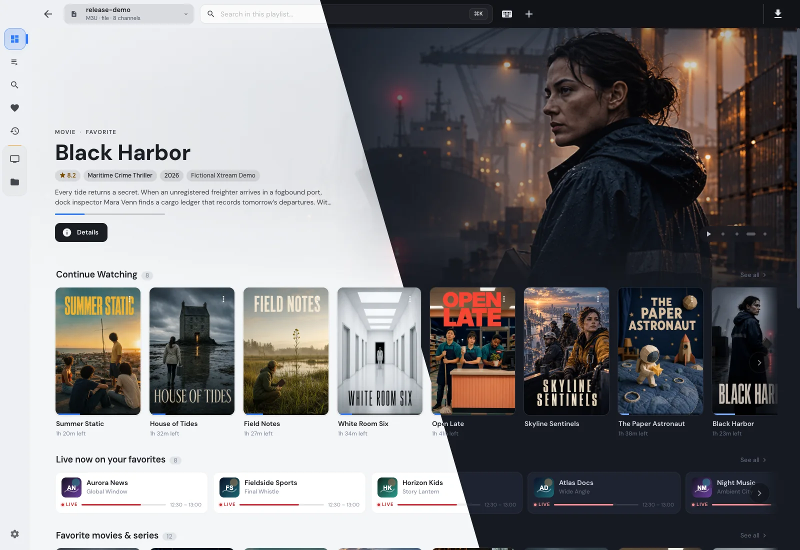

# IPTVnator

<p align="center">
  
</p>

**A free, open-source IPTV player for macOS, Windows, Linux and the browser.**
Bring your M3U playlists, Xtream Codes account or Stalker portal to watch live
TV, browse movies and series, and pick up where you left off.

**[Download](https://4gray.github.io/iptvnator/download/)** ·
[Website](https://4gray.github.io/iptvnator/) ·
[Getting started](https://4gray.github.io/iptvnator/guides/) ·
[Gallery](docs/screenshots.md)

[](https://github.com/4gray/iptvnator/releases)
[](https://github.com/4gray/iptvnator/actions/workflows/ci.yml)
[](https://github.com/4gray/iptvnator/releases)



> [!IMPORTANT]
> IPTVnator is a **player**: it does not provide or sell subscriptions, channels,
> playlists or other media. Screenshots show demonstration content. Download
> only from the [official website](https://4gray.github.io/iptvnator/) or
> [GitHub Releases](https://github.com/4gray/iptvnator/releases).
> [Learn about unofficial websites](https://4gray.github.io/iptvnator/blog/beware-unofficial-iptvnator-websites/).

## Download

Get the latest stable desktop release from the
[download page](https://4gray.github.io/iptvnator/download/) or
[GitHub Releases](https://github.com/4gray/iptvnator/releases).

| macOS | Windows | Linux |
| --- | --- | --- |
| [Apple Silicon / Intel](https://4gray.github.io/iptvnator/download/macos/) | [Installer / portable](https://4gray.github.io/iptvnator/download/windows/) | [AppImage, deb, rpm and more](https://4gray.github.io/iptvnator/download/linux/) |

For package-manager commands, experimental Linux Embedded MPV support and
nightly builds, see [Installation](docs/installation.md).

## Features

- **Your sources together:** local or remote M3U/M3U8 playlists, Xtream Codes,
  and Stalker / Ministra portals.
- **Live TV:** channel groups, search and favorites; XMLTV guide, multi-channel
  EPG and catch-up on desktop.
- **Movies and series:** posters, seasons, watch history and resume positions;
  optional TMDB metadata with your own API key.
- **Playback options:** built-in web players, external MPV/VLC/IINA and
  experimental Embedded MPV on desktop.
- **Watch later:** desktop downloads for movies and episodes, plus
  continue-watching and favorites across sources.
- **Make it yours:** light and dark themes, 21 language options, keyboard
  shortcuts and a command palette (`Ctrl/Cmd+K`).
- **Use your screen:** desktop apps, a self-hosted PWA and a phone remote for
  the desktop player.

[Full feature list and platform limits](docs/features.md) ·
[Keyboard shortcuts](docs/keyboard-shortcuts.md) ·
[All screenshots](docs/screenshots.md)

## Self-hosted PWA

Run the browser app and its backend together with Docker:

```bash
docker compose -f docker/docker-compose.yml up --build -d
```

Open <http://localhost:4333>. No separate backend container is needed. You can
also [run a server from the desktop app](docker/README.md#run-the-server-from-the-desktop-app).
Connected clients can share sources. Favorites, Recently Viewed and supported
watch progress each have their own synchronization opt-in.

The PWA does not include M3U XMLTV, Embedded MPV, managed external-player
launching, the download manager or Electron remote-control features.
See [Docker setup and client connections](docker/README.md) for configuration,
reverse proxies, playback troubleshooting and platform limits.

## Smart TV

### LG webOS and Samsung Tizen

LG webOS and Samsung Tizen share a dedicated, experimental TV client for M3U,
Xtream Codes and Stalker / Ministra sources. It requires a compatible IPTVnator
web backend. Build and install the package for your TV in Developer Mode.

- [LG webOS installation](apps/tv/README.md#installation)
- [Samsung Tizen installation and signing](apps/tv/tizen/README.md)

Add sources from your phone by scanning a QR code, or connect the TV to your
self-hosted IPTVnator source library. Favorites, history and resume positions
currently stay on the TV.

See the [TV README](apps/tv/README.md) for compatibility, phone setup, source
synchronization and screenshots.

### Fire TV / Android TV shell (experimental)

The Android shell bundles the same PWA used in the browser with an embedded
backend. It's designed primarily for Fire TV Stick and Android TV devices with a
D-pad remote. You can try it on tablets. Compact phone screens still need layout
work.

The `Build TV shell APK` workflow can publish a GitHub release, marked as a
pre-release by default. For APK builds, installation and remote controls, see
the [Android shell guide](./tv-shell/README.md).

### Enigma2 receivers

Dreaminator is a standalone IPTV plugin and browser-based playlist manager for
Enigma2 receivers. Organize channels in a browser and watch with the receiver's
remote. Tested on the Dreambox DM520 and Vu+ Uno 4K SE.

[Dreaminator on GitHub](https://github.com/4gray/dreaminator) ·
[Dreaminator on the IPTVnator blog](https://4gray.github.io/iptvnator/blog/dreaminator-enigma2/)

## Help and development

- [User guides](https://4gray.github.io/iptvnator/guides/) — sources, EPG,
  playback, downloads and updates.
- [Troubleshooting](docs/troubleshooting.md) — macOS and Linux startup fixes.
- [Build and develop](docs/development/README.md) — Node/pnpm setup, local
  Electron/PWA runs and diagnostics.
- [Developer and agent documentation](docs/maintenance/agent-context-map.md) —
  subsystem contracts; [AGENTS.md](AGENTS.md) and the
  [agent workflow](docs/development/agent-workflow.md) cover contribution rules.
- [Report a bug](https://github.com/4gray/iptvnator/issues) or join
  [Telegram](https://t.me/iptvnator) / [Bluesky](https://bsky.app/profile/iptvnator.bsky.social).

## Support the project

Support development through [GitHub Sponsors](https://github.com/sponsors/4gray),
[Ko-fi](https://ko-fi.com/4gray), or a star on GitHub.

<!-- ALL-CONTRIBUTORS-BADGE:START - Do not remove or modify this section -->

[](https://github.com/4gray/iptvnator/graphs/contributors)

<!-- ALL-CONTRIBUTORS-BADGE:END -->

## License and trademark

The source code is [MIT licensed](LICENSE.md). The IPTVnator name and logo are
unregistered trademarks of the project owner and are not covered by that
license. Forks and redistributions, including app-store submissions, must use
a different name and their own icon. See [TRADEMARK.md](TRADEMARK.md).
