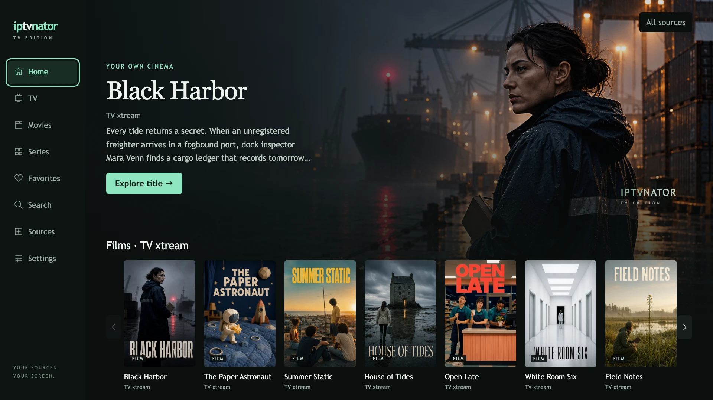
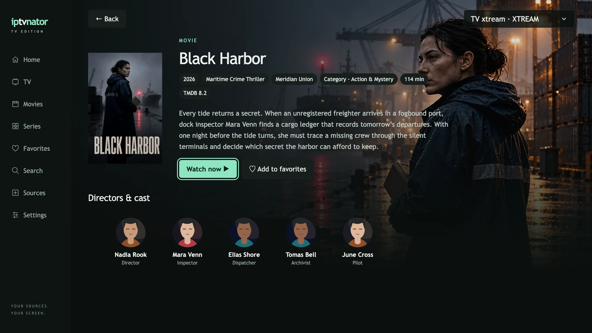
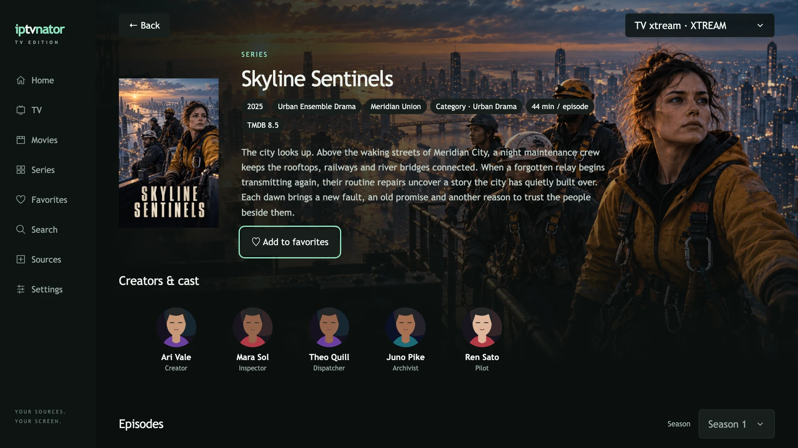

# IPTVnator TV for LG webOS and Samsung Tizen

An experimental TV edition of [IPTVnator](../../README.md) for watching your own
live TV, movies and series with a remote. The same client is packaged separately
for LG webOS and Samsung Tizen. It supports M3U playlists, Xtream Codes and
Stalker / Ministra portals, phone-assisted setup and a shared source library with
self-hosted IPTVnator.

IPTVnator is a player: it does not provide channels, playlists or subscriptions.



_Screenshots use fictional demo content, generated artwork and illustrated
portraits. They are browser captures of the TV interface._

[Compatibility](#compatibility) · [Installation](#installation) ·
[Phone setup](#add-playlists-from-your-phone) ·
[Synchronization](#sync-sources-with-self-hosted-iptvnator) ·
[Screenshots](#screenshots)

## Features

- Live TV, channel categories and programme guides from Xtream and Stalker.
- Movie and series catalogs with posters, seasons and episode browsing.
- Remote arrows, OK and Back navigation, plus Magic Remote pointer support on LG.
- Local and global favorites, watch history and continue watching on the TV.
- Add M3U URLs, Xtream accounts and Stalker sources from a phone using a QR code.
- Share source definitions with a self-hosted IPTVnator library.
- Optional TMDB artwork, descriptions, metadata chips, cast and filmographies
  using your own API key or read access token.
- Native TV video playback, including live preview and fullscreen viewing.

## Compatibility

| Platform | Status |
| --- | --- |
| LG webOS 5.x / Chromium 68 | Compatibility target. Hardware validation uses an LG BX (2020). |
| Later LG webOS versions | Hardware testing pending. |
| LG webOS 4.x and earlier | Below the current compatibility target. |
| Samsung Tizen 5.5+ | Experimental build target. Community tested on Samsung Q60C (2023) with Tizen 9.0. See the [device test results](../../docs/development/tv-tizen-validation.md#community-device-test). |
| Android TV and other TV platforms | No package available. |

The build targets Chromium 68. LG lists the engine used by each platform in its
[webOS compatibility table](https://webostv.developer.lge.com/develop/specifications/web-api-and-web-engine).
Stream formats, codecs, audio and seeking depend on the TV and provider; a
successful browser test does not establish native playback compatibility.

A matching **IPTVnator web backend is required**, even when sources are entered
directly on the TV. Host it on a computer, NAS or server reachable from the TV
and phone. The backend handles provider API requests and phone setup; streams
play directly on the TV. Shared server sources are optional.

## Installation

For Samsung, follow the [Tizen guide](tizen/README.md) to build, sign and install
a `.wgt` package in Developer Mode. The steps below cover LG webOS and its
locally built `.ipk` package. The TV application has its own package version,
declared in [`public/appinfo.json`](public/appinfo.json), independently of the
desktop app.

### 1. Prepare the backend

The [self-hosted Docker setup](../../docker/README.md) includes the backend,
phone setup page and server source library. Build it from the same checkout as
the TV app; an older backend may lack the required TV APIs.

In [`docker/docker-compose.yml`](../../docker/docker-compose.yml), include both
your web origin and the packaged TV origin in `CLIENT_URL`:

```yaml
services:
    iptvnator:
        environment:
            CLIENT_URL: 'http://iptvnator.home.test:4333,file://com.iptvnator.tv.prototype-webos'
```

This is an environment excerpt; keep the rest of the Compose configuration.
Replace `iptvnator.home.test` with your server's hostname or IP address. Use
that same address from the TV and phone; `localhost` on the TV means the TV
itself. For a reverse proxy, allow its actual web origin instead.

From the repository root, start the matching self-hosted build:

```sh
docker compose -f docker/docker-compose.yml up --build -d
```

With the example address above, the backend URL to enter on the TV is
`http://iptvnator.home.test:4333/api`. If server access is protected, enter its
access token on the TV too. Keep the backend on a trusted network; enable
`IPTVNATOR_PROXY_ALLOW_PRIVATE_NETWORKS` only when your provider endpoints
intentionally use private network addresses, as described in the Docker guide.

For an existing self-hosted installation that needs a separate TV backend, see
the [optional companion deployment](../../docker/tv/README.md).

### 2. Build the TV package

Clone the repository, then run these commands from its root. Use the Node
version in [`.nvmrc`](../../.nvmrc) and the pnpm version in
[`package.json`](../../package.json); the pinned webOS CLI is installed with
the project dependencies.

```sh
nvm install
nvm use
corepack enable
pnpm install --frozen-lockfile
pnpm nx run tv:package
```

The command builds and verifies the TV app, then writes the package to
`dist/tv-package/`. With the current app manifest, the filename is
`com.iptvnator.tv.prototype_0.1.25_all.ipk`. Use the filename printed by your
build if its version differs.

### 3. Enable Developer Mode and connect your TV

Follow LG's [Developer Mode setup guide](https://webostv.developer.lge.com/develop/getting-started/developer-mode-app):

1. Install **Developer Mode** from LG Apps on the TV and sign in with an
   LG Developer account.
2. Enable **Dev Mode Status** and let the TV restart. Keep your computer and TV
   on the same network.
3. On your computer, run `pnpm exec ares-setup-device` and choose **add**. Use
   a device name such as `living-room-tv`, the address shown on your TV,
   port `9922` and SSH user `prisoner`.
4. Enable **Key Server** in the TV's Developer Mode app, then retrieve the key:

```sh
pnpm exec ares-novacom --device living-room-tv --getkey
```

Enter the passphrase shown on your TV when prompted. The example device name
`living-room-tv` must match the one you added.

### 4. Install and launch

From the repository root, install the generated package and launch it:

```sh
pnpm exec ares-install --device living-room-tv dist/tv-package/com.iptvnator.tv.prototype_0.1.25_all.ipk
pnpm exec ares-launch --device living-room-tv com.iptvnator.tv.prototype
```

On first launch, use **Find backend** or enter the backend URL and access token
under **Sources** or **Settings → Connection**. Wait for **Connected** before
adding sources. Discovery covers only a limited set of local addresses and
ports; manual entry remains available for custom deployments.

Developer Mode has a session timer. Use **EXTEND** in LG's Developer Mode app
before it expires; LG removes developer-installed apps when Developer Mode is
disabled. See the LG guide above for the session lifecycle.

## Add playlists from your phone

1. Connect the TV to your backend and put the phone on the same home network.
2. On the TV, open **Sources → Add from phone** and scan the QR code.
3. On the phone, choose **M3U**, **Xtream** or **Stalker**, then enter the source
   URL or account details and submit.
4. Review the source on the TV and choose **Add source**. The phone reports
   success after the TV saves it.

QR links expire after five minutes; closing the TV setup cancels the link.
If the link expires or you reload the phone page, scan a fresh QR code. Phone
source entry accepts M3U URLs; to share an uploaded M3U file, import it in the
self-hosted PWA and connect its source library below.

**Settings → Set up from phone** also lets you enter a TMDB key, metadata
language, home layout and programme-guide preferences. Confirm **Apply settings**
on the TV to save the changes. An empty TMDB key field keeps the saved key.

## Sync sources with self-hosted IPTVnator

The TV can connect to the source library of your self-hosted IPTVnator. If your
selected backend offers it, choose **Use this server’s sources**. To enter a
separate address or token:

1. Open **Settings → Library & sync → Server library**.
2. Enter the **Library server URL** and optional **Library access token**.
   For the bundled Docker deployment, use the same backend base URL as above,
   for example `http://iptvnator.home.test:4333/api`.
3. Choose **Connect library**. Manage shared source definitions in the PWA.

| Data                                                                            | TV behavior                                              |
| ------------------------------------------------------------------------------- | -------------------------------------------------------- |
| M3U URLs and uploaded/pasted M3U content, Xtream and Stalker source definitions | Read from the connected server library.                  |
| Source edits and removals made in the PWA                                       | Applied to linked TV entries on refresh.                 |
| A source entered locally on the TV                                              | Uploaded only when you select **Copy source to server**. |
| Favorites, watch history and resume positions                                   | Stay local to the TV; not synchronized across devices.   |
| TV settings and TMDB preferences                                                | Stay local to the TV.                                    |

Sources refresh on launch, when returning to the app and every minute while
the app is visible and not playing. **Refresh library now** requests an update
manually. **Disconnect library** keeps downloaded sources as local copies and
preserves local viewing data. This feature shares sources; it does not relay
video or synchronize TV viewing activity with the desktop/PWA.

## Optional TMDB metadata

Open **Settings → Metadata · TMDB**, enable **Use TMDB metadata**, enter your own
v3 API key or v4 read access token, choose a metadata language and save. Checking
the key alone does not enable or save metadata. You can also enter the key
through phone setup.

When available, metadata adds artwork, descriptions, year/genre/country chips,
duration, ratings, cast, filmographies and episode details. Provider sources
remain authoritative for playback. The TV needs direct access to TMDB's API
and image servers; metadata failures leave provider content usable.

## Screenshots

| Movie details with metadata and cast                                                                 | Series details with creator and cast                                                    |
| ---------------------------------------------------------------------------------------------------- | --------------------------------------------------------------------------------------- |
|  |  |

All screenshots use the local synthetic demo catalog. The
[capture instructions](../../docs/development/tv-development.md#synthetic-screenshots)
describe how to reproduce them without provider accounts or real TMDB keys.

## Current limitations

- Experimental device support; provider and native playback compatibility
  still require testing on your TV.
- Programme guides come from Xtream and Stalker; M3U XMLTV and archive/catch-up
  playback are not included.
- No DRM, downloads, transcoding or desktop MPV/VLC integrations.
- Native video cannot attach arbitrary provider headers such as MAG cookies
  or custom User-Agent/Referer values. Some streams therefore need capabilities
  outside this client.

## Development and troubleshooting

- [TV development guide](../../docs/development/tv-development.md) — local runs,
  backend configuration, packaging and device validation.
- [TV architecture](../../docs/architecture/tv-application.md) — provider,
  playback, storage and synchronization contracts.
- [Docker guide](../../docker/README.md) — self-hosting, tokens and networking.
- [TV companion backend](../../docker/tv/README.md) — a separate deployment
  alongside an existing server library.

When reporting a problem, include the app build and device information shown
in **Settings → About**, your TV's OS version and source type. Do not include
provider credentials, access tokens or private stream URLs.
