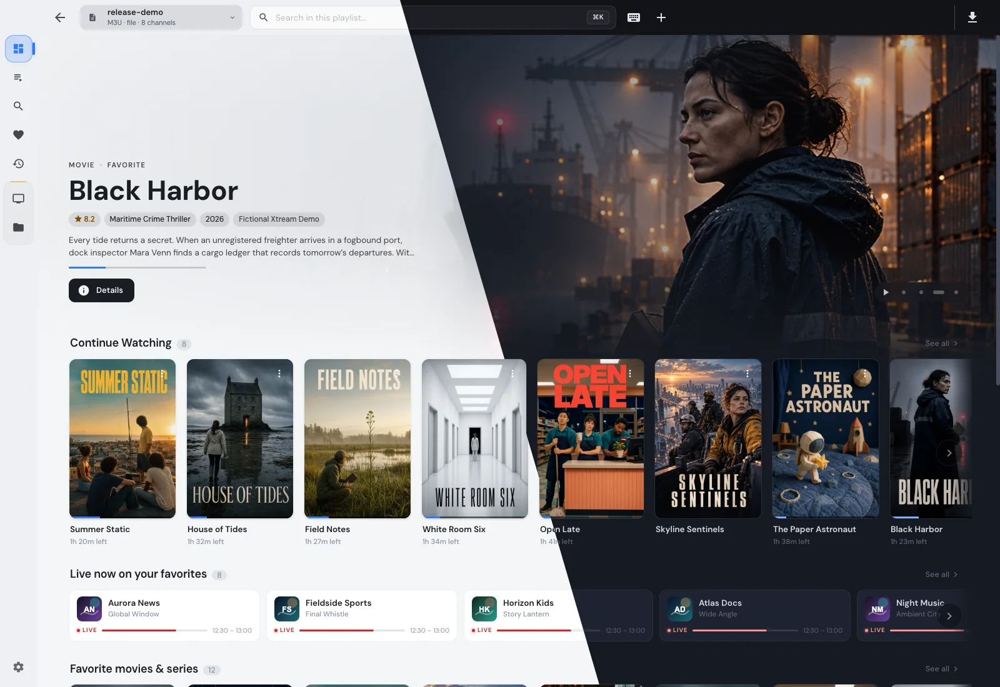
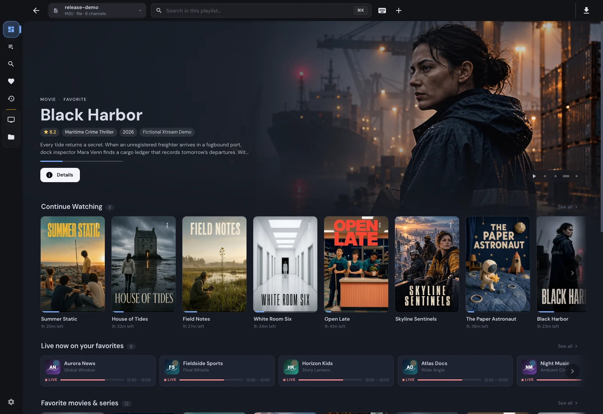
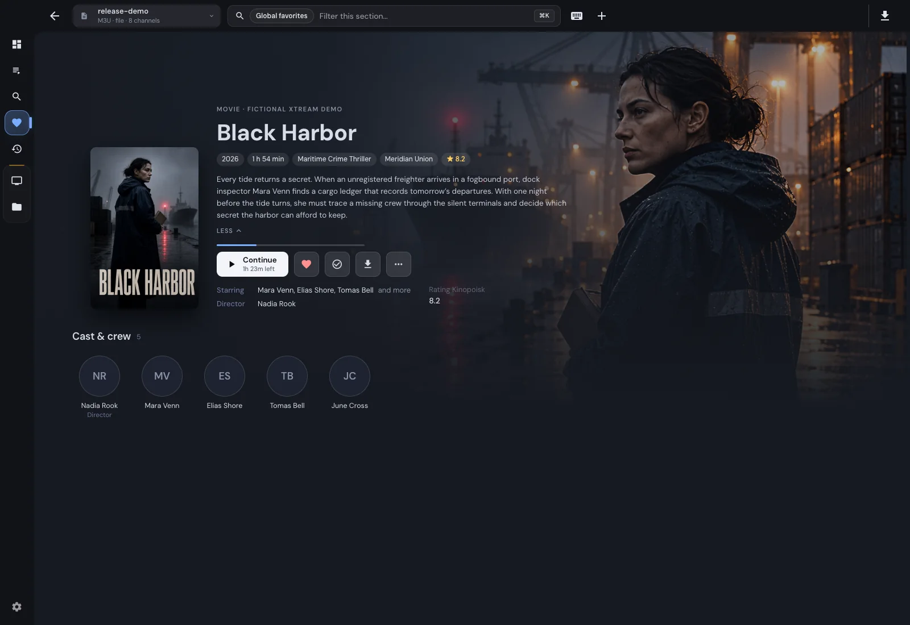
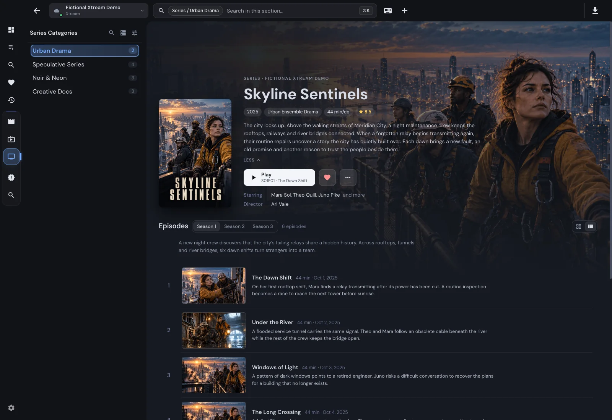
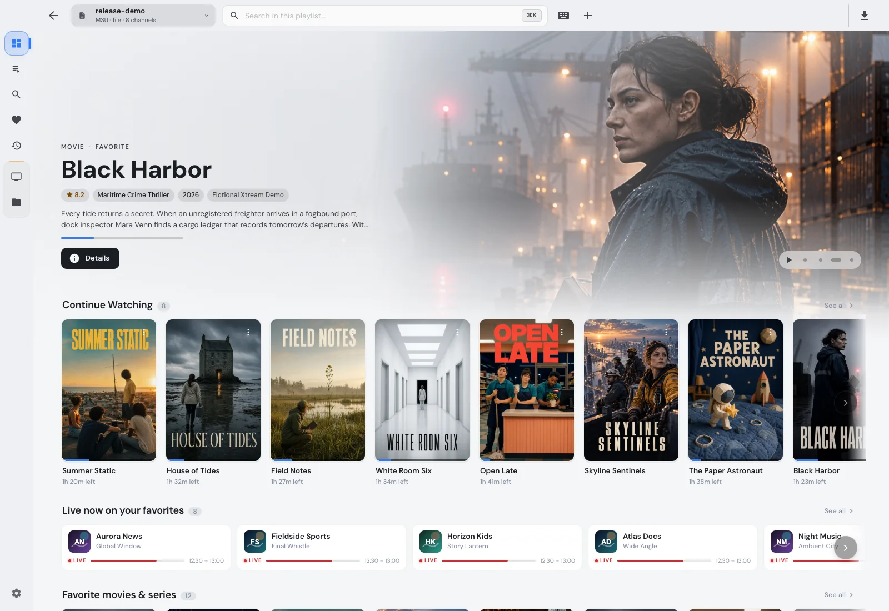

# Screenshot gallery

[Back to README](../README.md)

IPTVnator is a player and does not supply channels or media. Images show demonstration content. Screenshots can include features from the development version.

[Interactive website gallery](https://4gray.github.io/iptvnator/#screenshots) · [Full feature list](features.md)

## Dashboard in light and dark themes

## Dashboard

## Live TV and EPG

## Movies

## Series and episodes

## Program guide

## Add a source

## Channel categories

## Search

## Manage categories

## Movie library

## Recently added

## Downloads

## External players

## Radio

## Light theme

## Settings

